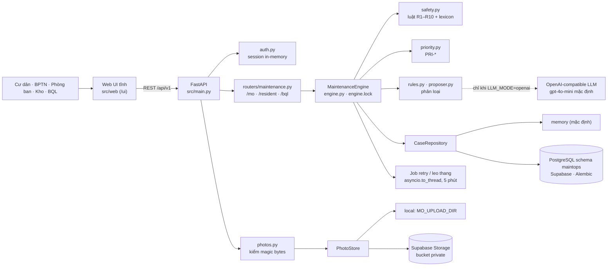
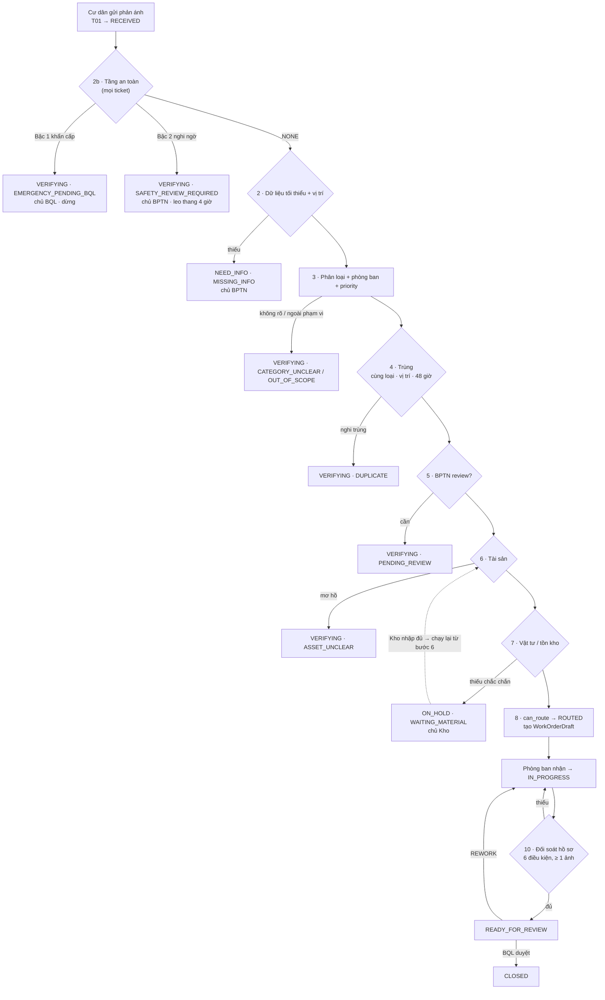
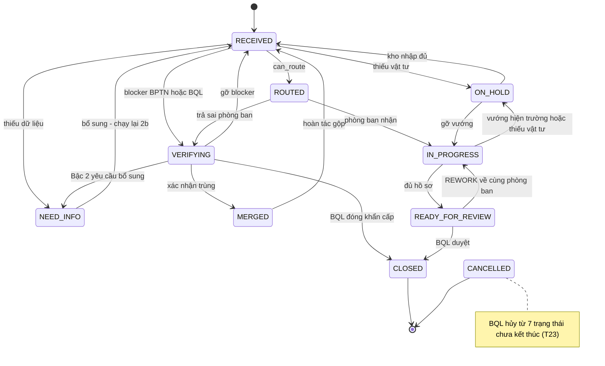

# MaintenanceOps Agent — Kiến trúc hệ thống

> Dữ liệu **mô phỏng** (`SIM-*`). Tài liệu này là bản tổng hợp kiến trúc; khi lệch thì thứ tự ưu tiên là: **code** → [CR-BPTN-03](docs/CR-BPTN-03.md) (spec nghiệp vụ duy nhất) → các tài liệu khác.
> Phân biệt ba nhãn xuyên suốt: **Đang chạy** (có trong code), **Mục tiêu 19/10** (LangGraph, Phoenix, GPT-4o — chưa tích hợp), **Contract đích** (D-01 delta + snapshot — chưa code). Không coi sơ đồ mục tiêu là bằng chứng đã deploy.
> Bản ResidentGPT (FAQ/RAG) trước đây là hướng cũ đã bỏ; xem lịch sử bằng `git log -- ARCHITECTURE.md`.

## 1. Bài toán và phạm vi

Cư dân gửi phản ánh về **vệ sinh khu vực chung** (`PB-CLN-01` → `DEPT_CLEANING`) hoặc **đèn chiếu sáng khu vực chung** (`PB-TEC-01` → `DEPT_TECHNICAL`). Agent kiểm tra dữ liệu, chạy **tầng an toàn**, phân loại, đặt ưu tiên, tra trùng / tài sản / vật tư rồi **giao phòng ban**; Ban Quản Lý (BQL) nghiệm thu và đóng.

Ngoài phạm vi: Agent gán nhân viên (MVP không gán — `set_assignee` luôn `ACTION_DENIED`), reopen ticket đã đóng, lịch trực/capacity, phân tích ảnh bằng AI, tích hợp hệ thống thật. Chi tiết: [CR-BPTN-03 §1](docs/CR-BPTN-03.md).

## 2. Thành phần hệ thống

| Thành phần | Vai trò | Nguồn |
|---|---|---|
| Web UI | UI tĩnh; BPTN/BQL dùng chung shell, nút bị ẩn/khoá theo vai trò | [src/web/](src/web/) |
| FastAPI | Gateway; xác thực, phân quyền, kiểm schema ở backend; lỗi store → 503/403 | [src/main.py](src/main.py) · [src/api/](src/api/) |
| Engine | State machine + pipeline + hành động người + job; duy nhất nơi ghi dữ liệu | [src/maintenance/engine.py](src/maintenance/engine.py) |
| Safety / Priority | Hàm thuần, từ vựng là **dữ liệu** | [safety.py](src/maintenance/safety.py) · [priority.py](src/maintenance/priority.py) · [lexicon.yaml](seed/maintenance_v1/lexicon.yaml) |
| Phân loại | Luật cố định + LLM đề xuất có guard (lỗi → fallback luật) | [rules.py](src/maintenance/rules.py) · [proposer.py](src/maintenance/proposer.py) |
| Store | `CaseRepository` (memory \| postgres) và `PhotoStore` (local \| supabase) | [src/maintenance/store/](src/maintenance/store/) |
| Views | View cư dân (allow-list), hàng đợi BQL, `queue_sort_key` | [views.py](src/maintenance/views.py) |
| LangGraph mẫu | **Không** nằm trên đường chạy MaintenanceOps | [src/agents/](src/agents/) |

Sơ đồ **mục tiêu** (bố cục gốc, có LangGraph / GPT-4o / Phoenix & LangSmith): [docs/architecture_diagram.md](docs/architecture_diagram.md) · [draw.io](docs/diagrams/Diagrams%20Components.drawio) · [SVG](docs/diagrams/Diagrams%20Components.drawio.svg).

## 3. Pipeline Agent

Thứ tự thực tế trong `_run_pipeline` ([engine.py:2119](src/maintenance/engine.py#L2119)), hàm bước đặt tên `_step_<số>_<việc>`:

- **2b đứng trước 2** (Bậc 1 > Bậc 2 > `MISSING_INFO`); cả hai mang số 2 nên `resume_step=2` chạy lại cả hai. Phân loại (3) chạy **trước** kiểm tra trùng (4) — quyết định D-09. Ticket Bậc 1 vẫn chạy bước 4 ở chế độ chỉ liên kết.
- Gỡ blocker → chạy lại từ bước: `MISSING_INFO` / `SAFETY_REVIEW_REQUIRED` / `EMERGENCY_PENDING_BQL` → 2 (2b tự bỏ qua khi đã `safety_cleared_*` và chưa có bổ sung mới) · `CATEGORY_UNCLEAR` / `OUT_OF_SCOPE` → 4 · `DUPLICATE` bác → 5 · `PENDING_REVIEW` / `ASSET_UNCLEAR` → 6 · `WAITING_MATERIAL` → 6. Bảng đầy đủ: [CR-BPTN-03 §5.2](docs/CR-BPTN-03.md).
- `can_route = review_status ∈ {NOT_REQUIRED, CONFIRMED} ∧ asset_resolution ∈ {FOUND, ONSITE_BY_BPTN, NOT_APPLICABLE} ∧ proposed_department_id ≠ null ∧ risk_level ≠ EMERGENCY`.
- `ROUTED` là đề xuất tuyến **phòng ban**, không gán cá nhân.

## 4. Máy trạng thái

10 trạng thái, 25 dòng trong `TRANSITIONS`; mọi đổi trạng thái đi qua `_apply_transition`. Mỗi ticket có **tối đa một blocker mở** (`ReasonCode` + `BlockerOwner`). Sơ đồ rút gọn (đủ T01–T23: [CR-BPTN-03 §4](docs/CR-BPTN-03.md)):

Bất biến bắt buộc có test: chỉ BQL đóng/hủy · Agent không ghi `assignee_id` · không nhảy `ROUTED` từ ngoài pipeline · `EMERGENCY_PENDING_BQL` không bao giờ bị `resume()`/job gỡ · BPTN trên blocker của BQL → 403 · cặp chuyển ngoài bảng → `INVALID_TRANSITION` (409), sai vai → `ACTION_DENIED` (403) + audit · nội dung/ảnh gốc của cư dân bất biến, bổ sung chỉ append · không reopen, rating đúng một lần.

## 5. Tầng an toàn (bước 2b)

`assess(text, lexicon) -> SafetyAssessment(risk_level, signals, …)`, `risk_level ∈ NONE | UNCLEAR | EMERGENCY`; **tách khỏi `priority`**.

| Bậc | `risk_level` | Blocker | Chủ | Hành động hợp lệ |
|---|---|---|---|---|
| 1 Khẩn cấp (khói, lửa, tia lửa, mùi khét, dây hở, người bị thương, chất lạ + dấu hiệu nguy hại…) | `EMERGENCY` | `EMERGENCY_PENDING_BQL` | **BQL** | Đóng (kèm ghi chú kết quả) · hạ báo nhầm · gộp · hủy |
| 2 Chưa đủ chắc (diễn đạt nghi ngờ, sự việc đã qua, từ nhiều nghĩa…) | `UNCLEAR` | `SAFETY_REVIEW_REQUIRED` | **BPTN** | Đúng 3 lựa chọn: xác nhận an toàn · nâng khẩn cấp · yêu cầu cư dân bổ sung |
| Không có | `NONE` | — | — | Đi tiếp flow thường |

- Luật cố định **quyết định**, LLM **chỉ được nâng mức, không được hạ**. Bước 2b của `build_engine()` **không truyền `safety_llm`** nên guard LLM không bật, kể cả khi `LLM_MODE=openai`.
- Khẩn cấp: Agent không chẩn đoán, không tạo `WorkOrderDraft`, không giao phòng ban, không hướng dẫn xử lý.
- Thời hạn (giờ lịch, cấu hình trong `sla_config`): Bậc 2 → leo thang BQL sau **4 giờ**; `NEED_INFO` an toàn (chủ cư dân) → leo thang sau **12 giờ**. Leo thang **không** tự coi ticket là an toàn.
- Cư dân chỉ thấy nhãn chung "Đang được kiểm tra", không thấy `risk_*`, `reason_code`, `priority`.
- Bẫy tiếng Việt (B-01…B-05: "bóng đèn bị cháy" ⇒ `NONE`, phủ định, từ nhiều nghĩa, ngữ cảnh nấu ăn, tổ hợp) và luật R1–R10: [docs/maintenance.md §3](docs/maintenance.md).

## 6. Vai trò và quyền

| Vai trò | Quyền chính | Cấm |
|---|---|---|
| Cư dân | Tạo ticket, bổ sung text/ảnh khi `NEED_INFO`, xem view allow-list, rating 1–5 **một lần** sau `CLOSED` | Sửa nội dung gốc, reopen, thấy dữ liệu nội bộ |
| Agent | Đề xuất loại việc/phòng ban/priority, chạy an toàn, trùng, asset, vật tư | Đóng/hủy, ghi `assignee_id`, tự xác nhận an toàn, gỡ blocker khẩn cấp |
| BPTN | Xử lý thiếu dữ liệu, trùng, asset, `WRONG_DEPT`, Bậc 2, sửa priority (có lý do) | Chạm blocker của BQL, đóng/hủy |
| Phòng ban | Nhận ticket được giao, checklist/vật tư/ảnh, trả sai phòng ban, báo vướng, nộp hồ sơ | Đóng/hủy, thấy ticket chưa giao |
| Kho (actor mô phỏng) | `RECEIVE_STOCK` → ticket `WAITING_MATERIAL` tự chạy lại | Mọi việc khác |
| BQL | Khẩn cấp, nghiệm thu, REWORK, đóng, **hủy**, sửa priority | Sửa nội dung gốc |

Quyền được kiểm ở **backend** (router chỉ bọc method engine); UI ẩn nút chỉ là tiện lợi. Mọi hành động nhạy cảm cần lý do và ghi audit. Màn hình: [docs/04_ui_flow_wireframe.md](docs/04_ui_flow_wireframe.md).

## 7. Dữ liệu và lưu trữ

| Tầng | Cơ chế | Chọn bằng |
|---|---|---|
| Ticket · sổ audit · outbox · tồn kho | `CaseRepository`: `memory` (mặc định, RAM) hoặc `postgres` schema `maintops` (Alembic, Supabase Session pooler) | `MO_STORE` |
| Ảnh | `PhotoStore`: `local` hoặc Supabase Storage bucket private; binary đi qua backend (không signed URL), metadata nằm trong case | `MO_PHOTO_STORE` |
| Tĩnh | YAML trong [seed/maintenance_v1/](seed/maintenance_v1/): catalog + `sla_config`, accounts, tickets (12 ca + expected), `lexicon.yaml` | nạp lúc khởi tạo (đổi phải restart) |
| Phiên đăng nhập | RAM (`auth.py`) | — |

- **Mỗi mutation = một transaction** qua `_mutate`: `get_for_update` (`FOR UPDATE`) → thao tác trên bản sao sâu → `save` (kiểm `version`) + audit + outbox cùng commit; fail closed. Lỗi DB → `ConcurrencyError` 409 / `StoreUnavailableError` 503 / `StorePermissionError` 403. Hành động bị từ chối ghi audit ở transaction riêng.
- `audit_log` và `notifications` append-only (trigger chặn UPDATE/DELETE). `notifications` là **outbox**, không khẳng định đã gửi ra dịch vụ ngoài.
- Khởi động: `check_photo_store` → `build_engine` (kiểm kết nối + revision, sai ⇒ exit 3) → `seed_if_empty` (chỉ khi rỗng, advisory lock một leader, **không reset**). Job 5 phút giữ `pg_try_advisory_xact_lock(151001)` — một backend chạy mỗi lượt. `reset`/`evaluate` trên DB chung cần `MO_ALLOW_RESET=true`.
- Chi tiết: [brain4agent/-data-architecture.md](brain4agent/-data-architecture.md) · [data-contract-v1](docs/data-contract-v1.md).

## 8. API

Prefix `/api/v1`; xác thực `POST /auth/login` → `Authorization: Bearer`. Ba router: `/mo` (nội bộ/phòng ban/kho), `/resident`, `/bql`. Bảng đầy đủ: [README.md](README.md#api-code-đang-chạy-spec-đích-cr-bptn-03) · Swagger `/docs`. Router **chỉ bọc** method engine; kiểm vai và logic nằm trong engine.

## 9. Cấu hình chính

| Biến | Mặc định | Ý nghĩa |
|---|---|---|
| `LLM_MODE` | `mock` | `mock`: chỉ luật; `openai`: bật LLM proposer (`MODEL_NAME`, mặc định `gpt-4o-mini`) |
| `MO_STORE` / `MO_PHOTO_STORE` | `memory` / `local` | Lưu trữ ticket / ảnh |
| `MO_JOBS_ENABLED` | `true` | Job retry + leo thang trong process API |
| `MO_ALLOW_RESET` | `false` | Cho phép xoá dữ liệu trên DB chung |
| `MO_ALLOW_ACTOR_HEADER` | `false` | `X-Actor-Id` thay token — **CẤM bật ở production** |

Danh sách đầy đủ: [README.md](README.md) · [src/config.py](src/config.py).

## 10. Hiện có và mục tiêu

| Hạng mục | Trạng thái |
|---|---|
| Engine, pipeline 2b→8→10, 5 method an toàn/khẩn cấp, `set_priority`, rating một lần | **Đang chạy** (CR-03 P0) |
| Repository memory/PostgreSQL, ảnh local/Supabase, job retry/leo thang | **Đang chạy** |
| LLM proposer (`gpt-4o-mini`), fallback luật | **Đang chạy**, tuỳ chọn |
| Guard LLM an toàn | Có trong code, **không bật** (`safety_llm=None`) |
| LangGraph điều phối pipeline, Phoenix & LangSmith telemetry, GPT-4o + vision | **Mục tiêu 19/10**, chưa tích hợp |
| D-01: chỉ bổ sung mới + snapshot có cấu trúc cho LLM | **Contract đích**, chưa code ([contract](planning/02_2026-10-03_truong-mvp-prep/specs/01-CONTRACTS.md)) |
| P1: T16/T17/E02 (báo sai phòng ban sau khi làm), gộp/hoàn tác gộp, PRI-U1/U2, tín hiệu S-06…S-08, S-10…S-13, C-01 | **P1**, sau 04/10 |
| Deploy online | **Chưa có** — nghiệm thu hiện chỉ localhost ([hồ sơ 07](planning/07_2026-10-04_online-acceptance/plan.md)) |

## 11. Quyết định kiến trúc đã chốt

| ID | Quyết định |
|---|---|
| D-01 | Sau `NEED_INFO` về `RECEIVED`; target: chỉ bổ sung mới + snapshot cho LLM; risk chỉ hạ bởi người có quyền (contract đích) |
| D-09 | Phân loại (3) **trước** trùng (4); an toàn 2b **trước** phân loại |
| D-10 | Gỡ blocker an toàn → chạy lại từ bước 2 |
| D-11 | Thiếu dữ liệu: chủ BPTN; riêng `NEED_INFO` an toàn chủ cư dân |
| D-12 | REWORK về chính phòng ban đang giữ |
| D-13 | MVP không gán nhân viên |

Toàn bộ D-01…D-13 và các quyết định bị thay thế: [CR-BPTN-03 §17](docs/CR-BPTN-03.md).

## 12. Bản đồ tài liệu

| Cần gì | Đọc |
|---|---|
| Spec nghiệp vụ (trạng thái, T01–T23, an toàn, priority, AC-01…20) | [docs/CR-BPTN-03.md](docs/CR-BPTN-03.md) |
| Engine, 5 method khẩn cấp, luật R1–R10, test | [docs/maintenance.md](docs/maintenance.md) |
| Sơ đồ components + data flow mục tiêu và khác biệt với code | [docs/architecture_diagram.md](docs/architecture_diagram.md) · [data-flow](docs/diagrams/maintenanceops-data-flow-20261019/README.md) |
| UI flow | [docs/04_ui_flow_wireframe.md](docs/04_ui_flow_wireframe.md) |
| Dữ liệu và lưu trữ | [brain4agent/-data-architecture.md](brain4agent/-data-architecture.md) |
| Lịch sử hồ sơ/specs | [planning/](planning/) (05 component, 08 data flow, 01–02 persistence/engine) |
| Chạy app, API, env | [README.md](README.md) |
