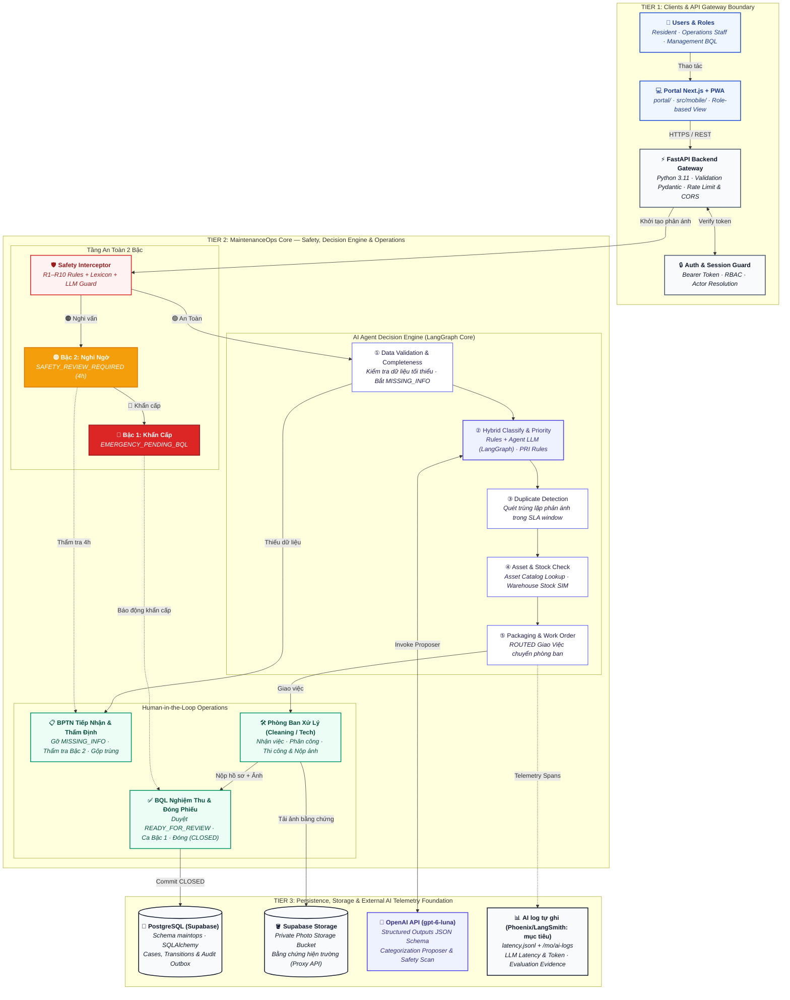

# P-151 — MaintenanceOps Agent

 <sub>đo 2026-10-17 bằng `pytest --cov=src`; chi tiết [docs/evaluation.md](docs/evaluation.md) §7.3</sub>

> Prototype **mô phỏng**. Toàn bộ dữ liệu (tiền tố `SIM-`), quy trình, định mức và kết quả là mô phỏng, không phải vận hành thật.
> Spec đích duy nhất: [CR-BPTN-03](docs/CR-BPTN-03.md) (duyệt cho phạm vi MVP 04/10, D-08). Mục API bên dưới mô tả **code đang chạy**;
> chỗ nào lệch CR-BPTN-03 thì theo CR-BPTN-03.

## Deliverables nộp bài

- **Live URL (giao diện):** <https://p151-portal.vercel.app/login>
- **API backend:** <https://p151-backend.vercel.app/docs> (Swagger) · health: <https://p151-backend.vercel.app/health>
- **Video demo:** thư mục Google Drive <https://drive.google.com/drive/folders/1_c2ZhS3hxWx7OUdAvLgjqlY_PkdI5ble?usp=sharing>

| # | Deliverable | Vị trí |
|---|---|---|
| 1 | Source code | [`src/`](src/), [`tests/`](tests/) |
| 2 | README | file này |
| 3 | Architecture diagram | [`docs/architecture_diagram.md`](docs/architecture_diagram.md), [`docs/diagrams/`](docs/diagrams/) |
| 4 | AI logs | [`docs/ai-logs.md`](docs/ai-logs.md) (8 trace thật của Agent), `GET /api/v1/mo/ai-logs`, [`docs/eval/runs/`](docs/eval/runs/) |
| 5 | Live URL | <https://p151-portal.vercel.app/login> · API <https://p151-backend.vercel.app/docs> |
| 6 | Video demo | [`docs/video-demo.md`](docs/video-demo.md) · [Google Drive](https://drive.google.com/drive/folders/1_c2ZhS3hxWx7OUdAvLgjqlY_PkdI5ble?usp=sharing) |
| 7 | Pitch deck | ⬜ chưa có `docs/pitch-deck.pdf`; nội dung 10 slide và Q&A: [`docs/pitch-deck-content.md`](docs/pitch-deck-content.md) |
| 8 | Journal | [`docs/journal.md`](docs/journal.md) |
| 9 | Worklog | [`docs/worklog.md`](docs/worklog.md) |
| 10 | Evaluation evidence | [`docs/evaluation.md`](docs/evaluation.md), [`docs/eval/runs/`](docs/eval/runs/) |

## Vấn đề

BQL cần tạo và kiểm tra hồ sơ bảo trì một cách nhất quán, truy vết được và không vượt quyền, để mỗi case
đủ điều kiện được chuyển BQL xem xét hoặc dừng đúng ở bước xác minh/ngoại lệ.

## Giải pháp

Cư dân gửi phản ánh vệ sinh hoặc đèn khu vực chung. Agent kiểm tra, chạy tầng an toàn, phân loại, tra tài sản/vật tư, rồi **đề xuất** tuyến tới phòng ban; Tiếp nhận (BPTN) xử lý ca cần người; BQL nghiệm thu.

- **Tầng an toàn (bước 2b, chạy trước phân loại)**: luật cố định + từ vựng dữ liệu làm lưới sàn; ngữ nghĩa (phủ định, "hình như", nhờ việc hay báo nguy) do Agent LLM suy luận, chỉ được **nâng** mức. Tín hiệu nguy hiểm (chất lạ, mùi khét, tia lửa, dây hở, người bị kẹt) → Bậc 1 `EMERGENCY_PENDING_BQL` (chủ BQL) hoặc Bậc 2 `SAFETY_REVIEW_REQUIRED` (chủ BPTN).
- **Phân loại**: Agent (LangGraph, `src/maintenance/agent/`) đọc phản ánh và trả quyết định có cấu trúc: loại việc, vị trí, ưu tiên, tài sản, vật tư; luật cố định chạy song song làm đối chứng. Hai playbook: vệ sinh `PB-CLN-01` và đèn khu vực chung `PB-TEC-01`.
- **Giao phòng ban**: tra tài sản (mỗi khu vực một đèn), tồn kho/vật tư → `ROUTED` tới phòng ban; không còn lịch trực/capacity/team. Agent không gán người (`assignee_id=null`).
- **Kiểm tra hồ sơ**: checklist, ảnh bắt buộc, số vật tư thực dùng → `READY_FOR_REVIEW`; BQL nghiệm thu hoặc trả làm lại; mọi thao tác có audit.
- **Vật tư và kho**: phòng ban "Yêu cầu vật tư" khi thiếu, Kho "Nhập đủ" thì ticket tự chạy tiếp; cảnh báo kho cho cả hai phòng.

## Giao diện

Cổng web (Next.js) cho 6 vai: Cư dân, Tiếp nhận, Vệ sinh, Kỹ thuật, Quản lý (BQL), Kho; có thêm PWA điện thoại tại `/app/`. Toàn bộ ảnh theo vai: [`docs/screenshots/`](docs/screenshots/README.md).

| Cư dân gửi phản ánh | Tiếp nhận phân loại |
|---|---|
|  |  |
| **Phòng Kỹ thuật** | **BQL tổng quan** |
|  |  |

## Tech Stack

| Lớp | Công nghệ |
|---|---|
| Agent | LangGraph + LangChain (`src/maintenance/agent/`), model `gpt-4o-mini` mặc định, production dùng `gpt-6-luna`; luật cố định làm lưới sàn an toàn. `LLM_MODE=mock` (mặc định) chỉ chạy luật, không cần khoá |
| Backend | FastAPI + Python 3.11, Pydantic v2 |
| Giao diện | `portal/` (Next.js, TypeScript, gọi `/api/v1`) + PWA điện thoại `src/mobile/` (JS thuần). UI tĩnh `src/web/` đã xoá 2026-10-12 |
| Dữ liệu | **Mặc định in-memory** từ fixture YAML, reset được; tuỳ chọn PostgreSQL trên Supabase (`MO_STORE=postgres`, Alembic) + Supabase Storage cho ảnh |
| DevOps | Docker Compose (backend, portal, db), GitHub Actions (ruff + pytest + coverage ≥ 60%), Vercel (portal và backend) |

---

## Kiến trúc hệ thống (System Architecture)

Sơ đồ kiến trúc thành phần mục tiêu (Target Architecture v0.6) theo chuẩn [CR-BPTN-03](docs/CR-BPTN-03.md), thiết kế theo chuẩn C4 Component / Enterprise 3-Tier phục vụ Demo Day AI20K:


> Sơ đồ SVG giữ bố cục gốc của bản mục tiêu. Các nhãn **"Web Application (/ui)"**, **"GPT-4o"** và **"Phoenix & LangSmith"** trong ảnh là thiết kế mục tiêu; **đang chạy** là Portal Next.js + PWA, `gpt-6-luna`, và log tự ghi ([`docs/ai-logs.md`](docs/ai-logs.md)). Phoenix/LangSmith chưa nối. Đối chiếu từng thành phần: [`ARCHITECTURE.md`](ARCHITECTURE.md) §10.

<details>
<summary><b>Nhấn để xem mã nguồn sơ đồ Mermaid</b></summary>



</details>

- **Chi tiết kiến trúc, bảng màu & file nguồn draw.io:** [`docs/diagrams/Diagrams Components.drawio`](docs/diagrams/Diagrams%20Components.drawio)
- **Đặc tả thiết kế chi tiết (SPEC):** [`docs/CR-BPTN-03.md`](docs/CR-BPTN-03.md)

---

## Chạy nhanh (Docker, không cần khoá)

Yêu cầu: [Docker Desktop](https://www.docker.com/products/docker-desktop/) (Windows: bật WSL 2) hoặc Docker Engine + Compose plugin; Git.
Kiểm tra: `docker compose version`.

```bash
git clone https://github.com/AI20K-Build-Phase-Cohort-4/P-151.git
cd P-151
cp .env.example .env              # Windows PowerShell: Copy-Item .env.example .env
docker compose up -d --build      # hoặc: make up
```

File `.env.example` đã đặt sẵn `LLM_MODE=mock` và `MO_STORE=memory`, nên **không cần sửa biến nào** để chạy demo.

Kiểm tra:

- Health: <http://localhost:8000/health> → `{"status":"ok",...}`
- Swagger UI: <http://localhost:8000/docs>
- Giao diện (portal): <http://localhost:8000/> · app điện thoại (PWA): <http://localhost:8000/app/>
- `docker compose ps` — `backend` phải `healthy`.

Dữ liệu in-memory: tắt/bật lại backend là về 12 ticket mẫu ban đầu.

### Lệnh thường dùng

| Việc cần làm | Lệnh | Make |
|---|---|---|
| Khởi động / build lại sau khi sửa code | `docker compose up -d --build` | `make up` |
| Xem log backend | `docker compose logs -f backend` | `make logs` |
| Dừng | `docker compose down` | `make down` |
| Chạy test | ngoài container: `python -m pytest -q` (image Docker không chứa `tests/`, xem `.dockerignore`) | |

Backend trong Docker **không** tự reload khi sửa code — chạy lại `make up`. Cần hot reload thì xem mục "Chạy ngoài Docker".

---

## Biến môi trường

Copy `.env.example` → `.env`. Không commit `.env`; không dán khoá vào repo hay chat công khai.
Với đường chạy nhanh **không biến nào bắt buộc**.

**LLM**

| Biến | Mặc định | Ghi chú |
|---|---|---|
| `LLM_MODE` | `mock` | `mock`: chỉ luật cố định, kết quả cố định, không cần khoá (test luôn dùng mode này). `openai`: bật LLM đề xuất |
| `OPENAI_API_KEY` | — | Bắt buộc khi `LLM_MODE=openai` (khoá OpenAI hoặc OpenRouter) |
| `OPENAI_BASE_URL` | trống | Khoá OpenRouter (`sk-or-...`) cần `https://openrouter.ai/api/v1`; trống = `api.openai.com` |
| `MODEL_NAME` | `gpt-4o-mini` | Model gọi khi `LLM_MODE=openai` |

**MaintenanceOps**

| Biến | Mặc định | Ghi chú |
|---|---|---|
| `MO_STORE` | `memory` | `memory`: trong RAM; `postgres`: dùng `DATABASE_URL` (Supabase) |
| `MO_SEED_ON_EMPTY` | `true` | Khi khởi động, nạp 12 ticket mẫu chỉ nếu kho chưa có ticket; không bao giờ xoá dữ liệu |
| `MO_ALLOW_RESET` | `false` | `POST /mo/reset`, `/mo/evaluate` xoá dữ liệu: luôn được với `memory`; trên DB chung chỉ chủ DB bật, tạm thời |
| `MO_PHOTO_STORE` | `local` | `local`: thư mục `MO_UPLOAD_DIR`; `supabase`: Supabase Storage |
| `MO_UPLOAD_DIR` | `./data/uploads/maintenance` | Thư mục ảnh khi `local` |
| `MO_JOBS_ENABLED` | `true` | Job retry/leo thang mỗi 5 phút trong process API |
| `MO_ALLOW_ACTOR_HEADER` | `false` | Chấp nhận header `X-Actor-Id` thay token — chỉ test/script, **CẤM bật ở production** |

**Supabase** (chỉ khi `MO_STORE=postgres` hoặc `MO_PHOTO_STORE=supabase`; xem mục "Dùng Supabase")

| Biến | Ghi chú |
|---|---|
| `SUPABASE_URL` | Dashboard → Project URL (không phải bí mật) |
| `SUPABASE_SERVICE_ROLE_KEY` | **BÍ MẬT.** Secret key `sb_secret_...` tự tạo trên Dashboard, không dùng publishable key |
| `SUPABASE_STORAGE_BUCKET` | Mặc định `maintenance-photos` (bucket riêng, 5 MB, jpeg/png/webp) |
| `DATABASE_URL` | Chuỗi Session pooler của DB chung; mặc định trỏ `localhost:5432` |

**Ứng dụng**

| Biến | Mặc định | Ghi chú |
|---|---|---|
| `APP_PORT` / `APP_HOST` | `8000` / `0.0.0.0` | Cổng đã bị chiếm thì đổi `APP_PORT` |
| `APP_ENV` | `development` | `development` \| `production` \| `test`; `production` tắt `/auth/demo-accounts` và `simulated_received_at` |
| `CORS_ORIGINS` | `http://localhost:3000,http://localhost:5173` | |
| `LOG_LEVEL` | `INFO` | |
| `POSTGRES_USER`, `POSTGRES_PASSWORD`, `POSTGRES_DB`, `POSTGRES_PORT` | `p151` ×3, `5432` | Chỉ cho container `db` của compose (dùng cho `pytest --pg`); backend **không** dùng |

**Log công cụ lập trình** (`AI_LOG_API_KEY`, `LANGCHAIN_*`, `AI_LOG_*`, thư mục `.ai-log/`): chỉ thành viên nhóm cần để nộp log dùng công cụ AI cho khoá học; **không phải log của Agent** (log Agent: [`docs/ai-logs.md`](docs/ai-logs.md)). Người chạy demo không cần.
Biến còn lại của template (`ANTHROPIC_API_KEY`, `GOOGLE_API_KEY`, `CHROMA_PERSIST_DIR`, `PINECONE_*`, `NEXT_PUBLIC_API_URL`) không dùng trong flow MaintenanceOps.
Cài hook một lần sau khi clone: `bash scripts/setup_hooks.sh` (Windows: `powershell -ExecutionPolicy Bypass -File scripts\setup_hooks.ps1`).

---

## Ví dụ truy vấn

### Tài khoản demo

Dữ liệu mô phỏng, file `seed/maintenance_v1/accounts.yaml`. Có **hai bộ** tài khoản cùng tồn tại:

| Bộ | Mật khẩu | Dùng để |
|---|---|---|
| Cổng web / app: `cudan`, `tiepnhan`, `quanly`, `vesinh`, `kythuat`, `kho` | `123456` | đăng nhập giao diện portal |
| Kiểm thử API: `cudan01`, `cudan02`, `bptn01`, `vesinh01`, `kythuat01`, `kho01`, `bql01`, `qa01` | `Demo@2026` | ví dụ `curl` bên dưới, test tự động; `qa01` là QA nội bộ |

Production tắt danh sách tài khoản demo (`APP_ENV=production`).

### Câu phản ánh mẫu

Gửi bằng tài khoản `cudan01`. Kết quả dưới đây đã chạy thật (`LLM_MODE=mock`, server vừa khởi động, gửi lần lượt từ trên xuống):

| Câu cư dân gửi | Kết quả |
|---|---|
| `Hành lang tầng 3 tòa SIM-A có nhiều rác và vết bẩn, cần vệ sinh.` | `ROUTED` → Phòng Vệ sinh |
| `Đèn hành lang tầng 3 tòa SIM-A không sáng từ tối qua.` | `ROUTED` → Phòng Kỹ thuật |
| `Tầng hầm B1 tòa SIM-A có chất lỏng lạ không rõ nguồn gốc, bốc mùi hắc gây khó thở, cần vệ sinh.` | `VERIFYING` + blocker `EMERGENCY_PENDING_BQL` (Bậc 1, chờ BQL) |
| `Đèn sảnh thang máy tầng 5 tòa SIM-A không sáng, có tia lửa và mùi khét ở hộp đèn.` | `VERIFYING` + blocker `EMERGENCY_PENDING_BQL` (Bậc 1, chờ BQL) |

Gửi **cùng một nội dung** lần thứ hai sẽ bị giữ ở `VERIFYING` để kiểm tra trùng — khởi động lại backend để về trạng thái ban đầu.
Câu quá ngắn/thiếu địa điểm (vd `Hanh lang tang 3 nhieu rac`) → `NEED_INFO`.

### curl (bash / Git Bash / macOS / Linux)

Tiếng Việt có dấu truyền qua file để tránh lỗi mã hoá terminal (Git Bash trên Windows):

```bash
B=http://localhost:8000/api/v1

# 1. Đăng nhập cư dân -> lấy token
TOKEN=$(curl -s -X POST $B/auth/login -H 'Content-Type: application/json' \
  -d '{"username":"cudan01","password":"Demo@2026"}' | python -c "import sys,json;print(json.load(sys.stdin)['access_token'])")

# 2. Gửi phản ánh
printf '%s' '{"original_description":"Hành lang tầng 3 tòa SIM-A có nhiều rác và vết bẩn, cần vệ sinh.","channel":"form"}' > body.json
curl -s -X POST $B/resident/tickets -H "Authorization: Bearer $TOKEN" \
  -H 'Content-Type: application/json' --data-binary @body.json      # -> ticket_id, status ROUTED

# 3. Xem ticket (trường công khai)
curl -s $B/resident/tickets/SIM-TKT-0001 -H "Authorization: Bearer $TOKEN"

# 4. BQL xem hàng đợi
BQL=$(curl -s -X POST $B/auth/login -H 'Content-Type: application/json' \
  -d '{"username":"bql01","password":"Demo@2026"}' | python -c "import sys,json;print(json.load(sys.stdin)['access_token'])")
curl -s $B/bql/tickets -H "Authorization: Bearer $BQL"
```

### PowerShell

```powershell
$B = "http://localhost:8000/api/v1"
function Utf8($s) { [Text.Encoding]::UTF8.GetBytes($s) }
$t = (Invoke-RestMethod "$B/auth/login" -Method Post -ContentType 'application/json; charset=utf-8' `
  -Body (Utf8 '{"username":"cudan01","password":"Demo@2026"}')).access_token
Invoke-RestMethod "$B/resident/tickets" -Method Post -Headers @{Authorization="Bearer $t"} `
  -ContentType 'application/json; charset=utf-8' `
  -Body (Utf8 '{"original_description":"Hành lang tầng 3 tòa SIM-A có nhiều rác và vết bẩn, cần vệ sinh.","channel":"form"}')
```

Nếu tiếng Việt hiển thị méo trong PowerShell 5.1 thì chỉ là lỗi hiển thị; hoặc dùng Swagger UI (<http://localhost:8000/docs>): `Authorize` bằng token từ `/auth/login`.

### Demo nhanh trên Swagger

Cần đăng nhập `qa01` (`/mo/*` demo là của QA nội bộ):

- `POST /mo/evaluate` — chạy 12 ticket mẫu so với expected (`passed` phải là 12).
- `POST /mo/demo/SIM-TKT-CLN-001` (flow 1), `SIM-TKT-CLN-002` (flow 2, ngoài giờ), `SIM-TKT-TEC-001` (flow 3), `SIM-TKT-TEC-002` (flow 4, chờ BPTN xác minh asset).

### Giao diện

Chạy xong mở <http://localhost:8000/> và đăng nhập bằng bộ tài khoản cổng web ở trên. Cư dân có thể đính kèm ảnh (không bắt buộc); phòng ban phải gửi ít nhất một ảnh sau xử lý mới báo hoàn thành được. Ảnh lưu ở `data/uploads/maintenance` (hoặc Supabase Storage khi `MO_PHOTO_STORE=supabase`).

---

## Chạy ngoài Docker (tuỳ chọn, hot reload)

```bash
python3.11 -m venv .venv
source .venv/bin/activate                     # Windows: .venv\Scripts\activate
pip install -r requirements.txt
cp .env.example .env
uvicorn src.main:app --reload --port 8000     # hoặc: make run
```

Không cần PostgreSQL vì `MO_STORE=memory`. Nếu `make up` đang chạy backend thì cổng 8000 đã bị chiếm — `docker compose stop backend` trước.

## Test và lint

```bash
PYTHONUTF8=1 LLM_MODE=mock python -m pytest -q -p no:cacheprovider
python -m ruff check src tests
python -m ruff format --check src tests

# kèm coverage (CI dùng ngưỡng 60%; số đo mới nhất 92%, xem docs/evaluation.md §7.3)
python -m pytest tests -q --cov=src --cov-report=term
```

Test dùng `LLM_MODE=mock` nên không cần khoá. Test Postgres (`pytest --pg`) chỉ chạy trên Docker local với DB tên kết thúc `_test`: đặt `MO_TEST_DATABASE_URL`.

## Dùng Supabase (tuỳ chọn, cần khoá)

Dùng khi muốn dữ liệu và ảnh lưu bền, dùng chung cả nhóm. Xin chủ dự án mời vào org "Build Phase" (role Developer), tự lấy mọi giá trị từ Dashboard; **chi tiết từng biến nằm trong chú thích của [`.env.example`](.env.example)**.

1. Trong `.env`: `MO_STORE=postgres`, `DATABASE_URL=<chuỗi Session pooler>`, `MO_PHOTO_STORE=supabase`, `SUPABASE_URL`, `SUPABASE_SERVICE_ROLE_KEY`.
2. Tạo schema `maintops` **một lần mỗi revision** (chủ DB): `python -m alembic -c src/maintenance/store/alembic.ini upgrade head`. Schema không bao giờ được tạo khi khởi động.
3. Khởi động như bình thường. Startup chỉ seed khi DB rỗng, không reset.

---

## Hướng dẫn vận hành và rollback

Gồm hai môi trường: **bản online** (Vercel + Supabase) và **bản Docker** trên máy. Thứ tự bắt buộc khi nâng cấp: **ghi mốc quay lui → migrate DB → deploy/build → kiểm tra**.

### 1. Vận hành bản online

| Thành phần | Chạy ở đâu |
|---|---|
| Giao diện (Next.js, `portal/`) | Vercel, project `p151-portal` — <https://p151-portal.vercel.app/login> |
| Backend (FastAPI, `src/`) | Vercel, project `p151-backend` |
| Dữ liệu và ảnh | Supabase (PostgreSQL schema `maintops`, Storage) |

- Cả hai project Vercel phải đặt vùng chạy **`sin1`** (Singapore, cùng vùng Supabase). Để mặc định `iad1` thì mỗi lời gọi API chậm khoảng 2,4 s thay vì 0,7 s.
- Biến môi trường bắt buộc của backend online: `MO_STORE=postgres`, `DATABASE_URL` (Session pooler), `MO_PHOTO_STORE=supabase`, `SUPABASE_URL`, `SUPABASE_SERVICE_ROLE_KEY`, **`AUTH_TOKEN_SECRET`** (thiếu thì mỗi instance tự sinh khoá riêng, đăng nhập sẽ lỗi 401 ngẫu nhiên), **`MO_DB_POOL=none`** (Supabase pooler chỉ cho 15 kết nối; để pool thì backend trả 503). Khoá LLM (`LLM_MODE`, `OPENAI_API_KEY`) chỉ đặt trong biến môi trường của Vercel, không commit. Thiếu khoá LLM thì hệ thống tự rơi về luật cố định.
- Cờ tính năng: `MO_STOCK_ALERTS=true` (cảnh báo hết hàng), `MO_AGENT_ENABLED` (bật/tắt Agent), `MO_LATENCY_LOG` (ghi thời gian từng lời gọi model; `off` để tắt).
- Kiểm tra sau mỗi lần deploy (đủ cả ba mới coi là xong): (a) `GET <backend>/health` trả `{"status":"ok",...}`; (b) đăng nhập được ở trang `/login`, mở danh sách phiếu mà không bị 401 xen kẽ; (c) một phản ánh thử đi qua đủ: gửi → phân loại → giao phòng ban.
- Lưu ý khi deploy bằng CLI: `vercel deploy` chạy trong thư mục có `.git` có thể bị chặn vì tác giả commit không thuộc tài khoản Vercel (bản deploy nằm ở trạng thái Blocked, lệnh treo không báo lỗi). Cách làm: xuất mã nguồn sạch (`git archive HEAD`) ra thư mục tạm, `vercel link` rồi `vercel deploy --prod` từ đó.

### 2. Chạy bản Docker trên máy

1. `cp .env.example .env`. Compose có service `portal` nên **bắt buộc** `SESSION_SECRET`; `.env.example` chưa có dòng này, tự thêm (thiếu thì `docker compose` dừng với lỗi `SESSION_SECRET must be set in .env`):
   ```bash
   echo "SESSION_SECRET=$(python -c 'import secrets;print(secrets.token_hex(32))')" >> .env
   ```
2. Dùng DB chung (`MO_STORE=postgres`): **chủ DB** chạy migration trước khi bật code mới, vì khi khởi động hệ thống không tự tạo schema:
   ```bash
   python -m alembic -c src/maintenance/store/alembic.ini current   # xem revision hiện tại
   python -m alembic -c src/maintenance/store/alembic.ini upgrade head
   ```
3. Build và chạy: `docker compose up -d --build` (hoặc `make up`).
4. Kiểm tra: `docker compose ps` (`backend` là `healthy`, `portal` là `running`); `curl -s http://localhost:8000/health`; mở <http://localhost:8000/> và đăng nhập tài khoản demo.

### 3. Ghi mốc quay lui TRƯỚC khi nâng cấp

```bash
git rev-parse --short HEAD                                         # SHA đang chạy ổn, ghi lại
python -m alembic -c src/maintenance/store/alembic.ini current     # revision DB hiện tại
tar czf data-backup-$(date +%Y%m%d).tgz data/                      # ảnh upload (PowerShell: Compress-Archive data -DestinationPath data-backup.zip)
```

Với Supabase: chụp backup từ Dashboard (Database → Backups) hoặc dùng `pg_dump` trước khi `upgrade`. Với Vercel: ghi lại địa chỉ của bản deploy production đang chạy ổn, để quay lại khi cần. Hạ revision (`downgrade`) chỉ đưa schema về cũ, **không** khôi phục dữ liệu đã bị xoá cùng cột.

### 4. Rollback

Chọn mức nhẹ nhất đủ dùng.

| Tình huống | Rollback |
|---|---|
| Sai biến môi trường | Sửa biến (Vercel Dashboard hoặc `.env`) rồi deploy/khởi động lại, không cần build lại code |
| Tính năng mới gây lỗi, DB vẫn tương thích | Chỉ quay lui code (4a). Nếu là tính năng có cờ, tắt cờ trước (ví dụ `MO_STOCK_ALERTS=false`) |
| Migration mới gây lỗi | Quay lui code **và** `alembic downgrade` (4b) |
| Dữ liệu hỏng | Khôi phục backup (4c); chủ DB làm và cần xác nhận trước |

**4a. Quay lui code.** Bản online: trên Vercel Dashboard → Deployments, chọn bản production cũ đã ghi lại và promote lại về Production (hoặc `vercel rollback`), làm cho cả `p151-backend` và `p151-portal` nếu cả hai bị ảnh hưởng. Mã nguồn: dùng `git revert` để không xoá lịch sử:

```bash
git revert --no-edit <sha-commit-hoac-merge>     # merge commit thì thêm -m 1
docker compose up -d --build                     # bản Docker
```

Chỉ dùng `git checkout <SHA-đã-ghi>` để chạy thử tạm trên máy cá nhân. **Cấm** `git reset --hard` và `git push --force` lên nhánh chung.

**4b. Quay lui schema.** Chỉ khi code cũ không chạy được với schema mới. Dừng backend trước để không ghi dở:

```bash
docker compose stop backend portal
python -m alembic -c src/maintenance/store/alembic.ini downgrade -1      # lùi một revision
# hoặc về đúng mốc đã ghi: ... downgrade 0005_stock_alerts
python -m alembic -c src/maintenance/store/alembic.ini current           # xác nhận
git revert ... && docker compose up -d --build                           # đưa code về khớp schema
```

Chuỗi revision hiện có: `0001_maintops_initial → 0002_p1_doc_shape → 0003_material_items → 0004_portal_extras → 0005_stock_alerts → 0006_stock_alert_tickets`. Mỗi revision có `downgrade()`. **Cấm `downgrade` trên DB dùng chung** khi các nhánh khác còn chạy trên revision mới hơn, vì sẽ làm gãy các nhánh đó; hỏi cả nhóm trước.

**4c. Khôi phục dữ liệu.** Ảnh: giải nén `data-backup-*.tgz` đè vào `data/`. DB Supabase: restore từ backup đã chụp. Chế độ `MO_STORE=memory` không có gì để khôi phục, khởi động lại là về 12 phiếu mẫu.

Sau mọi rollback, chạy lại bước kiểm tra ở mục 1 hoặc mục 2, rồi ghi sự cố vào [`brain4agent/-known-gotchas.md`](brain4agent/-known-gotchas.md).

> Phần Vercel (promote bản cũ, `vercel rollback`) chưa được thử trong repo này. Thử một lần trên bản không quan trọng trước ngày nộp.

---

## Xử lý sự cố thường gặp

| Triệu chứng | Cách xử lý |
|---|---|
| `failed to connect to the docker API` / `Cannot connect to the Docker daemon` | Docker Desktop chưa chạy — mở và đợi báo "Engine running" |
| `port is already allocated` (8000 hoặc 5432) | Đổi `APP_PORT` / `POSTGRES_PORT` trong `.env`, hoặc tắt chương trình đang dùng cổng |
| `env file .env not found` | Chưa tạo `.env` — `cp .env.example .env` |
| `SESSION_SECRET must be set in .env` | Thêm `SESSION_SECRET` vào `.env` — xem "Hướng dẫn vận hành và rollback" mục 2 |
| Sửa code nhưng không thấy thay đổi | Chạy `make up` để build lại image |
| Thêm thư viện vào `requirements.txt` | `make up` để build lại; người khác cũng cần `make up` sau khi pull |
| `There was an error parsing the body` khi gửi tiếng Việt bằng `curl -d` trên Windows | Truyền body qua file (`--data-binary @body.json`) hoặc dùng PowerShell / Swagger như mục trên |
| Ticket thứ hai cùng nội dung bị `VERIFYING` | Đúng thiết kế (kiểm tra trùng) — khởi động lại backend để về dữ liệu ban đầu |
| `/mo/reset`, `/mo/evaluate` bị từ chối | `MO_STORE=postgres` cần `MO_ALLOW_RESET=true`; với `memory` không bị chặn |

---

## Cấu trúc thư mục

```
src/
  maintenance/       Lõi nghiệp vụ: engine (state machine + pipeline), safety.py (tầng an toàn), priority.py, rules,
                     agent/ (Agent LangGraph + prompt), coordination/ (gộp, tách, trùng), store/ (memory | postgres + Alembic | ảnh),
                     material_policy.py, reports.py, views.py, catalog.py, i18n/vi.yaml
  api/               auth.py, photos.py, routers/maintenance.py (/mo, /resident, /bql)
  mobile/            PWA điện thoại (JS thuần), phục vụ ở /app/
  agents/, api/routes.py   Code mẫu LangGraph + chat của template (không nằm trong flow MaintenanceOps)
  config.py          Cấu hình (đọc từ .env)
  main.py            App entry point
portal/              Cổng web Next.js (TypeScript), gọi /api/v1; có test vitest và script kiểm trình duyệt
seed/maintenance_v1/     Catalog (13 khu vực/tài sản đèn, vật tư), 12 ticket kèm expected, tài khoản demo, từ vựng an toàn (lexicon.yaml)
seed/maintenance_cr03/   Fixture đích CR-03: nhãn safety + expected outcome
tests/test_maintenance/  pytest: acceptance, engine, API, auth, safety, emergency, priority, store, agent
scripts/                 Công cụ đo và nộp log: eval_labels.py, eval_hard_cases.py, eval_hard_llm*.py, agent_live_eval.py
docs/                    CR-BPTN-03.md (spec đích), evaluation.md, ai-logs.md, journal.md, worklog.md, video-demo.md,
                         maintenance.md, portal.md, mobile.md, diagrams/, screenshots/, eval/runs/, guide/ (sách của BTC)
planning/                Hồ sơ kế hoạch (spec-first); brain4agent/: bộ nhớ dự án cho AI agent
.github/workflows/ci.yml CI: ruff + pytest + coverage
Dockerfile, docker-compose.yml   Backend, portal và PostgreSQL (db chỉ cho test `--pg`)
```

## API (code đang chạy; spec đích: [CR-BPTN-03](docs/CR-BPTN-03.md))

Prefix `/api/v1`. Xác thực: `POST /auth/login` → `Authorization: Bearer <token>`. Toàn bộ dữ liệu là mô phỏng.

- Hai playbook: `PB-CLN-01` → `DEPT_CLEANING`, `PB-TEC-01` → `DEPT_TECHNICAL`. Thứ tự: an toàn (2b) → phân loại → trùng → BPTN review (nếu cần) → tài sản → vật tư → giao phòng ban.
- Trạng thái chính: `RECEIVED`, `VERIFYING`, `ROUTED`, `IN_PROGRESS`, `READY_FOR_REVIEW`, `CLOSED`; phụ: `NEED_INFO`, `ON_HOLD`; kết thúc: `MERGED`, `CANCELLED`. Mọi đổi trạng thái đi qua một hàm chuyển trạng thái, ghi một dòng sự kiện. Chỉ BQL đóng/hủy.
- Mỗi lần dừng là một `blocker` (mã lý do, người gỡ, bước chạy lại). Lời cho cư dân sinh từ `src/maintenance/i18n/vi.yaml`.

| Method | Path | Vai trò | Việc làm |
|---|---|---|---|
| POST | `/auth/login`, `/auth/logout`; GET `/auth/me`, `/auth/demo-accounts` | — | Đăng nhập; tài khoản demo (tắt khi `production`) |
| POST | `/resident/tickets` | Cư dân | Gửi phản ánh `{original_description, channel}`; Agent chạy pipeline |
| GET | `/resident/tickets`, `/resident/tickets/{id}` | Cư dân (chủ ticket) | Chỉ trường công khai: trạng thái, phòng ban, lời nhắn, eta, timeline |
| POST | `/resident/tickets/{id}/additions`, `/photos`, `/rating` | Cư dân | Bổ sung thông tin; ảnh; đánh giá (một lần) |
| POST | `/mo/tickets/{id}/bptn-resolve` | BPTN | Gỡ `MISSING_INFO`/`VERIFYING`: gộp/không trùng, loại việc, phòng ban, asset, location |
| POST | `/mo/tickets/{id}/safety` | BPTN | Bậc 2: `CONFIRM_SAFE` \| `REQUEST_INFO` \| `ESCALATE` |
| POST | `/mo/tickets/{id}/priority` | BPTN/BQL | Sửa ưu tiên, bắt buộc lý do |
| POST | `/mo/tickets/{id}/accept`, `/return`, `/block`, `/resume-work` | Phòng ban | Nhận việc; trả sai phòng ban; hoãn; tiếp tục |
| POST | `/mo/tickets/{id}/checklist/{item}`, `/materials/{code}`, `/evidence`, `/photos` | Phòng ban | Cập nhật khi xử lý |
| POST | `/mo/tickets/{id}/complete` | Phòng ban | Báo hoàn thành → Agent đối soát |
| POST | `/mo/tickets/{id}/material-shortage`, `/material-usage` | Phòng ban | Yêu cầu vật tư khi thiếu; ghi số vật tư thực dùng (một lần, một giao dịch) |
| GET/POST | `/mo/warehouse/stock`, `/mo/warehouse/stock/{item_code}`, `/mo/warehouse/requests`, `/mo/warehouse/usage` | Kho | Xem tồn kho; nhập vật tư (ticket chờ vật tư tự chạy lại); phiếu cần nhập; xếp hạng dùng vật tư |
| GET/POST | `/mo/stock-alerts`, `/mo/stock-alerts/{id}/ack` | Phòng ban | Thông báo kho đã nhập lại |
| GET | `/bql/tickets` | BQL | Hàng đợi đầy đủ; lọc `status`, `department_id`, `blocker_code`, `escalated`, `overdue` |
| POST | `/bql/tickets/{id}/close`, `/rework`, `/cancel` | BQL | Nghiệm thu (từ `READY_FOR_REVIEW`); trả làm lại; hủy |
| POST | `/bql/tickets/{id}/emergency/close`, `/emergency/downgrade`, `/emergency/merge` | BQL | Bậc 1: đã xử lý ngoài hệ thống; báo động giả; gộp ca nghi trùng |
| GET | `/bql/reports/performance` | BQL | Báo cáo hiệu suất phòng ban từ dữ liệu |
| GET | `/mo/tickets`, `/mo/tickets/{id}`, `.../events`, `.../audit`, `.../notifications`, `/mo/catalog`, `/mo/ai-logs` | nội bộ | Hàng đợi, case đầy đủ, timeline, audit, outbox, danh mục, log AI |
| POST | `/mo/tickets/{id}/transition`, `/resume`, `/jobs/run`, `/attempt` | theo bảng / QA | Chuyển trạng thái chung; chạy lại; job retry; thử hành động ngoài quyền (luôn `ACTION_DENIED` + audit) |
| POST | `/mo/reset`, `/mo/evaluate`, `/mo/demo/{ticket_id}` | QA | Nạp lại fixture; chạy 12 ticket so expected; demo một ticket |

Danh sách đầy đủ và schema: Swagger <http://localhost:8000/docs>. Chi tiết module: [`docs/maintenance.md`](docs/maintenance.md).

**Agent LLM** (`src/maintenance/agent/`, `proposer.py`): đặt `LLM_MODE=openai`. Agent suy luận ngữ nghĩa và trả quyết định có cấu trúc; luật cố định vẫn chạy song song làm đối chứng: không thống nhất → cờ `AGENT_DISAGREEMENT`; Agent lỗi → rơi về luật (cờ `AGENT_FALLBACK`). Tầng an toàn: Agent chỉ được **nâng** mức, không hạ. Log từng lượt gọi: [`docs/ai-logs.md`](docs/ai-logs.md).

## Tài liệu

- Spec đích: [`docs/CR-BPTN-03.md`](docs/CR-BPTN-03.md); module engine: [`docs/maintenance.md`](docs/maintenance.md); cổng web: [`docs/portal.md`](docs/portal.md); app điện thoại: [`docs/mobile.md`](docs/mobile.md)
- Kiến trúc: [`ARCHITECTURE.md`](ARCHITECTURE.md), [`docs/architecture_diagram.md`](docs/architecture_diagram.md), [`docs/diagrams/`](docs/diagrams/)
- Bài toán và yêu cầu (phần "Active" bám code hiện hành): [`docs/01_problem_statement.md`](docs/01_problem_statement.md), [`02_product_brief.md`](docs/02_product_brief.md), [`03_lean_prd.md`](docs/03_lean_prd.md), [`04_ui_flow_wireframe.md`](docs/04_ui_flow_wireframe.md), [`05_traceability_and_review.md`](docs/05_traceability_and_review.md), [`data-contract-v1.md`](docs/data-contract-v1.md), [`playbook-v1.md`](docs/playbook-v1.md)
- Bằng chứng nộp bài: [`docs/evaluation.md`](docs/evaluation.md), [`docs/ai-logs.md`](docs/ai-logs.md), [`docs/video-demo.md`](docs/video-demo.md), [`docs/journal.md`](docs/journal.md), [`docs/worklog.md`](docs/worklog.md), [`docs/submission/`](docs/submission/README.md)
- Technical Guidebook (của BTC): [`docs/guide/`](docs/guide/) hoặc <https://phoenix.note.transformerlabs.ai/technical-book>
- Quy ước đóng góp: [`CONTRIBUTING.md`](CONTRIBUTING.md)

## Team

| Thành viên | Vai trò |
|---|---|
| Lê Thị Châm Anh | Trưởng nhóm - Backend |
| Lê Như Ý | AI - Agent |
| Cao Văn Trường | BA/PO |
| Võ Đức Trí | Frontend |

## License

MIT
