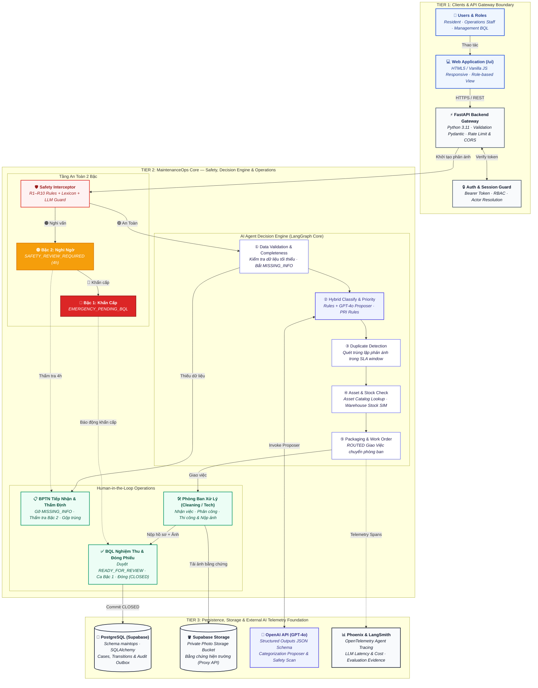

# P-151 — MaintenanceOps Agent

> Prototype **mô phỏng**. Toàn bộ dữ liệu (tiền tố `SIM-`), quy trình, định mức và kết quả là mô phỏng, không phải vận hành thật.
> Spec đích duy nhất: [CR-BPTN-03](docs/CR-BPTN-03.md) (v0.6 candidate, `PROPOSED`). Mục API bên dưới mô tả **code đang chạy**;
> chỗ nào lệch CR-BPTN-03 thì theo CR-BPTN-03.

## Vấn đề

BQL cần tạo và kiểm tra hồ sơ bảo trì một cách nhất quán, truy vết được và không vượt quyền, để mỗi case
đủ điều kiện được chuyển BQL xem xét hoặc dừng đúng ở bước xác minh/ngoại lệ.

## Giải pháp

Cư dân gửi phản ánh vệ sinh hoặc đèn khu vực chung. Agent kiểm tra, chạy tầng an toàn, phân loại, tra tài sản/vật tư, rồi **đề xuất** tuyến tới phòng ban; BQL nghiệm thu.

- **Tầng an toàn (bước 2b, chạy trước phân loại)**: luật cố định + từ vựng dữ liệu. Tín hiệu nguy hiểm (chất lạ, mùi khét, tia lửa, dây hở) →
  Bậc 1 `EMERGENCY_PENDING_BQL` (chủ BQL) hoặc Bậc 2 `SAFETY_REVIEW_REQUIRED` (chủ BPTN).
- **Phân loại**: playbook vệ sinh `PB-CLN-01` hoặc đèn khu vực chung `PB-TEC-01` bằng luật cố định, có thể kèm LLM đề xuất.
- **Đề xuất team**: tra asset, tồn kho, lịch trực, capacity (fixture tĩnh) → `ROUTED` là đề xuất tuyến, không phải đã giao việc; Agent không gán người.
- **Kiểm tra hồ sơ**: checklist, vật tư (3 phép đối soát), evidence tối thiểu → `READY_FOR_REVIEW`; mọi thao tác có audit.

## Tech Stack

| Lớp | Công nghệ |
|---|---|
| Agent | Luật cố định + LLM đề xuất (LangChain, `gpt-6-Luna` qua OpenAI/OpenRouter); mặc định `LLM_MODE=openai`|
| Backend | FastAPI + Python 3.11 |
| Giao diện | Portal Next.js `portal/` (qua cổng 8000) + app điện thoại `src/mobile/` (`/app/`) — cả hai chỉ gọi `/api/v1` |
| Dữ liệu | **Mặc định in-memory** từ fixture YAML, reset được; tuỳ chọn PostgreSQL trên Supabase (`MO_STORE=postgres`, Alembic) + Supabase Storage cho ảnh |
| DevOps | Docker Compose + GitHub Actions |

---

## Kiến trúc hệ thống (System Architecture)

Sơ đồ kiến trúc thành phần mục tiêu (Target Architecture v0.6) theo chuẩn [CR-BPTN-03](docs/CR-BPTN-03.md), thiết kế theo chuẩn C4 Component / Enterprise 3-Tier phục vụ Demo Day AI20K:


<details>
<summary><b>Nhấn để xem mã nguồn sơ đồ Mermaid</b></summary>



</details>

- **Chi tiết kiến trúc, bảng màu & file nguồn draw.io:** [`docs/diagrams/maintenanceops-target-20261019/README.md`](docs/diagrams/maintenanceops-target-20261019/README.md)
- **Đặc tả thiết kế chi tiết (SPEC):** [`docs/CR-BPTN-03.md`](docs/CR-BPTN-03.md)

---

## Chạy nhanh (Docker, không cần khoá)

Yêu cầu: [Docker Desktop](https://www.docker.com/products/docker-desktop/) (Windows: bật WSL 2) hoặc Docker Engine + Compose plugin; Git.
Kiểm tra: `docker compose version`.

```bash
git clone https://github.com/AI20K-Build-Phase-Cohort-4/P-151.git
cd P-151
cp .env.example .env              # Windows PowerShell: Copy-Item .env.example .env
docker compose up -d --build      # hoặc: make up
```

File `.env.example` đã đặt sẵn `LLM_MODE=mock` và `MO_STORE=memory`, nên **không cần sửa biến nào** để chạy demo.

Kiểm tra:

- Health: <http://localhost:8000/health> → `{"status":"ok",...}`
- Swagger UI: <http://localhost:8000/docs>
- Giao diện: <http://localhost:8000/> (portal, cần `PORTAL_URL`; không có portal thì chuyển tới app `/app/`)
- `docker compose ps` — `backend` phải `healthy`.

Dữ liệu in-memory: tắt/bật lại backend là về 12 ticket mẫu ban đầu.

### Lệnh thường dùng

| Việc cần làm | Lệnh | Make |
|---|---|---|
| Khởi động / build lại sau khi sửa code | `docker compose up -d --build` | `make up` |
| Xem log backend | `docker compose logs -f backend` | `make logs` |
| Dừng | `docker compose down` | `make down` |
| Chạy test trong container | `docker compose exec backend pytest tests/ -v` | |

Backend trong Docker **không** tự reload khi sửa code — chạy lại `make up`. Cần hot reload thì xem mục "Chạy ngoài Docker".

---

## Biến môi trường

Copy `.env.example` → `.env`. Không commit `.env`; không dán khoá vào repo hay chat công khai.
Với đường chạy nhanh **không biến nào bắt buộc**.

**LLM**

| Biến | Mặc định | Ghi chú |
|---|---|---|
| `LLM_MODE` | `mock` | `mock`: chỉ luật cố định, kết quả cố định, không cần khoá (test luôn dùng mode này). `openai`: bật LLM đề xuất |
| `OPENAI_API_KEY` | — | Bắt buộc khi `LLM_MODE=openai` (khoá OpenAI hoặc OpenRouter) |
| `OPENAI_BASE_URL` | trống | Khoá OpenRouter (`sk-or-...`) cần `https://openrouter.ai/api/v1`; trống = `api.openai.com` |
| `MODEL_NAME` | `gpt-4o-mini` | Model gọi khi `LLM_MODE=openai` |

**MaintenanceOps**

| Biến | Mặc định | Ghi chú |
|---|---|---|
| `MO_STORE` | `memory` | `memory`: trong RAM; `postgres`: dùng `DATABASE_URL` (Supabase) |
| `MO_SEED_ON_EMPTY` | `true` | Khi khởi động, nạp 12 ticket mẫu chỉ nếu kho chưa có ticket; không bao giờ xoá dữ liệu |
| `MO_ALLOW_RESET` | `false` | `POST /mo/reset`, `/mo/evaluate` xoá dữ liệu: luôn được với `memory`; trên DB chung chỉ chủ DB bật, tạm thời |
| `MO_PHOTO_STORE` | `local` | `local`: thư mục `MO_UPLOAD_DIR`; `supabase`: Supabase Storage |
| `MO_UPLOAD_DIR` | `./data/uploads/maintenance` | Thư mục ảnh khi `local` |
| `MO_JOBS_ENABLED` | `true` | Job retry/leo thang mỗi 5 phút trong process API |
| `MO_ALLOW_ACTOR_HEADER` | `false` | Chấp nhận header `X-Actor-Id` thay token — chỉ test/script, **CẤM bật ở production** |

**Supabase** (chỉ khi `MO_STORE=postgres` hoặc `MO_PHOTO_STORE=supabase`; xem mục "Dùng Supabase")

| Biến | Ghi chú |
|---|---|
| `SUPABASE_URL` | Dashboard → Project URL (không phải bí mật) |
| `SUPABASE_SERVICE_ROLE_KEY` | **BÍ MẬT.** Secret key `sb_secret_...` tự tạo trên Dashboard, không dùng publishable key |
| `SUPABASE_STORAGE_BUCKET` | Mặc định `maintenance-photos` (bucket riêng, 5 MB, jpeg/png/webp) |
| `DATABASE_URL` | Chuỗi Session pooler của DB chung; mặc định trỏ `localhost:5432` |

**Ứng dụng**

| Biến | Mặc định | Ghi chú |
|---|---|---|
| `APP_PORT` / `APP_HOST` | `8000` / `0.0.0.0` | Cổng đã bị chiếm thì đổi `APP_PORT` |
| `APP_ENV` | `development` | `development` \| `production` \| `test`; `production` tắt `/auth/demo-accounts` và `simulated_received_at` |
| `CORS_ORIGINS` | `http://localhost:3000,http://localhost:5173` | |
| `LOG_LEVEL` | `INFO` | |
| `POSTGRES_USER`, `POSTGRES_PASSWORD`, `POSTGRES_DB`, `POSTGRES_PORT` | `p151` ×3, `5432` | Chỉ cho container `db` của compose (dùng cho `pytest --pg`); backend **không** dùng |

**Log AI** (`AI_LOG_API_KEY`, `LANGCHAIN_*`, `AI_LOG_*`): chỉ thành viên nhóm cần để nộp log công cụ AI cho khoá học; **giảng viên chạy demo không cần**.
Biến còn lại của template (`ANTHROPIC_API_KEY`, `GOOGLE_API_KEY`, `CHROMA_PERSIST_DIR`, `PINECONE_*`, `NEXT_PUBLIC_API_URL`) không dùng trong flow MaintenanceOps.
Cài hook một lần sau khi clone: `bash scripts/setup_hooks.sh` (Windows: `powershell -ExecutionPolicy Bypass -File scripts\setup_hooks.ps1`).

---

## Ví dụ truy vấn

### Tài khoản demo

Mật khẩu chung `Demo@2026` (dữ liệu mô phỏng, file `seed/maintenance_v1/accounts.yaml`):

| Username | Vai trò |
|---|---|
| `cudan01`, `cudan02` | Cư dân |
| `bptn01` | BPTN |
| `vesinh01`, `kythuat01` | Phòng Vệ sinh / Kỹ thuật |
| `kho01` | Kho vật tư |
| `bql01` | BQL |
| `qa01` | QA nội bộ |

### Câu phản ánh mẫu

Gửi bằng tài khoản `cudan01`. Kết quả dưới đây đã chạy thật (`LLM_MODE=mock`, server vừa khởi động, gửi lần lượt từ trên xuống):

| Câu cư dân gửi | Kết quả |
|---|---|
| `Hành lang tầng 3 tòa SIM-A có nhiều rác và vết bẩn, cần vệ sinh.` | `ROUTED` → Phòng Vệ sinh |
| `Đèn hành lang tầng 3 tòa SIM-A không sáng từ tối qua.` | `ROUTED` → Phòng Kỹ thuật |
| `Tầng hầm B1 tòa SIM-A có chất lỏng lạ không rõ nguồn gốc, bốc mùi hắc gây khó thở, cần vệ sinh.` | `VERIFYING` + blocker `EMERGENCY_PENDING_BQL` (Bậc 1, chờ BQL) |
| `Đèn sảnh thang máy tầng 5 tòa SIM-A không sáng, có tia lửa và mùi khét ở hộp đèn.` | `VERIFYING` + blocker `EMERGENCY_PENDING_BQL` (Bậc 1, chờ BQL) |

Gửi **cùng một nội dung** lần thứ hai sẽ bị giữ ở `VERIFYING` để kiểm tra trùng — khởi động lại backend để về trạng thái ban đầu.
Câu quá ngắn/thiếu địa điểm (vd `Hanh lang tang 3 nhieu rac`) → `NEED_INFO`.

### curl (bash / Git Bash / macOS / Linux)

Tiếng Việt có dấu truyền qua file để tránh lỗi mã hoá terminal (Git Bash trên Windows):

```bash
B=http://localhost:8000/api/v1

# 1. Đăng nhập cư dân -> lấy token
TOKEN=$(curl -s -X POST $B/auth/login -H 'Content-Type: application/json' \
  -d '{"username":"cudan01","password":"Demo@2026"}' | python -c "import sys,json;print(json.load(sys.stdin)['access_token'])")

# 2. Gửi phản ánh
printf '%s' '{"original_description":"Hành lang tầng 3 tòa SIM-A có nhiều rác và vết bẩn, cần vệ sinh.","channel":"form"}' > body.json
curl -s -X POST $B/resident/tickets -H "Authorization: Bearer $TOKEN" \
  -H 'Content-Type: application/json' --data-binary @body.json      # -> ticket_id, status ROUTED

# 3. Xem ticket (trường công khai)
curl -s $B/resident/tickets/SIM-TKT-0001 -H "Authorization: Bearer $TOKEN"

# 4. BQL xem hàng đợi
BQL=$(curl -s -X POST $B/auth/login -H 'Content-Type: application/json' \
  -d '{"username":"bql01","password":"Demo@2026"}' | python -c "import sys,json;print(json.load(sys.stdin)['access_token'])")
curl -s $B/bql/tickets -H "Authorization: Bearer $BQL"
```

### PowerShell

```powershell
$B = "http://localhost:8000/api/v1"
function Utf8($s) { [Text.Encoding]::UTF8.GetBytes($s) }
$t = (Invoke-RestMethod "$B/auth/login" -Method Post -ContentType 'application/json; charset=utf-8' `
  -Body (Utf8 '{"username":"cudan01","password":"Demo@2026"}')).access_token
Invoke-RestMethod "$B/resident/tickets" -Method Post -Headers @{Authorization="Bearer $t"} `
  -ContentType 'application/json; charset=utf-8' `
  -Body (Utf8 '{"original_description":"Hành lang tầng 3 tòa SIM-A có nhiều rác và vết bẩn, cần vệ sinh.","channel":"form"}')
```

Nếu tiếng Việt hiển thị méo trong PowerShell 5.1 thì chỉ là lỗi hiển thị; hoặc dùng Swagger UI (<http://localhost:8000/docs>): `Authorize` bằng token từ `/auth/login`.

### Demo nhanh trên Swagger

Cần đăng nhập `qa01` (`/mo/*` demo là của QA nội bộ):

- `POST /mo/evaluate` — chạy 12 ticket mẫu so với expected (`passed` phải là 12).
- `POST /mo/demo/SIM-TKT-CLN-001` (flow 1), `SIM-TKT-CLN-002` (flow 2, ngoài giờ), `SIM-TKT-TEC-001` (flow 3), `SIM-TKT-TEC-002` (flow 4, chờ BPTN xác minh asset).

### Giao diện

Chạy xong mở <http://localhost:8000/> và đăng nhập bằng tài khoản trên. Cư dân có thể đính kèm ảnh (không bắt buộc); phòng ban phải gửi ít nhất một ảnh sau xử lý mới báo hoàn thành được. Ảnh lưu ở `data/uploads/maintenance`.

---

## Chạy ngoài Docker (tuỳ chọn, hot reload)

```bash
python3.11 -m venv .venv
source .venv/bin/activate                     # Windows: .venv\Scripts\activate
pip install -r requirements.txt
cp .env.example .env
uvicorn src.main:app --reload --port 8000     # hoặc: make run
```

Không cần PostgreSQL vì `MO_STORE=memory`. Nếu `make up` đang chạy backend thì cổng 8000 đã bị chiếm — `docker compose stop backend` trước.

## Test và lint

```bash
PYTHONUTF8=1 LLM_MODE=mock python -m pytest -q -p no:cacheprovider
python -m ruff check src tests
python -m ruff format --check src tests
```

Test dùng `LLM_MODE=mock` nên không cần khoá. Test Postgres (`pytest --pg`) chỉ chạy trên Docker local với DB tên kết thúc `_test`: đặt `MO_TEST_DATABASE_URL`.

## Dùng Supabase (tuỳ chọn, cần khoá)

Dùng khi muốn dữ liệu và ảnh lưu bền, dùng chung cả nhóm. Xin chủ dự án mời vào org "Build Phase" (role Developer), tự lấy mọi giá trị từ Dashboard; **chi tiết từng biến nằm trong chú thích của [`.env.example`](.env.example)**.

1. Trong `.env`: `MO_STORE=postgres`, `DATABASE_URL=<chuỗi Session pooler>`, `MO_PHOTO_STORE=supabase`, `SUPABASE_URL`, `SUPABASE_SERVICE_ROLE_KEY`.
2. Tạo schema `maintops` **một lần mỗi revision** (chủ DB): `python -m alembic -c src/maintenance/store/alembic.ini upgrade head`. Schema không bao giờ được tạo khi khởi động.
3. Khởi động như bình thường. Startup chỉ seed khi DB rỗng, không reset.

---

## Xử lý sự cố thường gặp

| Triệu chứng | Cách xử lý |
|---|---|
| `failed to connect to the docker API` / `Cannot connect to the Docker daemon` | Docker Desktop chưa chạy — mở và đợi báo "Engine running" |
| `port is already allocated` (8000 hoặc 5432) | Đổi `APP_PORT` / `POSTGRES_PORT` trong `.env`, hoặc tắt chương trình đang dùng cổng |
| `env file .env not found` | Chưa tạo `.env` — `cp .env.example .env` |
| Sửa code nhưng không thấy thay đổi | Chạy `make up` để build lại image |
| Thêm thư viện vào `requirements.txt` | `make up` để build lại; người khác cũng cần `make up` sau khi pull |
| `There was an error parsing the body` khi gửi tiếng Việt bằng `curl -d` trên Windows | Truyền body qua file (`--data-binary @body.json`) hoặc dùng PowerShell / Swagger như mục trên |
| Ticket thứ hai cùng nội dung bị `VERIFYING` | Đúng thiết kế (kiểm tra trùng) — khởi động lại backend để về dữ liệu ban đầu |
| `/mo/reset`, `/mo/evaluate` bị từ chối | `MO_STORE=postgres` cần `MO_ALLOW_RESET=true`; với `memory` không bị chặn |

---

## Cấu trúc thư mục

```
src/
  maintenance/       Lõi nghiệp vụ: engine (state machine + pipeline), safety.py (tầng an toàn), priority.py, rules,
                     proposer (LLM), views, catalog, store/ (memory | postgres + Alembic | ảnh), i18n/vi.yaml
  api/               main routers: auth.py, photos.py, routers/maintenance.py (/mo, /resident, /bql)
  web/               UI tĩnh (index.html, app.js)
  agents/, api/routes.py   Code mẫu LangGraph + chat của template (không nằm trong flow)
  config.py          Cấu hình (đọc từ .env)
  main.py            App entry point
seed/maintenance_v1/     Catalog, 12 ticket kèm expected, tài khoản demo, từ vựng an toàn (lexicon.yaml)
seed/maintenance_cr03/   Fixture đích CR-03: nhãn safety + expected outcome
tests/test_maintenance/  pytest: acceptance, engine, API, auth, safety, emergency, priority, store
docs/                    CR-BPTN-03.md (spec đích), maintenance.md (tài liệu module), diagrams/, guide/
planning/                Hồ sơ kế hoạch (spec-first); brain4agent/: bộ nhớ dự án cho AI agent
Dockerfile, docker-compose.yml   Backend (+ PostgreSQL chỉ cho test)
```

## API (code đang chạy; spec đích: [CR-BPTN-03](docs/CR-BPTN-03.md))

Prefix `/api/v1`. Xác thực: `POST /auth/login` → `Authorization: Bearer <token>`. Toàn bộ dữ liệu là mô phỏng.

- Hai playbook: `PB-CLN-01` → `DEPT_CLEANING`, `PB-TEC-01` → `DEPT_TECHNICAL`. Thứ tự: an toàn (2b) → phân loại → trùng → BPTN review (nếu cần) → tài sản → vật tư → giao phòng ban.
- Trạng thái chính: `RECEIVED`, `VERIFYING`, `ROUTED`, `IN_PROGRESS`, `READY_FOR_REVIEW`, `CLOSED`; phụ: `NEED_INFO`, `ON_HOLD`; kết thúc: `MERGED`, `CANCELLED`. Mọi đổi trạng thái đi qua một hàm chuyển trạng thái, ghi một dòng sự kiện. Chỉ BQL đóng/hủy.
- Mỗi lần dừng là một `blocker` (mã lý do, người gỡ, bước chạy lại). Lời cho cư dân sinh từ `src/maintenance/i18n/vi.yaml`.

| Method | Path | Vai trò | Việc làm |
|---|---|---|---|
| POST | `/auth/login`, `/auth/logout`; GET `/auth/me`, `/auth/demo-accounts` | — | Đăng nhập; tài khoản demo (tắt khi `production`) |
| POST | `/resident/tickets` | Cư dân | Gửi phản ánh `{original_description, channel}`; Agent chạy pipeline |
| GET | `/resident/tickets`, `/resident/tickets/{id}` | Cư dân (chủ ticket) | Chỉ trường công khai: trạng thái, phòng ban, lời nhắn, eta, timeline |
| POST | `/resident/tickets/{id}/additions`, `/photos`, `/rating` | Cư dân | Bổ sung thông tin; ảnh; đánh giá (một lần) |
| POST | `/mo/tickets/{id}/bptn-resolve` | BPTN | Gỡ `MISSING_INFO`/`VERIFYING`: gộp/không trùng, loại việc, phòng ban, asset, location |
| POST | `/mo/tickets/{id}/safety` | BPTN | Bậc 2: `CONFIRM_SAFE` \| `REQUEST_INFO` \| `ESCALATE` |
| POST | `/mo/tickets/{id}/priority` | BPTN/BQL | Sửa ưu tiên, bắt buộc lý do |
| POST | `/mo/tickets/{id}/accept`, `/return`, `/block`, `/resume-work` | Phòng ban | Nhận việc; trả sai phòng ban; hoãn; tiếp tục |
| POST | `/mo/tickets/{id}/checklist/{item}`, `/materials/{code}`, `/evidence`, `/photos` | Phòng ban | Cập nhật khi xử lý |
| POST | `/mo/tickets/{id}/complete` | Phòng ban | Báo hoàn thành → Agent đối soát |
| POST | `/mo/warehouse/stock/{item_code}` | Kho | Nhập vật tư; ticket chờ vật tư tự chạy lại |
| GET | `/bql/tickets` | BQL | Hàng đợi đầy đủ; lọc `status`, `department_id`, `blocker_code`, `escalated`, `overdue` |
| POST | `/bql/tickets/{id}/close`, `/rework`, `/cancel` | BQL | Nghiệm thu (từ `READY_FOR_REVIEW`); trả làm lại; hủy |
| POST | `/bql/tickets/{id}/emergency/close`, `/emergency/downgrade` | BQL | Bậc 1: đã xử lý ngoài hệ thống; báo động giả |
| GET | `/mo/tickets`, `/mo/tickets/{id}`, `.../events`, `.../audit`, `.../notifications`, `/mo/catalog`, `/mo/ai-logs` | nội bộ | Hàng đợi, case đầy đủ, timeline, audit, outbox, danh mục, log AI |
| POST | `/mo/tickets/{id}/transition`, `/resume`, `/jobs/run`, `/attempt` | theo bảng / QA | Chuyển trạng thái chung; chạy lại; job retry; thử hành động ngoài quyền (luôn `ACTION_DENIED` + audit) |
| POST | `/mo/reset`, `/mo/evaluate`, `/mo/demo/{ticket_id}` | QA | Nạp lại fixture; chạy 12 ticket so expected; demo một ticket |

Danh sách đầy đủ và schema: Swagger <http://localhost:8000/docs>. Chi tiết module: [`docs/maintenance.md`](docs/maintenance.md).

**Phân loại bằng LLM** (`src/maintenance/proposer.py`): đặt `LLM_MODE=openai`. LLM chỉ đề xuất; luật cố định vẫn chạy song song: không thống nhất → `CATEGORY_UNCLEAR`; chỉ LLM thấy playbook → BPTN review; LLM lỗi → dùng luật. Tầng an toàn: LLM chỉ được **nâng** mức, không hạ.

## Tài liệu

- Spec đích: [`docs/CR-BPTN-03.md`](docs/CR-BPTN-03.md); module engine: [`docs/maintenance.md`](docs/maintenance.md)
- Kiến trúc: [`ARCHITECTURE.md`](ARCHITECTURE.md), [`docs/architecture_diagram.md`](docs/architecture_diagram.md), [`docs/diagrams/`](docs/diagrams/)
- Bài toán/PRD nền (v0.3, lệch thì CR-03 thắng): [`docs/01_problem_statement.md`](docs/01_problem_statement.md) … [`05_traceability_and_review.md`](docs/05_traceability_and_review.md)
- Technical Guidebook: [`docs/guide/`](docs/guide/) hoặc <https://phoenix.note.transformerlabs.ai/technical-book>
- Quy ước đóng góp: [`CONTRIBUTING.md`](CONTRIBUTING.md)

## Team

| Thành viên | Vai trò | MSSV |
|---|---|---|
| Lê Thị Châm Anh | Trưởng nhóm - Backend | 2A202602846 |
| Lê Như Ý | AI - Agent | 2A202602517 |
| Cao Văn Trường | BA/PO | 2A202602562 |
| Võ Đức Trí | Frontend | 2A202602603 |
## License

MIT
