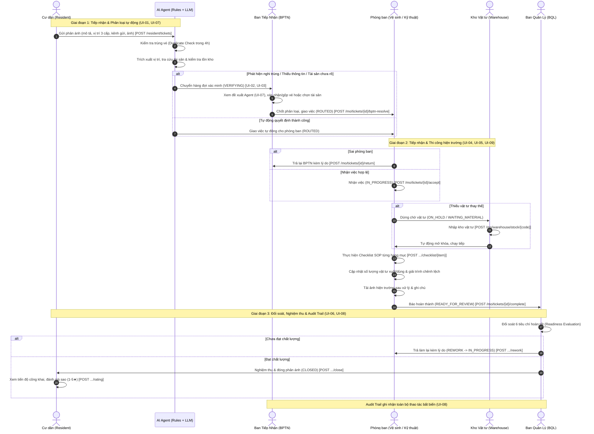

# Tài liệu Thiết kế Luồng Giao diện & Wireframe (UI-01 đến UI-10)
## Hệ thống MaintenanceOps Agent (CR-BPTN-02 / v0.5 Candidate)

Tài liệu này đặc tả chi tiết 10 màn hình chuẩn (UI-01 đến UI-10), sơ đồ luồng Swimlane nghiệp vụ đa vai trò, quy tắc giao diện và ánh xạ trực tiếp đến các REST API endpoint của hệ thống.

---

## 1. Sơ đồ luồng nghiệp vụ Swimlane (End-to-End Workflow)

---

## 2. Đặc tả 10 Màn hình Giao diện (UI-01 đến UI-10)

### UI-01 — Cư dân: Tạo phản ánh sự cố khu vực chung
- **Đối tượng sử dụng:** Cư dân tòa nhà (`ActorRole.RESIDENT`).
- **Mục tiêu:** Cho phép cư dân tạo ticket nhanh chóng, cung cấp vị trí chuẩn xác và đính kèm bằng chứng hình ảnh.
- **Thành phần giao diện:**
  1. **Nội dung mô tả (Description):** Ô nhập liệu đa dòng, tối đa 1000 ký tự, có placeholder hướng dẫn cụ thể.
  2. **Bộ chọn vị trí chuẩn 3 cấp (Location Selector):**
     - Tòa nhà (Building): `Tòa SIM-A`, `Tòa SIM-B`, `Tòa SIM-C`, `Khuôn viên ngoài trời`.
     - Tầng (Floor): `Tầng 1` đến `Tầng 20`, `Tầng hầm B1/B2`, `Tầng trệt`.
     - Khu vực cụ thể (Zone): `Hành lang`, `Sảnh thang máy`, `Thang bộ`, `Phòng rác tầng`, `Bãi đỗ xe`, `Sân chơi`.
     - Nút tự động chuẩn hóa chuỗi vị trí chèn vào mô tả.
  3. **Kênh tiếp nhận (Submission Channel):**
     - `form`: Cổng cư dân trực tuyến (Web Portal).
     - `app`: Ứng dụng di động cư dân (Resident App).
     - `hotline`: Tổng đài CSKH / Zalo tiếp nhận phản ánh.
  4. **Đính kèm ảnh hiện trường:** Chọn tối đa 5 ảnh (JPG, PNG, WEBP $\le$ 5 MB), hiển thị danh sách xem trước dung lượng/tên tệp.
  5. **Tùy chọn Demo:** Giả lập thời điểm gửi (hỗ trợ kiểm thử khung giờ 06:00–22:00 của phòng ban).
  6. **Danh sách phản ánh của tôi:** Hiển thị thẻ ticket với mã phản ánh, ngày gửi, kênh gửi và badge trạng thái.
  7. **Chi tiết tiến độ cư dân:** Thanh Stepper 5 bước (`RECEIVED` $\rightarrow$ `ROUTED` $\rightarrow$ `IN_PROGRESS` $\rightarrow$ `READY_FOR_REVIEW` $\rightarrow$ `CLOSED`), thời gian hoàn thành dự kiến (ETA), lời nhắn công khai, nút bổ sung thông tin, đánh giá sao (1–5 sao) và nút báo chưa xong trong 7 ngày sau khi đóng.
- **API tương ứng:** `POST /api/v1/resident/tickets`, `POST /api/v1/resident/tickets/{id}/photos`, `GET /api/v1/resident/tickets`.

---

### UI-02 — BPTN: Hàng đợi công việc & Xử lý nghi trùng (Work Queue & Duplicate Blocker)
- **Đối tượng sử dụng:** Nhân viên Bộ phận Tiếp nhận (`ActorRole.BPTN`).
- **Mục tiêu:** Kiểm tra các phản ánh rơi vào trạng thái `VERIFYING`, đặc biệt là cảnh báo nghi trùng vé để tránh xử lý phân tán hoặc lãng phí nhân lực.
- **Thành phần giao diện:**
  1. **Danh sách hàng chờ xác minh:** Lọc tự động các ticket có trạng thái `VERIFYING`, hiển thị badge lý do (`DUPLICATE`, `CATEGORY_UNCLEAR`, `PENDING_REVIEW`, `ASSET_UNCLEAR`, `WRONG_DEPT`,...).
  2. **Banner Cảnh báo trùng vé (Duplicate Warning):**
     - Xuất hiện nổi bật màu hổ phách/cam khi `blocker.code === 'DUPLICATE'`.
     - Hiển thị mã ticket gốc (`related_ticket_id`) cùng khoảng cách thời gian và lý do nghi ngờ.
  3. **Nút thao tác nhanh:**
     - **Gộp vào ticket gốc:** Gọi `POST /mo/tickets/{id}/bptn-resolve` với `{ merge: true }`, kết thúc ticket này và thông báo công khai cho cư dân theo dõi ticket gốc.
     - **Không trùng, xử lý tiếp:** Gọi API với `{ merge: false, note: '...' }` để gỡ blocker và tiếp tục chu trình xử lý.
- **API tương ứng:** `GET /api/v1/mo/tickets`, `POST /api/v1/mo/tickets/{id}/bptn-resolve`.

---

### UI-03 — BPTN: Xác nhận phân loại & Giao việc phòng ban (Routing & Blocker Resolution)
- **Đối tượng sử dụng:** Nhân viên BPTN.
- **Mục tiêu:** Xử lý các điều kiện chặn trước khi giao việc: chốt loại dịch vụ, xác định tài sản và giao phòng ban.
- **Thành phần giao diện:**
  1. **Bảng điều kiện giao việc (Route Checklist):** Hiển thị 3 điều kiện tiên quyết:
     - BPTN Review: `CONFIRMED` hoặc `NOT_REQUIRED`.
     - Tài sản: Đã tìm thấy (`FOUND`), kiểm tra tại hiện trường (`ONSITE_BY_BPTN`), hoặc không áp dụng (`NOT_APPLICABLE`).
     - Phòng ban đề xuất: Đã xác định (`proposed_department_id`).
  2. **Form giải quyết theo từng mã Blocker:**
     - `CATEGORY_UNCLEAR` / `OUT_OF_SCOPE`: Chọn loại việc (Vệ sinh `VE_SINH` / Kỹ thuật `KY_THUAT`) + Ghi chú lý do bắt buộc.
     - `PENDING_REVIEW`: Xác nhận hoặc thay đổi loại việc, chuẩn hóa vị trí, lý do điều chỉnh.
     - `ASSET_UNCLEAR`: Chọn tài sản từ danh mục thiết bị hoặc tích chọn "Không tìm thấy — Giao phòng ban kiểm tra tại hiện trường".
     - `WRONG_DEPT`: Phân công lại phòng ban hoặc đổi loại việc khi phòng ban gửi trả.
  3. **Khóa dữ liệu (Locked Fields):** Mọi giá trị do BPTN chốt sẽ ghi nhận vào `locked_fields`, AI Agent không được tự ý ghi đè.
- **API tương ứng:** `POST /api/v1/mo/tickets/{id}/bptn-resolve`.

---

### UI-04 — Phòng ban: Tiếp nhận việc & Trả lại việc (Department Queue & Acceptance)
- **Đối tượng sử dụng:** Nhân viên kỹ thuật/vệ sinh (`ActorRole.DEPARTMENT`).
- **Mục tiêu:** Nhận việc được phân công vào ca làm hoặc trả lại BPTN nếu công việc không thuộc thẩm quyền.
- **Thành phần giao diện:**
  1. **Danh sách việc đã giao:** Giới hạn phạm vi chỉ hiển thị ticket thuộc phòng ban của tài khoản đăng nhập (qua `department_id`), trạng thái `ROUTED`.
  2. **Nút "Nhận việc":** Chuyển trạng thái từ `ROUTED` sang `IN_PROGRESS`, bắt đầu tính SLA thực hiện.
  3. **Thao tác "Trả lại cho BPTN":** Dành cho trường hợp việc bị giao nhầm chuyên môn (`WRONG_DEPT`), yêu cầu nhập lý do chi tiết trước khi xác nhận.
- **API tương ứng:** `POST /api/v1/mo/tickets/{id}/accept`, `POST /api/v1/mo/tickets/{id}/return`.

---

### UI-05 — Phòng ban: Thực hiện hiện trường, Checklist & Nghiệm thu (Department Execution)
- **Đối tượng sử dụng:** Nhân viên kỹ thuật/vệ sinh.
- **Mục tiêu:** Ghi nhận toàn bộ tiến độ xử lý hiện trường, vật tư sử dụng, bằng chứng hình ảnh và báo hoàn thành.
- **Thành phần giao diện:**
  1. **Checklist công việc theo Playbook SOP:**
     - Danh sách các mục kiểm tra dựa trên Playbook (`PB-CLN-01` hoặc `PB-TEC-01`).
     - Tích chọn checkbox tự động lưu trạng thái `COMPLETED` / `PENDING` ngay lập tức.
  2. **Quản lý & Cân đối vật tư:**
     - Hiển thị danh mục vật tư định mức theo Playbook.
     - Ô nhập số lượng đã xuất kho (`issued_qty`) và số lượng thực dùng (`used_qty`).
     - Trường bắt buộc giải trình lý do chênh lệch (`variance_reason`) nếu số lượng thực tế khác định mức.
     - Nút "Lưu vật tư" độc lập cho từng hạng mục.
  3. **Tải ảnh sau khi xử lý:** Bắt buộc tối thiểu 1 ảnh hiện trường sau hoàn tất để chứng minh chất lượng công việc.
  4. **Ghi chú xử lý hiện trường:** Nhập thông tin bổ sung về các việc đã thực hiện.
  5. **Tạm hoãn tại hiện trường:** Nút "Vướng tại hiện trường?" cho phép tạm dừng công việc (`ON_HOLD / BLOCKED_ONSITE`) với lý do và giờ hẹn tiếp tục (ETA). Khi quay lại, có nút "Tiếp tục xử lý".
  6. **Nút "Báo hoàn thành":** Kiểm tra tự động các điều kiện trước khi nộp cho BQL (ảnh sau xử lý, checklist hoàn tất, vật tư đã lưu và giải trình chênh lệch). Nếu thiếu, hiển thị thông báo lỗi chỉ rõ từng mục còn thiếu.
- **API tương ứng:** `POST /mo/tickets/{id}/checklist/{item_id}`, `POST /mo/tickets/{id}/materials/{item_code}`, `POST /mo/tickets/{id}/photos`, `POST /mo/tickets/{id}/evidence`, `POST /mo/tickets/{id}/complete`, `POST /mo/tickets/{id}/block`, `POST /mo/tickets/{id}/resume-work`.

---

### UI-06 — BQL: Đối soát, Nghiệm thu & Rework (Inspection & Final Review)
- **Đối tượng sử dụng:** Ban Quản Lý tòa nhà (`ActorRole.BQL`).
- **Mục tiêu:** Đánh giá chất lượng xử lý của phòng ban, đối soát các điều kiện nghiệm thu, đóng ticket hoặc yêu cầu làm lại.
- **Thành phần giao diện:**
  1. **Bộ lọc BQL đa tiêu chí:** Lọc theo Trạng thái, Phòng ban xử lý, Cờ đã leo thang (`escalated`), và Cờ quá hạn SLA (`overdue`).
  2. **Bảng kết quả đối soát 6 tiêu chí (Readiness Evaluation):**
     - Tiêu chí 1: Phòng ban đã nhận việc (`department_accepted`).
     - Tiêu chí 2: Checklist hoàn tất 100% (`checklist_complete`).
     - Tiêu chí 3: Có ảnh sau khi xử lý (`photo_present`).
     - Tiêu chí 4: Đã nhập vật tư (`materials_entered`).
     - Tiêu chí 5: Chênh lệch vật tư có lý do rõ ràng (`variance_explained`).
     - Tiêu chí 6: Không còn vướng mắc blocker (`no_open_blocker`).
  3. **Thư viện ảnh đối chiếu:** Xem ảnh cư dân gửi lúc đầu song song với ảnh phòng ban chụp sau khi hoàn thành.
  4. **Các nút hành động của BQL:**
     - **Nghiệm thu (Close Ticket):** Đóng ticket thành công (`CLOSED`), kích hoạt luồng đánh giá sao cho cư dân.
     - **Trả làm lại (Rework):** Yêu cầu phòng ban làm lại nếu chất lượng chưa đạt, bắt buộc nhập lý do chi tiết. Cảnh báo tự động nếu đây là lần làm lại thứ 3 (sẽ kích hoạt cờ leo thang lên cấp cao hơn).
     - **Hủy phản ánh (Cancel):** Hủy ticket vi phạm hoặc không hợp lệ, yêu cầu hộp thoại xác nhận an toàn (`confirmDialog`) và ghi rõ lý do công khai gửi cư dân.
- **API tương ứng:** `GET /api/v1/bql/tickets`, `POST /api/v1/bql/tickets/{id}/close`, `POST /api/v1/bql/tickets/{id}/rework`, `POST /api/v1/bql/tickets/{id}/cancel`.

---

### UI-07 — Panel "Agent Đề Xuất & Phân Tích" (AI Decision Card)
- **Đối tượng sử dụng:** Toàn bộ nhân viên nội bộ (BPTN, Phòng ban, BQL, QA).
- **Mục tiêu:** Minh bạch hóa quá trình suy luận của Agent AI, cung cấp đầy đủ dữ kiện để nhân viên đưa ra quyết định nhanh chóng.
- **Thành phần giao diện:**
  1. **Badge Độ tin cậy (Confidence Badge):** Thể hiện phần trăm độ tin cậy kèm chỉ báo nhịp thở (Pulse dot):
     - Xanh lá (95% - Cao): Quy tắc và mô hình AI đồng thuận cao.
     - Hổ phách (70% - Trung bình): Cần chuyên viên BPTN xác nhận.
     - Đỏ (35% - Thấp): Ngoài phạm vi hoặc cần BQL xử lý đặc biệt.
     - Xanh dương (100%): Dữ liệu đã được BPTN chốt cố định.
  2. **Phân tích vị trí 3 cấp:** Hiển thị 3 chip thẻ riêng biệt: Tòa nhà, Tầng lầu, Khu vực nhận diện.
  3. **Playbook đề xuất & Đơn vị phụ trách:** Phân định rõ `PB-CLN-01` (Vệ sinh) vs `PB-TEC-01` (Kỹ thuật).
  4. **Kết quả kiểm tra trùng vé:** Báo cáo vé độc lập hoặc cảnh báo mã vé nghi ngờ kèm khoảng cách thời gian.
  5. **Thông tin Tài sản & Tồn kho:** Trạng thái tra cứu mã thiết bị (`SIM-ASSET-...`) và khả năng đáp ứng vật tư trong kho.
  6. **Lý do suy luận & Bộ quy tắc (Rule Trace):** Trích xuất lý do phân loại và danh sách các mã luật đã kích hoạt (VD: `PB-COM-R-CLS-01`).
  7. **Nút "Xem raw LLM prompt/response":** Mở Modal chuyên sâu hiển thị System Prompt, User Prompt, Structured JSON Output và độ trễ phản hồi (latency ms).
- **Thành phần mã nguồn:** [`src/web/js/components/agent_proposal.js`](file:///C:/Users/LENOVO/Documents/文档/GitHub/P-151/src/web/js/components/agent_proposal.js).

---

### UI-08 — Lịch sử truy vết Audit Trail & Dòng thời gian trạng thái (Audit Trail & Timeline)
- **Đối tượng sử dụng:** Nhân viên BPTN, Phòng ban, BQL, Ban kiểm toán nội bộ.
- **Mục tiêu:** Cung cấp khả năng truy vết hoàn chỉnh (Auditability) mọi biến động của phản ánh, đảm bảo tính bất biến (Append-only) và tuân thủ quy trình.
- **Thành phần giao diện:**
  1. **Hệ thống Tab chuyển đổi linh hoạt:**
     - **Tab 1: Lịch sử trạng thái (Status Timeline):** Danh sách các mốc thay đổi trạng thái từ lúc tiếp nhận đến khi kết thúc, kèm lời nhắn công khai cho cư dân và ghi chú nội bộ của nhân viên.
     - **Tab 2: Nhật ký kiểm toán (Audit Trail):** Bảng chi tiết toàn bộ các thao tác nghiệp vụ, bao gồm tra cứu dữ liệu, đổi phân loại, cập nhật checklist, xuất kho, và các nỗ lực vi phạm phân quyền (`DENIED`).
  2. **Các trường thông tin trong bảng Audit Trail:**
     - Thời gian ghi nhận (`timestamp` chính xác đến từng giây).
     - Tác nhân (`actor_role` và `actor_id`: Agent, Cư dân, BPTN, Kỹ thuật viên, BQL).
     - Hành động (`action`: `ASSIGN`, `LOOKUP_ASSET`, `CHECKLIST_UPDATE`, `MATERIAL_RECORD`, `ATTEMPT_DENIED`,...).
     - Đối tượng & Trường dữ liệu bị tác động (`entity_type`, `field_name`).
     - Chi tiết biến động: Giá trị cũ $\rightarrow$ Giá trị mới (`old_value → new_value`).
     - Lý do nghiệp vụ / Mã quy tắc đối soát (`reason`, `rule_id`).
     - Kết quả thực thi: Badge xanh lá (`ALLOWED`) hoặc Badge đỏ cảnh báo (`DENIED`).
- **API tương ứng:** `GET /api/v1/mo/tickets/{id}/audit`, dữ liệu `case.audit` trong `GET /api/v1/mo/tickets/{id}`.

---

### UI-09 — Kho vật tư: Quản lý hàng chờ & Nhập kho (Warehouse Inventory & Stock Inflow)
- **Đối tượng sử dụng:** Thủ kho (`ActorRole.WAREHOUSE`).
- **Mục tiêu:** Tiếp nhận nhu cầu vật tư cho các sự cố kỹ thuật, thực hiện nhập kho và tự động kích hoạt lại các ticket đang bị tạm hoãn.
- **Thành phần giao diện:**
  1. **Danh sách phản ánh chờ vật tư:** Lọc các ticket có trạng thái `ON_HOLD` mang mã blocker `WAITING_MATERIAL`.
  2. **Form Nhập kho vật tư:**
     - Chọn loại vật tư từ danh mục (VD: `SIM-MAT-T8-1200` — Bóng đèn LED T8 1.2m).
     - Nhập số lượng thực nhập kho.
     - Nút "Nhập kho".
  3. **Cơ chế tự động tiếp tục (Auto-Resume):** Sau khi nhập kho, hệ thống tự động kiểm tra tồn kho và chuyển các ticket đang chờ sang bước xử lý tiếp theo, hiển thị thông báo toast: `"Đã nhập kho; N phản ánh chạy tiếp"`.
- **API tương ứng:** `POST /api/v1/mo/warehouse/stock/{item_code}`.

---

### UI-10 — Bảng điều khiển QA, Đánh giá mô hình & Quan sát AI Logs (Observability & Evaluation)
- **Đối tượng sử dụng:** Chuyên viên QA, Kỹ sư AI / MLOps (`ActorRole.QA_INTERNAL`).
- **Mục tiêu:** Đánh giá độ chính xác của Agent trên 12 kịch bản mẫu, giả lập tiến trình nghiệp vụ và giám sát chuyên sâu các lượt gọi LLM.
- **Thành phần giao diện:**
  1. **Bộ công cụ thử nghiệm dữ liệu mẫu:**
     - Nút "Kiểm tra 12 phản ánh mẫu": Thực hiện nạp lại dữ liệu gốc, chạy đánh giá tự động và hiển thị tỷ lệ chính xác (Accuracy %).
     - Nút "Chạy job nhắc / leo thang": Kích hoạt cưỡng bức cron job kiểm tra SLA và leo thang ticket.
     - Nút "Nạp lại dữ liệu mẫu": Reset toàn bộ dữ liệu phiên demo về trạng thái ban đầu.
     - Danh sách tài khoản thử nghiệm nhanh (Resident, BPTN, Tech, Cleaning, Warehouse, BQL).
  2. **Màn hình AI Logs Chuyên sâu (Observability Dashboard):**
     - Bảng thẻ tóm tắt: Tổng số lượt gọi, Lượt thành công LLM, Lượt Fallback quy tắc, Độ trễ trung bình (ms).
     - Bộ lọc theo Model (Tất cả, gemini-2.5, gpt-4o, claude-3.5, rule-engine).
     - Ô tìm kiếm từ khóa theo mã ticket hoặc nội dung prompt.
     - Modal "Chi tiết AI Log": Hiển thị chi tiết System Prompt, User Prompt, Output JSON cấu trúc và nút sao chép JSON.
     - Nút "Làm mới" và "Reset Logs" phục vụ kiểm thử lại từ đầu.
- **API tương ứng:** `POST /api/v1/mo/evaluate`, `POST /api/v1/mo/jobs/run`, `POST /api/v1/mo/reset`, `GET /api/v1/mo/ai-logs`, `POST /api/v1/mo/ai-logs/reset`.
