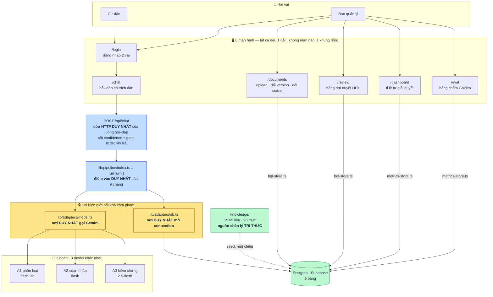
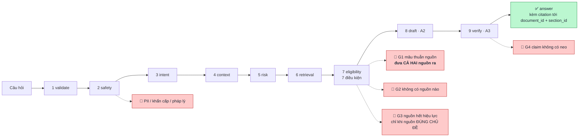
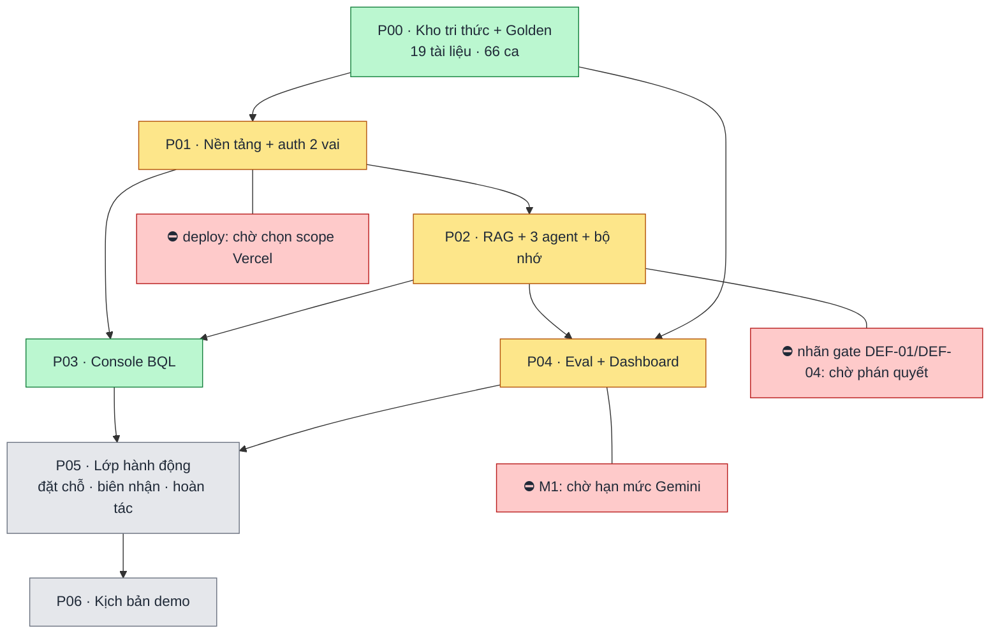
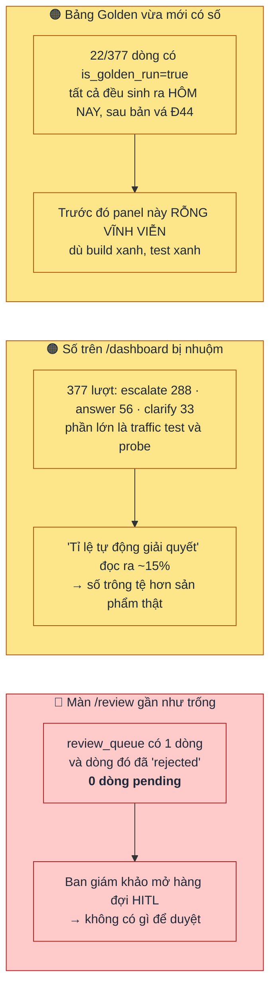
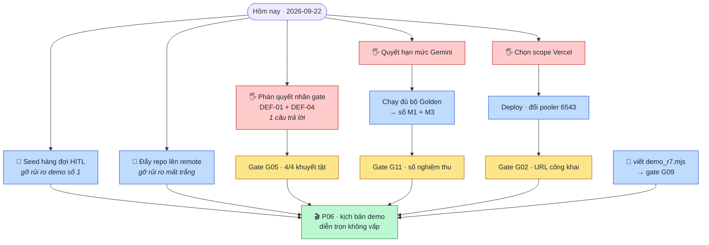

# TỔNG QUAN HIỆN TRẠNG — Resident Agent v1.0

> **File này là NGOẠI LỆ trong thư mục `docs/`.** Sáu tài liệu còn lại ở đây (`PRD_ResidentGPT_MVP.md`,
> `Product_Brief_*`, `UI_Flow_*`, `MVP_*`, `Problem_Card.md`) mô tả một **sản phẩm CŨ đã bị hạ cấp**
> — bản v0.2 "ResidentGPT", actor khác, mục tiêu khác. Chúng chỉ còn là nguồn tham chiếu nội dung và
> giọng văn. **File này mô tả sản phẩm ĐANG CHẠY, đo trực tiếp trên đĩa và trên DB thật.**
>
> **Mốc đo: 2026-09-22, tại commit `504b7a9`.** Deadline demo: **2026-09-27** (còn 5 ngày).
> Nguồn chân lý thiết kế: [`planning/01_2026-09-20_resident-agent-v1/plan.md`](../planning/01_2026-09-20_resident-agent-v1/plan.md)
> (nhật ký 46 quyết định Đ01–Đ46) → [`specs/`](../planning/01_2026-09-20_resident-agent-v1/specs/) → rồi mới tới `docs/`.

---

## 1. Sản phẩm này là gì

Trợ lý AI cho cư dân khu đô thị, **mô phỏng toàn phần** — không nối API Vinhomes, không dữ liệu cư dân
thật. Mục đích duy nhất: để ban giám khảo AI20K bấm thử trong 10 phút và tick đủ rubric `C104 / VHR-01 / G104`.

Điểm khác biệt của nó không nằm ở chỗ "trả lời được", mà ở chỗ **biết khi nào KHÔNG được trả lời**:
kho tri thức bị **cố tình cài 4 khuyết tật**, và sản phẩm phải phát hiện đúng từng cái, từ chối đúng lý do,
thay vì bịa ra một câu trả lời trôi chảy.

| Khuyết tật | Loại | Hiện ở đâu |
| :-- | :-- | :-- |
| `DEF-01` | thiếu nguồn | không tài liệu nào chứa "pickleball" |
| `DEF-02` | thiếu nguồn | không mục nào nêu phí cấp lại thẻ gửi xe |
| `DEF-03` | **mâu thuẫn** | `BBQ-CAP-01` nói 10 người, `BLD-AMEN-07` nói 15 người — cả hai còn hiệu lực |
| `DEF-04` | hết hiệu lực | `OCP1-POOL-RULES-2024` đã hết hạn |

`DEF-03` là cảnh demo mạnh nhất: agent **không chọn bên**, nó đưa cả hai nguồn ra để cư dân đối chiếu.

---

## 2. Kiến trúc — cái gì gọi cái gì

**Hai biên giới ở giữa là điều kiện sống của dự án**, không phải sở thích kiến trúc: đổi nhà cung cấp DB
hay model chỉ phải sửa đúng một file. Cả hai đều có script canh tự động (`check_adapter_boundary.sh`)
và script đó **đã được chứng minh là bắt được vi phạm thật**, không phải cổng trang trí.

---

## 3. Một lượt hỏi đi qua 9 chặng và có 5 lối thoát

Đây là phần đáng khoe nhất với ban giám khảo: **mỗi lối thoát nói một lý do khác nhau**, không gộp thành
"xin lỗi tôi không biết".

Câu *"chỉ khi nguồn ĐÚNG CHỦ ĐỀ"* ở `G3` là bài học đắt nhất của dự án. Trước đó sản phẩm nói
*"tài liệu đã hết hiệu lực"* cho một tiện ích **chưa bao giờ có tài liệu** — tức là bịa một lý do nghe
có vẻ chuyên nghiệp. Xem `plan.md` Đ28 → Đ41 → Đ46.

---

## 4. ĐÃ CÓ GÌ — số đo thật, không phải mô tả

Tất cả chạy lại tại commit `504b7a9`, mã thoát kiểm trực tiếp:

| Hạng mục | Số đo | Trạng thái |
| :-- | :-- | :-- |
| Biên dịch | `npx tsc --noEmit` | ✅ exit 0 |
| Build | `npm run build` — 9/10 route dynamic | ✅ exit 0 |
| Bộ test | **172 ca · 172 pass · 0 fail · 0 skip** | ✅ exit 0 |
| Biên giới adapter | `violations: 0` | ✅ |
| Không lộ confidence ra UI | `matches: 0` | ✅ |
| Không hardcode tri thức | `matches: 0` | ✅ |
| Kho tri thức | 19 tài liệu · 98 mục · **4/4 khuyết tật đúng chỗ** | ✅ exit 0 |
| Bộ Golden | 50 ca FAQ (40 trả lời được) · 16 ca an toàn · phủ 10/10 mã | ✅ exit 0 |
| Mã nguồn | `lib/` 18 file · 4.356 dòng — `app/` 10 route · 1.934 dòng — `tests/` 23 file · 3.450 dòng | — |

**Dữ liệu thật đang nằm trong Supabase:**

| Bảng | Dòng | | Bảng | Dòng |
| :-- | --: | :-- | :-- | --: |
| `documents` | 19 | | `conversations` | 398 |
| `sections` | 98 | | `messages` | 571 |
| `chunks` | 98 | | `answer_turns` | 377 |
| `users` | 2 | | `review_queue` | **1** |

Và một điều đáng ghi nhận: **không màn nào trong `app/` là khung rỗng.** Cả 10 route đều có logic thật —
Server Action, truy vấn SQL, hoặc `fetch`. Giao diện **không** phải điểm yếu của dự án này.

---

## 5. Tiến độ 7 gói việc

| Gói | Trạng thái | Còn thiếu chính xác cái gì |
| :-- | :-- | :-- |
| **P00** Tri thức + Golden | ✅ xong | — |
| **P01** Nền tảng, auth | 🟡 gần xong | chỉ còn **deploy** — chờ chọn scope Vercel |
| **P02** RAG, 3 agent, bộ nhớ | 🟡 gần xong | chạy end-to-end thật rồi; còn nhãn `gate` của `DEF-01`/`DEF-04` chờ phán quyết |
| **P03** Console BQL | ✅ xong | còn thiếu màn `setSectionExcluded` (loại một mục khỏi RAG) |
| **P04** Eval + Dashboard | 🟡 gần xong | màn hình xong; **con số nghiệm thu `M1` chưa có** (cạn hạn mức) |
| **P05** Lớp hành động | ⬜ chưa động | `lib/simbackend/` chưa tồn tại; bảng `bookings`/`receipts` chưa có (cố ý — khoá sau cổng) |
| **P06** Kịch bản demo | ⬜ chưa động | — |

---

## 6. THIẾU GÌ

### 6.1. Tám script mà SPEC nhắc tới nhưng không có trên đĩa

| Script | Dùng để | Hệ quả khi thiếu |
| :-- | :-- | :-- |
| `demo_r7.mjs` | chứng minh BQL đổi tài liệu → agent đổi hành vi **ngay trong phiên** | **gate `G09` không đóng được** — đây là cảnh demo thuyết phục nhất của vai BQL |
| `check_enum_closed.mjs` | canh enum 15 mã lý do không bị nới | gate `G16` treo |
| `probe_embedding.mjs` · `probe_model.mjs` | kiểm 384 chiều, chuẩn hoá L2, responseSchema | gate `G27`–`G29` treo |
| `compare_faithfulness.mjs` | đối chiếu faithfulness | một phần `G11` |
| `validate_capabilities.mjs` · `validate_policy.mjs` · `demo_2339.mjs` | nghiệm thu P05 | chưa cần — P05 chưa mở |

### 6.2. Ba thứ chỉ người quyết được, không agent nào tự làm

1. **Nhãn `gate` cho `DEF-01` và `DEF-04`.** Hành vi đã đúng, mã lý do đã đúng; chỉ còn nhãn `gate` lệch
   so với kỳ vọng ghi trong bộ Golden. **Một phán quyết đóng được cả hai ca.** Đây là việc rẻ nhất trong
   danh sách và đang chặn gate rubric quan trọng nhất.
2. **Hạn mức Gemini.** Bộ `safety` 16 ca đã chạy hết; bộ `faq` 40 ca **chưa chạy được ca nào** — cạn quota.
   Không có `M1` thì `G11` không tick được. Nạp tiền Google Cloud, hay chia nhỏ chạy rải trong 5 ngày còn lại?
3. **Scope Vercel.** CLI đã đăng nhập sẵn, `npm run build` xanh không cần DB. Chỉ thiếu một lựa chọn scope.
   *(Kèm một việc kỹ thuật bắt buộc trước khi deploy: `DATABASE_URL` hiện trỏ cổng `5432`, serverless phải
   đổi sang pooler `6543`.)*

### 6.3. Repo chưa có remote

`git remote -v` rỗng. **Toàn bộ 15 commit chỉ tồn tại trên một ổ đĩa.** Đây là rủi ro lớn nhất mà cũng
rẻ nhất để gỡ trong toàn bộ danh sách này.

---

## 7. RỦI RO DEMO — ba thứ sẽ lộ ra ngay khi bấm thử

Đây là phần tôi muốn anh đọc kỹ nhất, vì cả ba đều **không** hiện ra ở bất kỳ cổng test nào.

**Rủi ro 1 là nghiêm trọng nhất và cũng dễ sửa nhất.** Hàng đợi HITL là một trong những màn được chấm,
nhưng hiện không có lượt nào ở trạng thái `pending` để BQL bấm Duyệt/Sửa/Từ chối. Cần **seed vài lượt
nháp chờ duyệt** trước buổi demo.

**Rủi ro 2:** năm panel vận hành lọc `is_golden_run = false`, nên chúng hứng trọn traffic test. Hai cách
xử: dọn dữ liệu thử nghiệm (xoá nhiều dòng — cần anh gật), hoặc thêm một cờ phân biệt traffic demo.

**Rủi ro 3** đã được vá hôm nay và số bắt đầu chảy vào, nhưng mới 22 dòng. Chạy đủ bộ Golden sẽ lấp đầy —
lại quay về vấn đề hạn mức ở mục 6.2.

---

## 8. ĐƯỜNG GĂNG TỚI DEMO — 5 ngày

Ba ô đỏ là **ba câu trả lời của anh**. Không câu nào cần quá một phút, nhưng cả ba đều đang chặn một
nhánh riêng. Mọi ô xanh dương agent làm được ngay khi có lệnh.

**Thứ tự tôi đề nghị:** phán quyết nhãn gate trước (rẻ nhất, mở khoá gate rubric quan trọng nhất) → seed
hàng đợi HITL và đẩy remote (agent tự làm, không chờ ai) → rồi mới tới hạn mức và deploy.

---

## 9. TỐI ƯU GÌ

Xếp theo tỉ lệ *giá trị / công sức*, không theo thứ tự kỹ thuật.

| # | Việc | Vì sao đáng làm |
| :-- | :-- | :-- |
| 1 | **Đẩy repo lên remote** | 15 commit đang nằm trên một ổ đĩa. Mất ổ là mất cả dự án. Tốn 2 phút |
| 2 | **Seed hàng đợi HITL** | Gỡ rủi ro demo nghiêm trọng nhất. Một màn được chấm đang trống trơn |
| 3 | **Tách traffic demo khỏi traffic thật** | Dashboard hiện đọc ra ~15% tự giải quyết vì bị test nhuộm — số trông tệ hơn sản phẩm thật rất nhiều |
| 4 | **Viết `demo_r7.mjs`** | Mở gate `G09`, và nó chính là cảnh demo thuyết phục nhất của vai BQL: sửa tài liệu → agent đổi câu trả lời ngay |
| 5 | **Bơm lỗi dai dẳng cho ca `S14`** (Đ45) | Ca này hiện xanh **một phần nhờ hạn mức đang cạn**. Quota hồi thì nó đổi màu mà không ai chạm code |
| 6 | **Nối `RETRIEVAL_MODE=hybrid`** | Hiện **0/98 chunk có embedding** — đang chạy thuần lexical. Hybrid là điểm cộng kỹ thuật, nhưng tốn quota |
| 7 | **Màn `setSectionExcluded`** | Nốt phần còn thiếu của P03 |

**Việc KHÔNG nên làm trong 5 ngày còn lại:** P05 (lớp hành động). Nó là gói **duy nhất được thiết kế để
cắt khi trễ hạn**, và cắt nó không đụng một dòng nào của rubric. `SPEC-P05` đã viết xong đầy đủ — để đó,
làm sau demo.

---

## 10. Một đặc điểm của dự án này, ghi lại để đừng quên

Trong phiên làm việc gần nhất, **sáu lần** gặp cùng một họ lỗi: **cổng kiểm xanh nhưng không canh gì cả.**

- script canh biên giới adapter từng xanh giả (Đ21)
- bộ chấm Golden thiếu 3/7 checkpoint nên mọi điểm đều cao hơn sự thật (Đ36)
- một assertion `≤ 300 ký tự` có mặt nhưng **chưa bao giờ được đọc**, vì dữ liệu test dài tối đa 200 (Đ42)
- hàm `isValidUuid` tồn tại nhưng là **mã chết**, không chỗ nào gọi (Đ43)
- cột `is_golden_run` không có đường nào để ghi `true`, panel nghiệm thu rỗng vĩnh viễn (Đ44)
- ca `S14` xanh **một phần nhờ hạn mức thật đang cạn**, không phải nhờ logic (Đ45)

Không lần nào có test đỏ. Tất cả đều chỉ lộ ra khi **đối chiếu tay với dữ liệu thật**.

Từ đó có một luật đang áp dụng, ghi ở Đ45: *một con số chỉ được coi là số nghiệm thu khi nó **không đổi
theo điều kiện môi trường***. Và một luật thi công: **mọi bộ đo mới phải được chứng minh là từng ĐỎ**
trước khi được tin.

---

## 11. Đọc tiếp ở đâu

| Cần gì | Đọc file nào |
| :-- | :-- |
| Vì sao một quyết định được chốt như vậy | [`planning/01_.../plan.md`](../planning/01_2026-09-20_resident-agent-v1/plan.md) §2 — 46 quyết định có mốc thời gian |
| Hợp đồng dữ liệu, DDL, 15 mã lý do | [`specs/01-CONTRACTS.md`](../planning/01_2026-09-20_resident-agent-v1/specs/01-CONTRACTS.md) |
| Ma trận test và 31 Exit Gate | [`specs/TESTING-ACCEPTANCE.md`](../planning/01_2026-09-20_resident-agent-v1/specs/TESTING-ACCEPTANCE.md) |
| Bẫy kỹ thuật đã gặp | [`brain4agent/-known-gotchas.md`](../brain4agent/-known-gotchas.md) — G01→G32 |
| Việc đang treo, theo thứ tự | [`brain4agent/roadmap.md`](../brain4agent/roadmap.md) |
| Bằng chứng máy của từng gói | [`planning/01_.../evidence/`](../planning/01_2026-09-20_resident-agent-v1/evidence/) |

---

*Tài liệu này mô tả hiện trạng tại một thời điểm. Khi số liệu ở mục 4 và mục 7 lệch với thực tế, hãy đo
lại rồi cập nhật file này — đừng tin nó hơn kết quả đo.*
