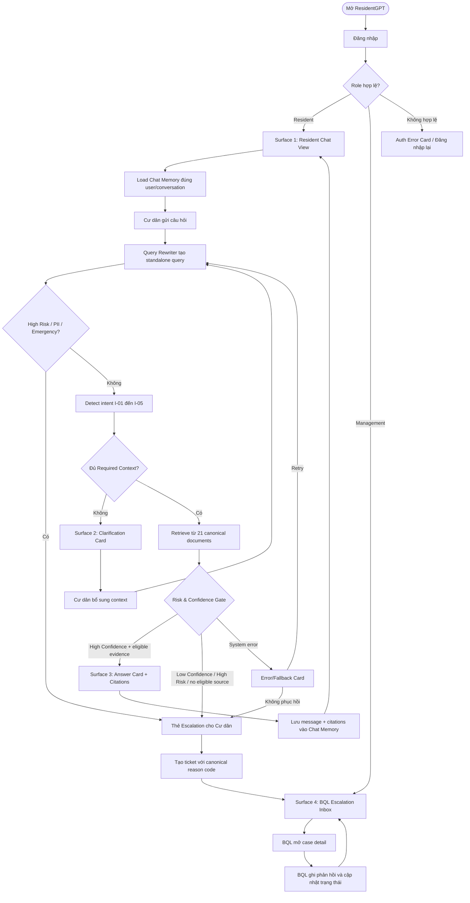

# UI Flow — ResidentGPT MVP v0.3

> **Status:** FROZEN FOR MVP v0.3 — Dual-role & Confidence Escalation Alignment
> **Freeze date:** 21/09/2026
> **Deadline:** 27/10/2026
> **Source of truth:** `docs/PRD_ResidentGPT_MVP.md`
> **Scope contract:** `knowledge_coverage_scope = VINHOMES_OCEAN_PARK`;
> `pilot_operator_scope = Cư dân Tòa S1.12, Cụm Sapphire 1 & Văn phòng BQL Tòa nhà (Tầng 1 S1.03, Hotline 1900 232 389 Nhánh 4) tại Vinhomes Ocean Park 1`.
> Knowledge coverage rộng hơn pilot operator scope không đồng nghĩa hỗ trợ multi-site.

Release UI phải được truy cập qua **Live URL** công khai và vượt qua health/smoke test trước nghiệm thu BTC.

Intent contract áp dụng xuyên suốt flow: `I-01` Thẻ cư dân/ra vào; `I-02` Phương tiện/thẻ xe; `I-03` Tiện ích chung; `I-04` Chuyển đồ/thi công; `I-05` Nội quy sinh hoạt.

## 1. UX Principles

- Cư dân bắt đầu từ chat, không phải từ quy trình nghiệp vụ nội bộ.
- Câu trả lời thành công luôn hiển thị citations dễ kiểm tra.
- Hỏi lại chỉ khi thiếu required context và chỉ hỏi field cần thiết.
- Low Confidence/High Risk không được che giấu bằng câu trả lời mơ hồ; phải tạo handoff rõ ràng.
- BQL nhận case trong một Inbox tập trung với lý do và context đủ xử lý.
- Loading, empty, unauthorized và error state đều có nội dung/action; không có màn hình trắng.
- Booking, payment và upsell không xuất hiện trong navigation hoặc CTA của MVP.

## 2. End-to-End Mermaid Flow

## 3. Resident Flow

### 3.1. Login and session

1. Cư dân đăng nhập.
2. Backend xác thực `role = resident` và route đến Resident Chat View.
3. App tải conversation list/history thuộc đúng tài khoản.
4. Unauthorized, expired session hoặc network error hiển thị Error Card với CTA đăng nhập lại/retry.

### 3.2. Multi-turn chat and rewrite

1. Cư dân nhập câu hỏi và chọn **Gửi**.
2. UI tạo optimistic message/loading state nhưng không hiển thị kết luận tạm.
3. Backend tải Chat Memory đúng conversation.
4. Query Rewriter biến câu hỏi phụ thuộc thành standalone query, giữ đúng entity/context và không thêm fact.
5. Rewritten query đi qua early risk gate, intent detection và Required Context check.

### 3.3. Clarification

1. Nếu thiếu field bắt buộc theo PRD §5.1, trả `clarification_required`.
2. Surface 2 nêu ngắn gọn thông tin còn thiếu; không hiển thị substantive answer/citation giả.
3. Cư dân bổ sung context trong cùng conversation.
4. Hệ thống rewrite/reprocess từ safety gate, không bỏ qua risk check.

### 3.4. High-confidence answer

1. Retrieval chỉ dùng eligible section thuộc Knowledge Pack `1.18`.
2. Similarity Score và Grader Node xác nhận Confidence cao.
3. Surface 3 hiển thị Answer Card và danh sách citation.
4. Mỗi citation hiển thị tối thiểu `document_id`, `section_id`; có thể mở metadata/snippet.
5. Message, rewritten query cần thiết và citations được lưu vào Chat Memory.
6. Golden terminal state: `answered`.

### 3.5. Low-confidence/high-risk escalation

1. Nếu Low Confidence, High Risk, no eligible source, source conflict, expired/unknown source hoặc lỗi không phục hồi, không sinh substantive answer.
2. Cư dân thấy Thẻ Escalation gồm giải thích ngắn, Hotline/Văn phòng BQL và xác nhận đã chuyển case.
3. Backend tạo ticket với exact canonical reason code, conversation/context cần thiết, intent nếu có, evidence đã thử và timestamps.
4. Ticket xuất hiện trong BQL Escalation Inbox.
5. Golden terminal state: `escalated` tại thời điểm handoff thành công.

## 4. BQL Flow

1. BQL/CSKH đăng nhập với `role = management`.
2. Backend route đến Surface 4 — Escalation Inbox; Resident route/API bị tách quyền phù hợp.
3. Inbox hiển thị case theo thời gian, trạng thái, intent, reason code và ưu tiên.
4. BQL lọc/search và mở case detail.
5. Case detail hiển thị transcript tối thiểu cần thiết, required context đã thu thập, risk/confidence outcome và evidence/citations đã thử nếu có.
6. BQL ghi phản hồi, chuyển `new` → `in_progress` → `responded`/`closed` theo workflow quản lý.
7. Mọi thao tác ghi actor và timestamp; lỗi lưu phản hồi giữ nội dung đã nhập và cho retry.

## 5. Four MVP UI Surfaces

### Surface 1 — Resident Chat View

**Purpose:** giao diện chat thân thiện, hỗ trợ hỏi nối tiếp.

**Required elements:**

- Conversation history/list đúng tài khoản.
- Message timeline và input composer.
- Loading indicator cho rewrite/retrieval/grading.
- Entry point rõ cho câu hỏi mới.
- Inline Error/Fallback Card; không màn hình trắng.

**States:** empty, ready, submitting, waiting, answered, clarification, escalated, recoverable error.

### Surface 2 — Clarification Card

**Purpose:** hỏi lại thông tin còn thiếu theo Required Context Contract.

**Required elements:**

- Giải thích ngắn vì sao cần thêm thông tin.
- Một hoặc nhiều field/question đúng contract, không yêu cầu PII dư thừa.
- CTA gửi context trong cùng conversation.
- Không hiển thị answer/citation như thể đã đủ context.

### Surface 3 — Answer Card with Citations

**Purpose:** hiển thị nội dung giải đáp grounded và nguồn quy định.

**Required elements:**

- Answer text.
- Citation chips/cards chứa `document_id` và `section_id`.
- Expandable source title/snippet/metadata nếu có.
- Nút tiếp tục hỏi trong cùng conversation.
- Nếu citation payload invalid, không render Answer Card như case thành công; chuyển safe fallback/escalation.

### Surface 4 — BQL Escalation Inbox

**Purpose:** danh sách và chi tiết câu hỏi cần BQL can thiệp.

**Required elements:**

- Inbox list: ticket ID, thời gian, intent, reason code, ưu tiên, trạng thái.
- Filter/search theo trạng thái, intent, reason code và thời gian.
- Case detail: transcript/context tối thiểu, confidence/risk outcome, evidence đã thử.
- Response composer và state transition.
- Empty/loading/error/unauthorized state có thông điệp và CTA; không màn hình trắng.

## 6. Cards and State Contracts

### 6.1. Escalation Card for Resident

- Tiêu đề: cần BQL hỗ trợ.
- Lý do user-facing, không lộ chain-of-thought hoặc score nội bộ chưa calibrated.
- Hotline và thông tin Văn phòng BQL lấy từ eligible directory source/config.
- Xác nhận case đã chuyển thành công hoặc nêu lỗi + retry nếu tạo ticket thất bại.
- Không hứa SLA/kết quả không có nguồn.

### 6.2. Error/Fallback Card

- Không hiển thị output trống.
- Nêu lỗi ở mức người dùng có thể hiểu, không lộ secret/stack trace.
- Cho retry; nếu lỗi kéo dài, cho escalation với `system_error`.
- Giữ message input hoặc response draft của BQL khi retry an toàn.

### 6.3. Citation Card

- Bắt buộc `document_id` và `section_id`.
- Không cho phép citation rỗng, section không tồn tại hoặc source ngoài 21 canonical documents.
- Citation phải gắn với claim hỗ trợ trực tiếp.

## 7. Confidence & Risk UX

- Không hiển thị fake confidence percentage.
- UI có thể dùng nhãn user-facing như “Đã tìm thấy căn cứ phù hợp” hoặc “Cần BQL kiểm tra thêm”.
- Internal log vẫn lưu similarity, grader outcome, threshold version và decision path.
- High Risk luôn ưu tiên hơn similarity cao.
- Missing required context ưu tiên Clarification khi có thể bổ sung an toàn; không dùng escalation thay thế tùy tiện.

## 8. Canonical Reason Codes in UI/Inbox

- `pii_or_account_specific`
- `legal_or_compensation_escalation`
- `unsupported_intent`
- `intent_unresolved`
- `no_eligible_source`
- `source_conflict`
- `source_expired_or_unknown`
- `system_error`
- `emergency_or_life_safety`
- `reviewer_rejected_draft`

Inbox dùng exact enum cho filter/audit; UI có thể ánh xạ sang nhãn tiếng Việt nhưng không tạo alias backend mới. `clarification_required` là state/event.

## 9. Responsive & Accessibility Minimum

- Resident Chat và cards đọc được trên mobile và desktop.
- Inbox ưu tiên desktop nhưng vẫn có layout tối thiểu trên màn hình hẹp.
- Keyboard focus, label, contrast và error message không phụ thuộc duy nhất vào màu.
- Loading có accessible status; citations có tên đọc được.

## 10. Failure Matrix

| Failure | Resident behavior | Management behavior | Terminal/state |
|---|---|---|---|
| Missing required context | Clarification Card | Chưa tạo ticket | `clarification_required` |
| Low Confidence | Escalation Card | Ticket mới trong Inbox | `escalated` |
| High Risk | Escalation Card/hướng dẫn khẩn nếu cần | Ticket có exact reason code | `escalated` |
| No eligible source/conflict/expired | Không substantive answer | Ticket có evidence outcome | `escalated` |
| Model/retrieval error tạm thời | Error Card + retry | Không tạo ticket nếu retry thành công | recoverable |
| Lỗi kéo dài hoặc ticket creation failure | Error Card, retry/handoff phù hợp | Log `system_error`; ticket khi persistence phục hồi | `escalated` khi handoff thành công |
| Unauthorized | Đăng nhập lại/403 Card | Đăng nhập lại/403 Card | non-terminal |
| Render error | Error boundary có CTA | Error boundary có CTA | non-terminal; không màn hình trắng |

## 11. E2E UI Acceptance

- **Answered:** `resident_submits_query` → `system_answers_with_citation`.
- **Clarification:** `resident_submits_query` → `system_requests_clarification` → `resident_provides_context` → `system_answers_with_citation`.
- **Escalation:** `resident_submits_query` → `system_detects_low_confidence_or_risk` → `system_escalates_to_bql`.
- **Retry:** `resident_submits_query` → `system_encounters_recoverable_error` → `resident_retries_query` → `system_answers_with_citation`.
- **Unresolved Escalation:** `resident_submits_query` → `system_requests_clarification` → `resident_provides_unhelpful_context` → `system_detects_low_confidence_or_risk` → `system_escalates_to_bql`.
- BQL login → Inbox list → case detail → response succeeds.
- Resident cannot access Inbox; Management authorization is enforced server-side.
- Fault injection for auth/retrieval/model/persistence/render never results in a blank page.

## 12. Not in MVP

- Booking/đặt lịch, payment và upsell.
- Voice/call-center integration.
- Auto-resolution of legal/dispute/compensation cases.
- CRM/routing phức tạp ngoài Escalation Inbox tối thiểu.
- Multi-site runtime ngoài OCP1 pilot.
