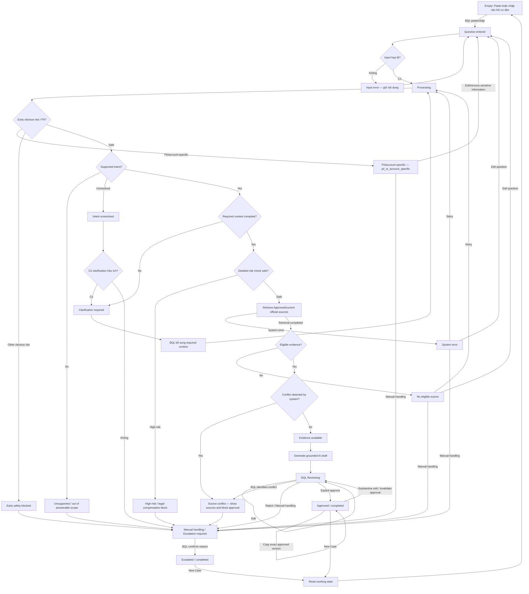

# UI Flow — ResidentGPT MVP: AI-assisted Drafting cho BQL/CSKH

Status: FROZEN FOR LOW-FI WIREFRAME v0.2 — consistency alignment amendment; không mở rộng feature scope.

Alignment log: `docs/MVP_CONSISTENCY_ALIGNMENT_v0.2.md`

> **Primary user:** Nhân viên BQL/CSKH. **Affected user:** Cư dân. Hotline/Zalo chỉ là channel origin; BQL/CSKH nhập hoặc paste câu hỏi vào UI. Mọi AI output là draft, cần BQL/CSKH review và explicit approval trước khi copy/use. MVP không auto-send.

> **Scope contract:** `knowledge_coverage_scope = VINHOMES_OCEAN_PARK`;
> `pilot_operator_scope = BQL/CSKH của một cụm/tòa được chọn tại Vinhomes
> Ocean Park 1`. UI phải hỏi đúng building/area/property context khi source
> có giới hạn phạm vi; MVP không hỗ trợ multi-site runtime.

> **Evaluation reference:** Knowledge Pack `1.18` và Golden Dataset `0.1` đã
> Frozen. Golden gồm 50 FAQ và 30 E2E cases, được phê duyệt cho MVP demo và
> offline evaluation ngày 19/09/2026.

## PM Decisions Applied

- Required-context contract dùng danh sách đã khóa trong PRD Mục 5.1 và
  `evals/golden/dataset_manifest.yaml`; field `when_relevant` là conditional.
- Reason code dùng duy nhất canonical enum trong PRD Mục 8/Golden manifest.
- Explicit Approve do BQL/CSKH operator hiện tại thực hiện; MVP ghi
  `operator_alias` hoặc `session_alias` và timestamp, không cần role model phức tạp.
- Retry limit không được chấm trong Golden revision `0.1`; Retry, Edit question
  và Manual handling vẫn là action bắt buộc ở failure surface.

## A. UI Flow Overview

### Nguyên tắc tương tác

- Tối ưu thao tác nhập/paste → review → approve → copy, nhưng không bỏ qua human control.
- Hiển thị intent, trạng thái an toàn và evidence ngắn gọn; không dùng confidence score chưa calibrated.
- Risk/fallback state phải khác rõ normal draft state bằng nhãn và action, không phụ thuộc visual styling cụ thể.
- Early obvious-risk/PII check diễn ra trước intent; detailed risk check diễn ra sau required context và trước retrieval.
- Nút **Copy response** chỉ khả dụng cho exact approved version; substantive edit sau Approval làm mất approval, khóa Copy và yêu cầu explicit re-approval.
- **Approved** và **Escalated/Manual handling** là business completion states. Copy chỉ là optional action/event và không quyết định completion hoặc handling-time end timestamp.
- Từ Approved hoặc Escalated, **New Case** reset toàn bộ working state về Empty; không carry query, intent, evidence, draft hoặc approval sang case mới.
- Required clarification chặn drafting; optional clarification không chặn nếu context hiện tại đã đủ để tạo câu trả lời đúng và grounded.
- Bồi thường, tranh chấp, xác định trách nhiệm/lỗi, xử phạt và diễn giải pháp lý là hard-block category: không tạo substantive answer draft, đề xuất chuyển BQL và log `legal_or_compensation_escalation`.

Không có path nào từ AI draft tới Copy mà bỏ qua `BQL review/edit → Explicit approve`. Copy chỉ áp dụng cho exact approved version; substantive edit luôn quay về Reviewing và bắt buộc re-approval.

## B. Detailed Flow Specification

### Flow A — Happy Path — MUST-HAVE

| Flow ID | Step | User Action | System Action | Decision | Next State |
|---|---:|---|---|---|---|
| A-01 | 1 | Mở màn hình xử lý case. | Hiển thị primary copy **“Paste hoặc nhập câu hỏi cư dân”**. Helper tùy chọn: “Có thể dán nội dung từ hotline/Zalo hoặc nhập thủ công.” | — | Empty |
| A-02 | 2 | Paste hoặc nhập câu hỏi cư dân. | Giữ nội dung để BQL kiểm tra trước khi submit. | Input có nội dung hợp lệ? | Question entered |
| A-03 | 3 | Chọn **Phân tích câu hỏi**. | Validate input; input invalid vẫn giữ nội dung và hiển thị lỗi. Input valid tạo case/timestamp và bắt đầu xử lý. | Input valid? | Question entered hoặc Processing |
| A-04 | 4 | Chờ kết quả. | Chạy early obvious-risk/PII check trước intent. | Bị block sớm? | Flow C hoặc tiếp tục A-05 |
| A-05 | 5 | Không cần thao tác. | Xác định supported intent; không hiển thị fake confidence percentage. | Supported, unresolved hay unsupported? | Intent detected, Flow F hoặc Flow C |
| A-06 | 6 | Không cần thao tác. | Kiểm tra required context. | Required context complete? | Tiếp tục hoặc Flow B |
| A-07 | 7 | Không cần thao tác. | Chạy detailed risk check sau khi đủ required context và trước retrieval. | High-risk? | Flow C hoặc tiếp tục |
| A-08 | 8 | Không cần thao tác. | Retrieve source có Status = Approved, current/effective, traceable và thuộc allowed official source list. | Retrieval thành công và có eligible evidence? | Evidence available hoặc Flow D |
| A-09 | 9 | Có thể mở evidence. | Kiểm tra source eligibility và conflict trước drafting; automatic semantic-conflict detection không cần hoàn hảo. | Conflict được system detect? | Flow E hoặc Evidence available |
| A-10 | 10 | Đọc AI draft và evidence. | Tạo grounded AI draft; hiển thị nhãn **AI draft — chưa được duyệt**, intent và lightweight source metadata. | — | Draft generated → Reviewing |
| A-11 | 11 | Review/edit hoặc kiểm tra evidence. | Lưu generated draft và edit; nếu BQL identify source conflict thì chuyển Flow E và block approval. | Approve, edit, reject/manual hay conflict? | A-12, Reviewing, Flow G hoặc Flow E |
| A-12 | 12 | Chọn **Approve**. | Yêu cầu explicit action; khóa exact approved version. Không auto-send. Ghi M2 end timestamp khi vào Approved. | Explicit approval có xảy ra? | Approved — business completion |
| A-13 | 13 | Có thể chọn **Copy response**. | Chỉ copy exact approved version; Copy là optional event, không đổi completion state hoặc M2 end timestamp. | Exact version vẫn Approved? | Approved |

### Flow B — Ambiguous / Missing Context — MUST-HAVE

| Flow ID | Step | User Action | System Action | Decision | Next State |
|---|---:|---|---|---|---|
| B-01 | 1 | Submit câu hỏi. | Xác định thông tin required theo intent/source bằng contract tại PRD Mục 5.1. Chỉ field liên quan đến claim/source selection mới blocking; field `when_relevant` là conditional. | Missing required context? | Clarification required; nếu đủ thì tiếp tục Flow A |
| B-02 | 2 | Xem yêu cầu làm rõ. | Với **required clarification**, nêu ngắn gọn dữ liệu còn thiếu và không tạo draft. | Required context thiếu? | Clarification required |
| B-03 | 3 | Hỏi cư dân ngoài MVP và nhập/paste required context bổ sung. | Không yêu cầu thêm PII/account-specific information; nếu input mới có obvious PII thì chạy Flow C trước khi tiếp tục. | Context đã đủ? | Processing hoặc Clarification required |
| B-04 | 4 | Chọn xử lý lại. | Reprocess từ early safety/PII check, rồi intent → context → detailed risk → source. | Có thể đi tiếp an toàn? | Flow A, C, D hoặc F |
| B-05 | 5 | Có thể bỏ qua hoặc bổ sung optional context. | Optional clarification chỉ là inline helper SHOULD-HAVE khi context hiện tại đã đủ; không tạo dedicated state/screen cho Wireframe v1. | Context required đã đủ? | Tiếp tục Flow A |

**Phân biệt:** `Clarification required` chặn draft và phải nêu thông tin thiếu; `Optional clarification` không chặn draft, là SHOULD-HAVE và chỉ được dùng khi rule theo intent/source đã được PM/BA xác định.

**Required-context reference:** I-01 dùng loại thẻ/yêu cầu/bất động sản và
unit type khi hạn mức liên quan; I-02 dùng card-or-service/địa điểm/hình thức
gửi/loại xe/khung giờ; I-03 dùng tiện ích/variant/tuổi hoặc chiều cao khi an
toàn liên quan; I-04 dùng chuyển đồ-or-thi công/property/building/work type và
ngày giờ khi lịch liên quan; I-05 dùng chủ đề/phạm vi bất động sản/general-or-
case-specific. Tên field kỹ thuật đầy đủ lấy từ PRD Mục 5.1 và Golden manifest.

### Flow C — Early Safety / PII / High-Risk / Unsupported — MUST-HAVE

| Flow ID | Step | User Action | System Action | Decision | Next State |
|---|---:|---|---|---|---|
| C-01 | 1 | Submit input hợp lệ. | Trước intent, chặn obvious personal/account-specific, identity verification, personalized fee/payment, access credential/security, emergency/life-safety và obvious dispute/complaint. Biểu phí công khai hoặc hướng dẫn thanh toán chung không bị early-block chỉ vì có nội dung tài chính. | Early block category? | Early safety blocked, PII/account-specific hoặc tiếp tục Flow A |
| C-02 | 2 | Đọc PII/account-specific warning. | Lưu event `pii_or_account_specific`; không tạo substantive personalized answer draft, không coi là normal FAQ, không yêu cầu thêm PII và không cố ý persist unnecessary raw PII. Hiển thị lựa chọn sửa/xóa sensitive information hoặc Manual handling. | Có thể loại bỏ sensitive information an toàn? | Question entered hoặc Escalation required |
| C-03 | 3 | Chọn **Edit/remove sensitive information** nếu phù hợp. | Quay lại input; lần submit tiếp theo reprocess từ early check và không carry risk clearance từ input cũ. | — | Question entered |
| C-04 | 4 | Hoặc chọn **Manual handling**. | Lưu escalation reason/state và ghi M2 end timestamp khi Escalated hợp lệ. | BQL xác nhận manual handling? | Escalated — business completion |
| C-05 | 5 | Không cần thao tác. | Unsupported intent sau intent check → không tạo substantive answer draft; yêu cầu Manual handling. | Intent unsupported? | Unsupported / out-of-answerable-scope → Escalation required |
| C-06 | 6 | Không cần thao tác. | Sau required context, chạy detailed risk check trước retrieval. Nếu câu hỏi liên quan bồi thường, tranh chấp, xác định trách nhiệm/lỗi, xử phạt hoặc diễn giải pháp lý: hard-block answer generation, không tạo substantive draft, hiển thị đề xuất chuyển BQL và gắn reason `legal_or_compensation_escalation`. | High-risk? | High-risk → Escalation required hoặc tiếp tục Flow A |
| C-07 | 7 | Chọn **Chuyển BQL / Manual handling** cho nhóm legal/compensation; chọn Manual handling cho early-risk, unsupported hoặc high-risk khác. | Lưu category/reason/state. Đích của nhóm legal/compensation được khóa là BQL; tuyến nội bộ sau khi BQL tiếp nhận không thuộc MVP. Không tích hợp ticketing. Ghi M2 end timestamp khi Escalated hợp lệ. | Reason hợp lệ đã được ghi? | Escalated — business completion |

Canonical reason cho Flow C: `pii_or_account_specific`,
`legal_or_compensation_escalation`, `unsupported_intent` hoặc
`emergency_or_life_safety` tùy category. Không dùng generic
reason code cho mọi loại high-risk.

Production PII redaction/retention/access policy vẫn là TBD trước real-user pilot; behavior MVP tại input đã được chốt như trên.

### Flow D — Error / No Source — MUST-HAVE

| Flow ID | Step | User Action | System Action | Decision | Next State |
|---|---:|---|---|---|---|
| D-01 | 1 | Submit câu hỏi đủ context. | Retrieval không có eligible Approved/current source → `no_eligible_source`; chỉ thấy Expired/Unknown hoặc không xác định được source current → `source_expired_or_unknown`; lỗi retrieval/model → `system_error`. | Loại failure nào? | No eligible source / Invalid source status / System error |
| D-02 | 2 | Đọc safe fallback. | Hiển thị lý do có thể hành động được; không tạo substantive answer draft và không giả vờ chắc chắn. | BQL chọn action nào? | Fallback state |
| D-03 | 3 | Chọn **Retry**. | Chạy lại Processing và log retry; retry policy/limit là **TBD**. | — | Processing |
| D-04 | 4 | Hoặc chọn **Edit question**. | Quay lại nội dung input, giữ case context phù hợp. | — | Question entered |
| D-05 | 5 | Hoặc chọn **Manual handling / Escalate**. | Lưu exact canonical reason code, chuyển Escalated và ghi M2 end timestamp. | Reason hợp lệ? | Escalated — business completion |

### Flow E — Source Conflict — MUST-HAVE, là nhánh của Flow D

| Flow ID | Step | User Action | System Action | Decision | Next State |
|---|---:|---|---|---|---|
| E-01 | 1 | Không cần thao tác hoặc BQL review evidence. | Nhận conflict do system detect **hoặc BQL identify trong evidence review**. Không yêu cầu automatic semantic-conflict detection phải hoàn hảo. | Conflict vẫn unresolved? | Source conflict |
| E-02 | 2 | Mở danh sách evidence. | Hiển thị các source và lightweight metadata; không tự chọn. Nếu trước draft thì block substantive draft; nếu đã có draft đang review thì block approval. | — | Source conflict |
| E-03 | 3 | Chọn **Manual handling / Escalate**. | Ghi `source_conflict`, reason/state và yêu cầu knowledge owner/BQL xử lý thủ công; destination cụ thể TBD. | — | Escalated — business completion |

### Flow F — Unresolved Intent — MUST-HAVE

| Flow ID | Step | User Action | System Action | Decision | Next State |
|---|---:|---|---|---|---|
| F-01 | 1 | Submit câu hỏi. | Không ép classification và không hiển thị fake confidence percentage. | Có clarification hữu ích? | F-02 hoặc F-04 |
| F-02 | 2 | Nếu có, xem câu hỏi làm rõ. | Nêu clarification hữu ích; không tạo draft. | — | Clarification required |
| F-03 | 3 | Edit/bổ sung context rồi xử lý lại. | Reprocess từ early safety/PII check. | Intent đã supported và rõ? | Processing |
| F-04 | 4 | Nếu không có clarification hữu ích, chọn **Manual handling**. | Log `intent_unresolved`, reason/state; không tạo draft. | — | Escalated — business completion |

Candidate intent list/manual-select presentation là **SHOULD-HAVE/TBD**, không block Wireframe v1 và không được hiển thị fake confidence percentage.

### Flow G — Draft Edit / Reject / Approval Invalidation — MUST-HAVE; regenerate NOT IN MVP

| Flow ID | Step | User Action | System Action | Decision | Next State |
|---|---:|---|---|---|---|
| G-01 | 1 | Đánh giá draft không phù hợp. | Giữ nhãn unapproved; Copy vẫn bị khóa. | BQL có thể sửa an toàn? | Reviewing |
| G-02 | 2 | Edit thủ công dựa trên evidence. | Lưu bản edit; edit không tự approve. | BQL chấp nhận bản edit? | Reviewing |
| G-03 | 3 | Chọn **Approve** bằng explicit action. | Khóa exact approved version và ghi M2 end timestamp. | — | Approved — business completion |
| G-04 | 4 | Hoặc Reject bằng action **Manual handling / Escalate**. | Lưu `reviewer_rejected_draft`; không cho copy draft chưa duyệt. | — | Escalated — business completion |
| G-05 | 5 | Từ Approved, thực hiện substantive edit. | Invalidate Approval ngay, chuyển Reviewing và disable Copy. | — | Reviewing |
| G-06 | 6 | Review lại và explicit re-approve. | Tạo exact approved version mới; chỉ version mới này được Copy. | — | Approved — business completion |

`Regenerate with instruction` không có trong PRD/Product Brief và không cần cho MVP đầu tiên; chỉ xem xét sau khi có evidence rằng manual edit không đủ.

### Flow H — Source Review — MUST-HAVE, lightweight

| Flow ID | Step | User Action | System Action | Decision | Next State |
|---|---:|---|---|---|---|
| H-01 | 1 | Chọn/expand source trên draft. | Chỉ hiển thị **Title, Snippet, Owner, Version, Effective dates, Status** và **Last updated nếu có**. | Source vẫn Approved/current? | Source review hoặc Flow D |
| H-02 | 2 | Đối chiếu claim với evidence. | Giữ draft và evidence cùng case; BQL có thể identify source conflict; không cần complex document viewer. | Evidence eligible/nhất quán? | Reviewing, Flow E hoặc Flow D |
| H-03 | 3 | Quay lại review. | Việc chỉ xem source không đổi review state. Source ineligible/conflict mới được identify trong evidence review sẽ block approval và chuyển Flow D/E. | — | Reviewing, Flow D hoặc Flow E |

### Flow I — New Case — MUST-HAVE

| Flow ID | Step | User Action | System Action | Decision | Next State |
|---|---:|---|---|---|---|
| I-01 | 1 | Từ Approved hoặc Escalated, chọn **New Case**. | Tạo điểm bắt đầu cho case mới; Copy không phải điều kiện để action này khả dụng. | Case hiện tại đã ở completion state? | Reset working state |
| I-02 | 2 | Không cần thao tác. | Reset query, context, intent, evidence, draft, review state, approval và safety/fallback state; không carry dữ liệu sang case mới. | Reset thành công? | Empty |

**Completion rule:** Business completion xảy ra khi case vào **Approved** hoặc **Escalated/Manual handling**. M2 end timestamp được ghi tại transition đó. Copy chỉ là optional action/event trên exact approved version.

## C. UI State Matrix

| State | What user sees | Primary action | Secondary action | System behavior | Draft allowed? | Approval allowed? |
|---|---|---|---|---|---|---|
| Empty | **Paste hoặc nhập câu hỏi cư dân**; helper hotline/Zalo là optional. | Nhập/paste câu hỏi | — | Chưa có working state của case mới. | No | No |
| Question entered | Nội dung có thể sửa; validation error nếu có; CTA phân tích. | Phân tích câu hỏi | Xóa/sửa | Validate input; input invalid vẫn giữ nội dung. | No | No |
| Processing | Loading/progress text ngắn; không hiển thị kết luận tạm. | — | Cancel: **TBD** | Chạy theo thứ tự early safety/PII → intent → required context → detailed risk → retrieval. | No | No |
| Early safety blocked | Category/reason của obvious risk; không có substantive answer draft. Với emergency/life-safety, hiển thị hướng dẫn chuyển xử lý ngay. | Manual handling / chuyển đầu mối khẩn cấp phù hợp | — | Chặn intent/retrieval/draft; yêu cầu exact canonical reason/state. | No | No |
| PII/account-specific | Cảnh báo identity verification/sensitive input; không yêu cầu thêm PII. | Edit/remove sensitive information | Manual handling | Không xử lý substantive content; log `pii_or_account_specific` mà không cố ý persist unnecessary raw PII. | No | No |
| Intent detected | Intent label thuộc 5 Provisional MVP Intents; không có fake confidence %. | — | — | Giữ intent trong case log; tự động tiếp tục required-context check. | No | No |
| Intent unresolved | Nhãn chưa xác định intent và clarification hữu ích nếu có; candidate list chỉ là SHOULD/TBD. | Clarify nếu hữu ích | Manual handling | Không ép intent; không hiển thị fake confidence percentage. | No | No |
| Clarification required | Required context còn thiếu và câu hỏi làm rõ. | Bổ sung required context | — | Chặn retrieval/draft; không yêu cầu thêm PII; reprocess từ early check. | No | No |
| Evidence available | Source cards/snippets và lightweight metadata. | Xem evidence | — | Eligibility đã pass; conflict vẫn có thể được BQL identify trước approval. | Yes — grounded generation may proceed | No |
| Draft generated | Nhãn **AI draft — chưa được duyệt**, draft, intent và evidence. | Review draft | Xem source | Không auto-approve; Copy bị khóa. | Existing AI draft only | No — review first |
| Reviewing | Editor, evidence và trạng thái chưa duyệt. | Edit hoặc explicit Approve | Manual handling / identify conflict | Lưu edit; approval chỉ cho exact current version nếu mọi safety/source check pass. | Existing/edit only | Yes — conditional on valid evidence and no unresolved risk/conflict |
| Approved | Exact approved version, `operator_alias`/`session_alias` và approval timestamp; completion rõ. | Copy exact approved version | Substantive edit / New Case | Copy là event. Substantive edit invalidate Approval → Reviewing, disable Copy và require re-approval. | Exact approved version only | Already approved; edit invalidates |
| Escalation required | Risk/failure reason; không có usable substantive answer draft. | Confirm Manual handling / Escalate | — | Chặn draft/approval/copy; yêu cầu valid reason. | No | No |
| Escalated / Manual handling | Completed state và reason/category. | New Case | Xem reason/log | Ghi M2 end timestamp; không cần Copy để complete. | No | No |
| Unsupported / out-of-answerable-scope | Unsupported label và giải thích ngắn. | Manual handling | — | Không tạo claim; log unsupported intent. | No | No |
| High-risk | High-risk category và lý do handoff. Nhóm legal/compensation hiển thị rõ AI không thể trả lời và đề xuất chuyển BQL. | Chuyển BQL / Manual handling | — | Không tạo substantive answer draft; nhóm legal/compensation log `legal_or_compensation_escalation`. | No | No |
| No eligible source | Không có relevant Approved/current source. | Retry | Edit question / Manual handling | Không dùng source không eligible, không đoán; log `no_eligible_source`. | No | No |
| Source expired/unknown | Chỉ có source Expired/Unknown hoặc không xác định được source current. | Retry | Edit question / Manual handling | Không dùng source; log `source_expired_or_unknown`. | No | No |
| Source conflict | Các source mâu thuẫn do system detect hoặc BQL identify trong evidence review. | Manual handling | Xem sources | Show sources; block substantive drafting/approval as applicable; log `source_conflict`. | No substantive draft | No |
| System error | Safe fallback có thể hành động; không có output trống. | Retry | Edit question / Manual handling | Retry → Processing; Edit → Question entered; log lỗi. | No | No |

Optional clarification là inline SHOULD-HAVE variant khi required context đã đủ; không phải lifecycle state hoặc dedicated screen bắt buộc trong Wireframe v1. `Copied` là event trên Approved, không phải lifecycle state.

## UI Surface Model

`System states ≠ screens.` Low-Fi Wireframe v1 chỉ cần biểu diễn bốn surface chính và các state variants cần thiết:

1. **Surface 1 — Workbench**
   - Empty
   - Question entered
   - Processing
   - Input error và Intent detected là variants trong Workbench, không phải màn hình riêng.
2. **Surface 2 — Needs Information**
   - Clarification required
   - Intent unresolved
   - Optional clarification, nếu có, chỉ là inline helper SHOULD-HAVE; không cần dedicated state/screen.
3. **Surface 3 — Draft Review**
   - Evidence available
   - Draft generated
   - Reviewing
   - Approved
   - Source review là expand/detail nhẹ trong surface này, không phải complex document viewer.
4. **Surface 4 — Manual Handling / Fallback**
   - High-risk / Early safety blocked
   - Emergency/life-safety handoff
   - Legal/compensation hard block với CTA **Chuyển BQL**
   - PII/account-specific
   - Unsupported
   - No eligible source
   - Source expired/unknown
   - Source conflict
   - System error
   - Escalation required và Escalated là action/completion variants trong cùng surface.

## D. MVP Flow Priority

### Must Have

- Bốn UI surfaces trong `UI Surface Model`; system states được biểu diễn bằng variants, không thành một screen cho mỗi state.
- Deterministic order: input validation → early safety/PII → intent → required context → detailed risk → retrieval.
- Required clarification; enough required context thì tiếp tục, missing required context thì Clarify và reprocess từ early check.
- Explicit PII/account-specific state với Edit/remove sensitive information hoặc Manual handling; không yêu cầu thêm PII.
- Unsupported, high-risk, no eligible evidence, expired/unknown evidence, source conflict và system error đều có actionable Manual handling/fallback path.
- No eligible source/Source expired-or-unknown/System error có đúng ba action: Retry → Processing; Edit question → Question entered; Manual handling → Escalated.
- Source eligibility trước draft; lightweight source review; conflict do system detect hoặc BQL identify đều block approval/substantive draft as appropriate.
- Grounded AI draft → Reviewing → explicit Approval; không auto-approve, không auto-send.
- Copy chỉ exact approved version; substantive edit invalidate Approval → Reviewing → Copy disabled → explicit re-approval.
- Approved và Escalated là completion states; M2 end timestamp tại hai state này; Copy không phải completion.
- New Case từ Approved/Escalated reset query, context, intent, evidence, draft, approval và safety state về Empty.
- Logging đủ cho query → intent/status → evidence → draft/edit → approval/escalation/fallback, event reason và timestamps theo PRD.
- Log `copy_attempted` cùng allowed/blocked và `draft_version`; Copy không đổi completion state hoặc M2 timestamp.

### Should Have

- Optional clarification dạng inline helper, không blocking và không có dedicated screen/state trong Wireframe v1.
- Candidate intent list/manual-select presentation cho Intent unresolved; rule là **TBD**, không block wireframe và không có fake confidence percentage.
- Lưu/hiển thị draft gốc và bản BQL đã edit để evaluation.
- Lightweight current-case event history nếu cần kiểm tra flow; không phải operations dashboard.

### Could Have

- Cancel processing nếu việc hỗ trợ an toàn và effort thấp; behavior khi cancel là TBD.
- Link mở full source bên ngoài UI nếu reference/link đã tồn tại và access phù hợp; không xây document viewer.

### Not in MVP

- Resident-facing chatbot; direct Zalo/hotline/telephony/transcription integration; omnichannel inbox.
- Auto-send, auto-approve hoặc autonomous response cho bất kỳ intent nào.
- CRM/ticketing integration; routing workflow phức tạp; dashboard production.
- Confidence percentage chưa calibrated.
- Regenerate draft bằng free-form instruction; complex document viewer; authentication/role model phức tạp.
- Dedicated `Copied` lifecycle screen/state; dedicated Optional clarification screen; một screen riêng cho mỗi system state.
- Perfect automatic semantic-conflict detection; flow vẫn phải hỗ trợ conflict do BQL identify trong evidence review.
- Production PII redaction/retention/access architecture.

## E. PM/UX Open Questions

Các TBD dưới đây không block Low-Fi Wireframe v1 và không thay đổi Product Decisions đã chốt:

1. Invalid input bao gồm những trường hợp nào ngoài empty/whitespace? Giới hạn độ dài là **TBD**.
2. Candidate intent list/manual-select nên hiển thị thế nào nếu được làm ở SHOULD-HAVE? Không dùng fake confidence percentage.
3. Source snippet cần dài đến mức nào; có cần link ra tài liệu gốc hay chỉ metadata/snippet?
4. Timeout và latency target là gì? Retry limit không được chấm trong Golden revision `0.1`; UI vẫn phải có Retry/Edit/Manual handling.
5. Demo nhận text gõ/paste; có cần trường nhập riêng cho context hay dùng một ô hội thoại?
6. Trước real-user pilot, production PII redaction/retention/access policy cụ thể là gì?

## Traceability — PRD to UI Behavior

| UI Flow / State | Product Requirement / Safety Rule |
|---|---|
| Input / Question entered | US-01; FR-01; operator workflow; hotline/Zalo là documentation-only channel origin boundary |
| Early Safety / PII | FR-09; NFR-05; AC-09; SR-08; safety/privacy boundary; event `pii_or_account_specific` |
| Intent detected / Intent unresolved | US-02; FR-02; SR-03; M3; event `intent_unresolved` |
| Clarification required | US-04; FR-03; AC-04–05; SR-02; Missing required context |
| Manual handling / Escalated | US-06–07; FR-08–09; AC-06, AC-08–10; SR-01, SR-03–06; high-risk / unsupported / no evidence |
| Approved/current source eligibility | US-03, US-08; FR-04, FR-06; NFR-03; grounding requirement |
| Evidence available / Source review | US-08; FR-06; AC-03; NFR-03; lightweight metadata only |
| Source conflict | AC-07; SR-05; system-detected hoặc BQL-identified conflict; event `source_conflict` |
| Draft generated / Reviewing | US-03, US-05; FR-05, FR-07; AC-01–02; AI-assisted drafting |
| Approval | US-05; FR-07; AC-02; SR-09; explicit human control; exact approved version |
| Approval invalidation | Exact-version approval invariant; substantive edit → Reviewing → Copy disabled → explicit re-approval |
| Completion / Copy | M2 end timestamp tại Approved hoặc valid Escalation; Copy là optional event, không phải lifecycle state |
| New Case | Operator workflow / efficiency; Approved hoặc Escalated → reset working state → Empty |
| System error | NFR-02; AC-11; SR-07; Safe fallback + Retry/Edit/Manual handling |
| Case logging | US-09; FR-10; NFR-06; AC-12; M1–M3 |

## Final Validation

1. **PASS — Core flow deterministic và không có dead-end ngoài completion.** Mọi decision có labeled outcome; Retry → Processing, Edit question → Question entered, Clarify → Reprocess, Manual handling → Escalated và New Case → Empty.
2. **PASS — Safety triage đúng thứ tự.** Input valid → early safety/PII → intent → required context → detailed risk → retrieval; không có path bypass safety gate.
3. **PASS — PII/account-specific behavior rõ.** Không tạo substantive personalized answer draft, không yêu cầu thêm PII; BQL chỉ Edit/remove sensitive information hoặc Manual handling; event `pii_or_account_specific` được log mà không cố ý persist unnecessary raw PII.
4. **PASS — Missing context và unresolved intent có outcome đúng.** Missing required context → Clarify; unresolved intent chỉ Clarify khi hữu ích, nếu không → Manual handling. Candidate list là SHOULD/TBD và không có fake confidence percentage.
5. **PASS — Source policy nhất quán.** Chỉ Approved/current eligible source được dùng; Draft/Deprecated/Expired/Unknown/no-current → không substantive draft và hiển thị safe fallback với Retry, Edit question hoặc Manual handling.
6. **PASS — Source conflict được xử lý an toàn.** Conflict do system detect hoặc BQL identify trong evidence review đều show sources, không tự chọn, block substantive draft/approval as appropriate và log `source_conflict`; không yêu cầu automatic detection hoàn hảo.
7. **PASS — Human control không có bypass.** Mọi substantive AI output là draft; không auto-approve, không auto-send; Copy chỉ khả dụng cho exact approved version.
8. **PASS — Approval invalidation deterministic.** Approved + substantive edit → Approval invalidated → Reviewing → Copy disabled → explicit re-approval required.
9. **PASS — Completion và Copy tách biệt.** Approved và Escalated/Manual handling là business completion states và M2 end timestamp; Copy là optional event, không bắt buộc để complete.
10. **PASS — New Case reset đầy đủ.** Từ Approved/Escalated, New Case xóa working query, context, intent, evidence, draft, safety state và approval trước khi về Empty.
11. **PASS — Error/fallback actionable.** No eligible source và System error đều có Retry, Edit question và Manual handling với transition rõ ràng.
12. **PASS — Wireframe readiness.** Bốn surface Workbench, Needs Information, Draft Review và Manual Handling/Fallback đã có CTA/state variants; `System states ≠ screens`; Optional clarification không cần dedicated Wireframe v1 screen.
13. **PASS — Scope control.** Không có resident chatbot, channel integration, auto-send/approve, CRM/ticketing, production dashboard, fake confidence score, regenerate workflow, complex viewer, production PII architecture hoặc autonomous agent behavior.
