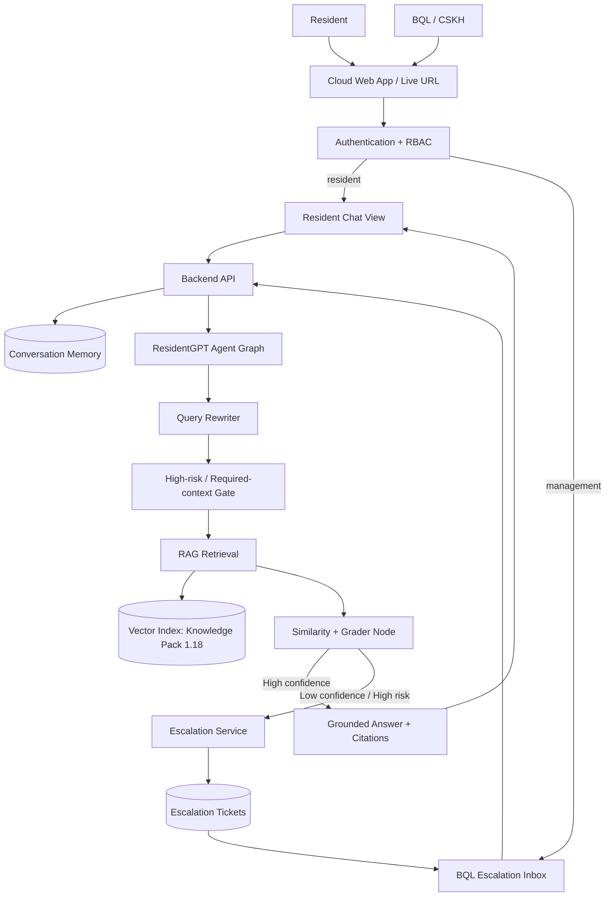
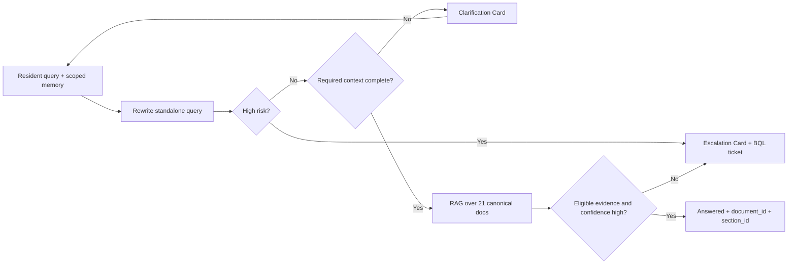

# ResidentGPT v0.3 — Architecture Diagram

> **LEGACY — không phải kiến trúc active.** Tài liệu này mô tả ResidentGPT (FAQ/RAG) trước MaintenanceOps MVP v0.3. Kiến trúc active nằm ở `docs/03_lean_prd.md`, `docs/data-contract-v1.md` và `src/maintenance/`. CSKH chỉ thuộc Deferred/Future Scope.

## System Overview

## Decision Flow

## Component Responsibilities

- **Cloud Web App:** dual-role UI, error boundary, responsive rendering and Live URL.
- **Authentication + RBAC:** server-side role enforcement for `resident` and `management`.
- **Conversation Memory:** isolated multi-turn history by user/conversation.
- **Query Rewriter:** converts follow-up turns into standalone retrieval queries without inventing facts.
- **RAG Retrieval:** searches only the 21 canonical documents in Knowledge Pack `1.18` and returns document/section identifiers.
- **Risk & Confidence Gate:** combines high-risk policy, source eligibility, similarity score and Grader Node.
- **Escalation Service:** shows the Resident handoff card and atomically creates the BQL Inbox ticket.
- **Persistence/Audit:** stores conversations, citations, decisions, terminal state, reason code and management response.

## Deployment Boundary

The web/API stack must be containerizable and expose a health endpoint. A release is not considered BTC-ready until the deployment artifact records the public Live URL, build/commit, deployment timestamp and smoke-test result. Booking, payment and upsell are not architecture components in MVP v0.3.
