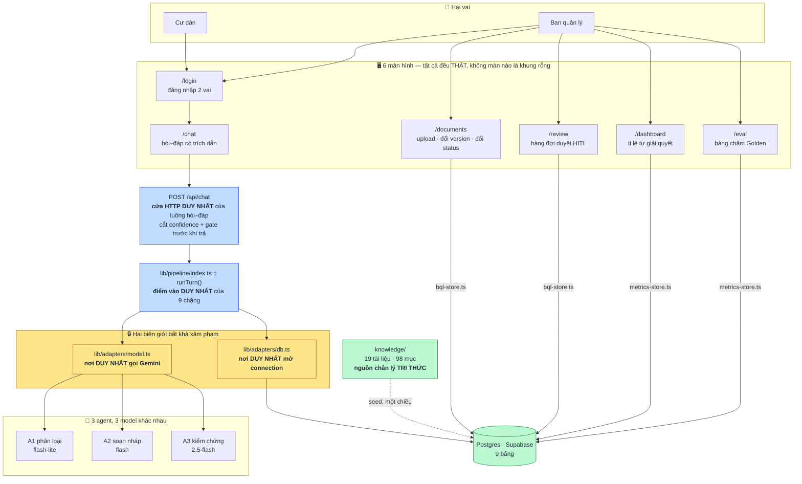
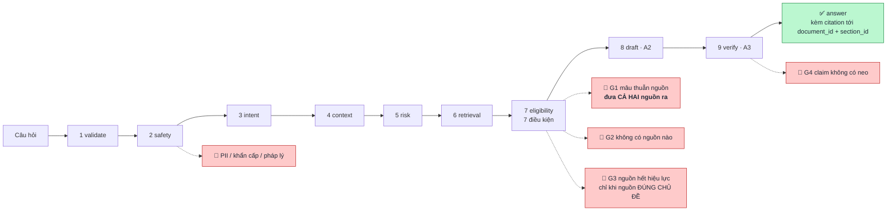
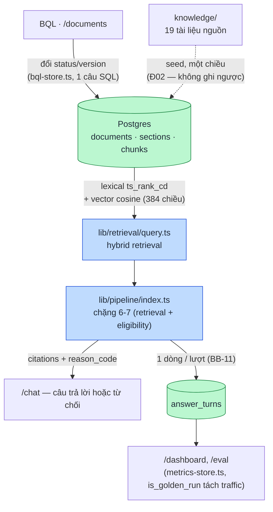

# Architecture Diagram

> Nguồn số liệu và ngữ cảnh đầy đủ: [`docs/OVERVIEW.md`](OVERVIEW.md) §2, §3, §5.
> Ba sơ đồ dưới đây lấy nguyên nội dung từ đó, tách riêng cho deliverable BTC.

## 1. System Overview — cái gì gọi cái gì

## 2. Agent Flow — một lượt hỏi đi qua 9 chặng, 5 lối thoát

Mỗi lối thoát nói một lý do khác nhau, không gộp chung "xin lỗi tôi không biết".

## 3. Data Flow — BQL sửa tài liệu → DB → retrieval

BQL đổi `status` một tài liệu ở `/documents` phải làm câu trả lời liên quan đổi
hành vi **ngay trong cùng phiên demo** (gạch rubric R7) — không có bước rebuild
hay cache tách rời giữa ghi và đọc.

## Component Details

| Component (file) | Vai trò |
| :-- | :-- |
| `app/(resident)/chat/` | Màn hỏi–đáp cư dân, hiển thị trích dẫn `document_id · section_id` |
| `app/(bql)/documents/` | BQL upload tài liệu mới, đổi version, đổi `status`/`effective_status`/`allowed_for_rag` |
| `app/(bql)/review/` | Hàng đợi HITL: `pending → approved \| edited_approved \| rejected` |
| `app/(bql)/dashboard/` | Tỉ lệ tự động giải quyết, tách theo intent và reason code |
| `app/(bql)/eval/` | Bảng eval Golden (faithfulness/relevance), nút chạy lại |
| `app/api/chat/route.ts` | Cửa HTTP DUY NHẤT của luồng hỏi–đáp — cắt confidence trước khi trả về client |
| `lib/pipeline/index.ts` | `runTurn()` — điểm vào DUY NHẤT của 9 chặng (validate → verify) |
| `lib/adapters/db.ts` | Nơi DUY NHẤT mở connection Postgres (BB-07) |
| `lib/adapters/model.ts` | Nơi DUY NHẤT gọi Gemini, đọc `GEMINI_API_KEY` (BB-07) |
| `lib/adapters/bql-store.ts` | Toàn bộ truy vấn của console BQL (documents + review) |
| `lib/adapters/metrics-store.ts` | Toàn bộ truy vấn dashboard + eval |
| `lib/eval/score.ts` | Bộ chấm Golden DUY NHẤT — dùng chung bởi `scripts/eval_golden.mjs` và `/bql/eval` (BB-06) |
| `knowledge/` | 19 tài liệu nguồn tri thức, nguồn chân lý TRI THỨC, 4 khuyết tật cài sẵn (DEF-01…04) |
| Postgres (Supabase) | 9 bảng: `documents`, `sections`, `chunks`, `users`, `conversations`, `messages`, `answer_turns`, `review_queue`, `schema_migrations` |

## Hai bất biến kiến trúc bắt buộc

### BB-05 — Confidence không bao giờ ra màn hình `[Đ07]`

Số confidence chỉ sống trong DB và log. UI chỉ hiển thị **lý do** (`reason_code`
→ câu tiếng Việt) và **trạng thái**, không hiển thị phần trăm hay thanh tiến độ
tin cậy. Canh bằng `scripts/check_no_confidence_ui.sh` — `grep -rniE
"confidence|độ tin cậy" app/ --include=*.tsx` không được khớp dòng nào trong
JSX hiển thị.

### BB-07 — Mọi lối ra ngoài đi qua adapter `[Đ11, Đ17]`

Không file nào ngoài `lib/adapters/**` được gọi tới nhà cung cấp model, đọc
khoá nhà cung cấp, `import` driver Postgres, hay `fetch` tới host ngoài.

| File | Độc quyền cái gì |
| :-- | :-- |
| `lib/adapters/model.ts` | Gọi `generativelanguage.googleapis.com` · đọc `GEMINI_API_KEY` |
| `lib/adapters/db.ts` | Mở connection Postgres |

Canh bằng `scripts/check_adapter_boundary.sh` — `violations: 0`. Lý do bất
biến này tồn tại không phải sở thích kiến trúc: Đ17 đã chứng minh bằng một lần
lật nhà cung cấp model thật (TokenRouter → Gemini) mà không đụng call site
nào ở tầng trên, chính vì mọi lời gọi đi qua đúng một file.
