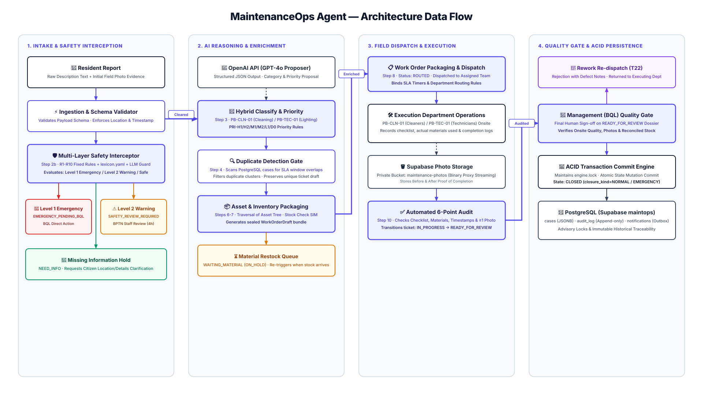

# MaintenanceOps — Target Components và Data Flow

> Giữ bố cục gốc của hai sơ đồ mục tiêu theo yêu cầu người dùng. Dữ liệu mô phỏng SIM. Spec nghiệp vụ đích: [CR-BPTN-03](CR-BPTN-03.md). Các ghi chú bên dưới đối chiếu code hiện có; hình mục tiêu không phải bằng chứng đã triển khai.

## 1. Components — sơ đồ mục tiêu, bố cục gốc

Các ghi chú sau mô tả code hiện có; sơ đồ giữ các thành phần mục tiêu như LangGraph/GPT-4o/Phoenix.


[Nguồn draw.io](diagrams/Diagrams%20Components.drawio) · [Mermaid](diagrams/Diagrams%20Components.mmd). SVG gốc có nguồn draw.io nhúng; file .drawio riêng được trích nguyên vẹn từ nguồn đó. Mermaid là bản đồng hành về ngữ nghĩa, không dùng để thay bố cục SVG.

- Web App gọi FastAPI; xác thực/phân quyền và kiểm tra schema ở backend. HTTPS cần hạ tầng TLS; localhost dùng HTTP.
- MaintenanceEngine chạy pipeline và các hành động người dùng; LangGraph mẫu trong src/agents chưa điều phối đường chạy này.
- Safety dùng R1–R10 và lexicon. Guard LLM có trong code nhưng build_engine không truyền safety_llm, kể cả khi LLM_MODE=openai.
- Phân loại dùng luật; LLM proposer chỉ bật với LLM_MODE=openai, model mặc định gpt-4o-mini, lỗi thì fallback về luật.
- CaseRepository mặc định memory; tuỳ chọn PostgreSQL schema maintops. Mỗi mutation giữ engine.lock và lưu case, audit, notifications nguyên tử. Không đợi CLOSED mới lưu.
- Ảnh đi qua backend: binary lưu local mặc định hoặc Supabase Storage tuỳ chọn; metadata nằm trong case. API có job retry/leo thang; session đăng nhập vẫn in-memory.

## 2. Data flow — sơ đồ mục tiêu, bố cục gốc

**Khác biệt cần lưu ý khi đọc hình:** code chạy safety 2b trước kiểm tra vị trí tối thiểu; có BPTN review bước 5; REWORK quay về phòng ban; repository lưu mutation trong suốt vòng đời. Những khác biệt này được ghi ở văn bản, không thay bố cục gốc.



[Nguồn và hướng dẫn](diagrams/maintenanceops-data-flow-20261019/README.md).

Thứ tự thực tế trong _run_pipeline: **2b an toàn → 2 dữ liệu tối thiểu → 3 phân loại/phòng ban/priority → 4 trùng → 5 BPTN review khi cần → 6 asset → 7 stock → 8 route**. Kiểm tra schema API trước engine khác với kiểm tra đủ vị trí ở bước 2.

- Bậc 1: status VERIFYING, blocker EMERGENCY_PENDING_BQL, chỉ BQL xử lý; đóng khẩn cấp/downgrade qua hành động riêng.
- Bậc 2: status VERIFYING, blocker SAFETY_REVIEW_REQUIRED, BPTN thẩm tra; leo thang 4 giờ. Confirm safe / request info / escalate rồi tiếp tục theo guard.
- MISSING_INFO thường do BPTN resolve; NEED_INFO trong ngữ cảnh an toàn yêu cầu cư dân bổ sung, leo thang 12 giờ. Resume không vượt quyền blocker BQL.
- Bước 5 có thể dừng ở PENDING_REVIEW; BPTN gỡ rồi tiếp tục bước 6. Thiếu vật tư: status ON_HOLD + blocker WAITING_MATERIAL; nhận vật tư/job chỉ chạy lại ca đủ điều kiện.
- ROUTED là đề xuất tuyến phòng ban, không gán cá nhân. Phòng ban nhận → IN_PROGRESS; nộp checklist, vật tư thực tế và ảnh qua backend; bước 10 kiểm hồ sơ → READY_FOR_REVIEW.
- BQL duyệt → CLOSED; REWORK → IN_PROGRESS về cùng phòng ban. Kho dữ liệu phục vụ toàn vòng đời, cả trước và sau nghiệm thu; notifications là outbox, không khẳng định đã gửi ra dịch vụ ngoài.

```mermaid
%% MaintenanceOps Agent — Architecture Data Flow Diagram
%% 4-Pillar Sequential Flow · Zero-Crossing Layout · Zero-Piercing Clean Architecture

flowchart LR
    %% THEME & CLASS STYLES
    classDef nodeStyle fill:#FFFFFF,stroke:#4F46E5,stroke-width:2px,color:#1E1B4B;
    classDef alertRed fill:#FEF2F2,stroke:#DC2626,stroke-width:2px,color:#991B1B;
    classDef alertAmber fill:#FFFBEB,stroke:#D97706,stroke-width:2px,color:#92400E;
    classDef alertGreen fill:#F0FDF4,stroke:#059669,stroke-width:2px,color:#064E3B;
    classDef alertPurple fill:#FAF5FF,stroke:#7C3AED,stroke-width:2px,color:#4C1D95;
    classDef storeStyle fill:#F8FAFC,stroke:#334155,stroke-width:2px,color:#1E293B;

    %% =========================================================================
    %% PILLAR 1: INTAKE & MULTI-LAYER SAFETY GATE
    %% =========================================================================
    subgraph P1 ["1. Intake & Safety Interception"]
        direction TB
        P1_RES["👤 <b>Resident Report</b><br/><i>Raw Payload & Initial Photos</i>"]:::nodeStyle
        P1_INGEST["⚡ <b>Ingestion & Validation</b><br/><i>Schema & Minimum Location Check</i>"]:::nodeStyle
        P1_SAFETY["🛡️ <b>Multi-Layer Safety Gate</b><br/><i>Step 2b · R1-R10 Rules + Lexicon + LLM Guard</i>"]:::nodeStyle

        subgraph P1_EXCEPTIONS ["Exception & Warning Queues"]
            direction LR
            P1_EM["🚨 <b>Level 1: Emergency</b><br/><i>EMERGENCY_PENDING_BQL</i>"]:::alertRed
            P1_WARN["⚠️ <b>Level 2: Warning</b><br/><i>SAFETY_REVIEW_REQUIRED</i>"]:::alertAmber
        end
        P1_INFO["🔄 <b>Missing Information Hold</b><br/><i>NEED_INFO (Citizen Clarification)</i>"]:::alertGreen

        P1_RES --> P1_INGEST
        P1_INGEST --> P1_SAFETY
        P1_SAFETY -->|🔴 Emergency| P1_EM
        P1_SAFETY -->|🟠 Warning| P1_WARN
        P1_SAFETY -->|🟡 Missing Info| P1_INFO
    end

    %% =========================================================================
    %% PILLAR 2: AI REASONING & ENRICHMENT
    %% =========================================================================
    subgraph P2 ["2. AI Reasoning & Enrichment"]
        direction TB
        P2_LLM["🧠 <b>OpenAI API (GPT-4o)</b><br/><i>Structured Proposal JSON</i>"]:::storeStyle
        P2_CLASSIFY["🤖 <b>Hybrid Classify & Priority</b><br/><i>PB-CLN-01 / PB-TEC-01 · PRI Rules</i>"]:::nodeStyle
        P2_DEDUP["🔍 <b>Duplicate Detection</b><br/><i>SLA Window Match against Cases DB</i>"]:::nodeStyle
        P2_ASSET["📦 <b>Asset & Inventory Check</b><br/><i>Asset Hierarchy & Stock Simulation</i>"]:::nodeStyle
        P2_STOCK["⏳ <b>Out-of-Stock Queue</b><br/><i>WAITING_MATERIAL (ON_HOLD)</i>"]:::alertAmber

        P2_LLM -.->|Structured Prompt / JSON| P2_CLASSIFY
        P2_CLASSIFY --> P2_DEDUP
        P2_DEDUP --> P2_ASSET
        P2_ASSET -->|Stock Shortage| P2_STOCK
    end

    %% =========================================================================
    %% PILLAR 3: FIELD DISPATCH & EXECUTION
    %% =========================================================================
    subgraph P3 ["3. Field Dispatch & Execution"]
        direction TB
        P3_DISPATCH["📋 <b>Work Order Packaging</b><br/><i>State: ROUTED · Assigned to Dept</i>"]:::nodeStyle
        P3_DEPT["🛠️ <b>Field Operations</b><br/><i>Technicians / Cleaners Execution</i>"]:::nodeStyle
        P3_STORAGE[("🪣 <b>Supabase Photo Storage</b><br/><i>Before & After Evidence Photos</i>")]:::storeStyle
        P3_AUDIT["✅ <b>Automated 6-Point Audit</b><br/><i>Evidence Check · READY_FOR_REVIEW</i>"]:::nodeStyle

        P3_DISPATCH --> P3_DEPT
        P3_DEPT -->|Upload Field Photos| P3_STORAGE
        P3_STORAGE -->|Verify Evidence| P3_AUDIT
    end

    %% =========================================================================
    %% PILLAR 4: QUALITY GATE & ACID PERSISTENCE
    %% =========================================================================
    subgraph P4 ["4. Quality Gate & Persistence"]
        direction TB
        P4_REWORK["🔧 <b>Rework Re-dispatch</b><br/><i>Defect Notice back to Dept</i>"]:::alertPurple
        P4_BQL["👔 <b>Management (BQL) Review</b><br/><i>Final Quality Sign-off</i>"]:::nodeStyle
        P4_COMMIT["💾 <b>ACID Commit Engine</b><br/><i>Atomic State Mutation Commit</i>"]:::nodeStyle
        P4_DB[("🐘 <b>PostgreSQL (maintops)</b><br/><i>cases · audit_log · notifications</i>")]:::storeStyle

        P4_BQL -->|❌ Reject / Defect| P4_REWORK
        P4_BQL -->|✅ Approve (CLOSED)| P4_COMMIT
        P4_COMMIT -->|Persist State| P4_DB
    end

    %% =========================================================================
    %% PURE HORIZONTAL BRIDGES BETWEEN PILLARS (ZERO CROSSING)
    %% =========================================================================
    P1_SAFETY ==>|🟢 Cleared Payload| P2_CLASSIFY
    P2_ASSET ==>|Enriched WorkOrderDraft| P3_DISPATCH
    P3_AUDIT ==>|Verified Audit Dossier| P4_BQL
```

## 3. Hiện có và mục tiêu

Hiện có: FastAPI, engine Python, luật + LLM proposer tuỳ chọn, repository memory/PostgreSQL và ảnh local/Supabase. **LangGraph và Phoenix chưa tích hợp vào pipeline; GPT-4o là model mục tiêu 19/10.** Không coi package đã cài hoặc sơ đồ mục tiêu là bằng chứng tính năng đang chạy.

## 4. Đồng bộ và kiểm tra

SVG/draw.io giữ nguyên bản gốc, không tự thay bố cục. Components Mermaid được suy ra từ nguồn draw.io nhúng; data flow SVG/draw.io/Mermaid được phục hồi cùng bộ backup. Khi cần chỉnh nội dung, giữ geometry và đối chiếu các ghi chú hiện trạng. Bằng chứng phục hồi là hash với backup, không phải phép đo render/runtime mới.

## 5. Ghi chú bản tích hợp develop 37a0fb3

Bố cục hai hình vẫn giữ nguyên. Code mới yêu cầu ảnh/ghi chú mới cho mỗi vòng REWORK; giữ quyền BQL sau leo thang; receive tính trước proposal phân loại ngoài engine.lock; job có thể phục hồi RECEIVED không blocker quá 2 phút. Những thay đổi này được giải thích bằng văn bản, không dùng để vẽ lại hình mục tiêu.
