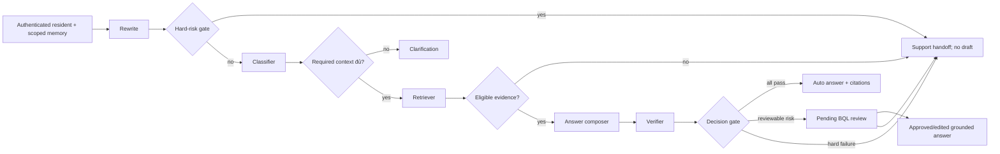

# ResidentGPT v0.4 — kiến trúc và hợp đồng giữa các agent

> **Loại tài liệu:** thiết kế cần triển khai. Code hiện tại ở `src/agents/graph.py` chỉ có `analyze`/`respond` mẫu, `src/agents/tools/example_tool.py` chưa tìm kiếm knowledge thật; các contract dưới đây chưa phải API hiện hành.
> **Nguồn yêu cầu:** [PRD v0.4](PRD_ResidentGPT_v0.4.md). [MVP PRD §5.1, §8](../PRD_ResidentGPT_MVP.md) giữ quyền quyết định với hard risk và required context.

## 1. Ranh giới trách nhiệm



- **Coordinator** là state machine có nhánh rõ; nó gọi từng component và quyết định dừng. Ba specialist là classifier, retriever và verifier. Composer tạo draft dựa trên evidence, không được truy cập corpus hoặc gửi thẳng tới resident. Không cho agent tự gửi message, publish tài liệu hay tạo vòng gọi lẫn nhau.
- **Hard-risk gate** chạy trước retrieval/generation. Trường hợp emergency, PII/account-specific, pháp lý/bồi thường/tranh chấp theo baseline không tạo substantive draft. Handoff có canonical reason code và Resident Escalation Card.
- **Classifier** nhận rewritten query, context đã được scope, kết quả early risk. Nó xuất intent thuộc `I-01`…`I-05` hoặc unresolved/unsupported, required-context fields áp dụng và căn cứ quyết định. Không invent field ngoài PRD v0.3 §5.1.
- **Retriever** dùng rewritten query và thuộc tính scope để lấy section đủ điều kiện trong active source snapshot. Nó trả evidence có nguồn/version/locator; nó không quyết định câu trả lời cuối.
- **Verifier** kiểm từng claim của draft, citation, scope, phiên bản, hiệu lực, conflict, và trả verdict có cấu trúc. Nó không tự sửa facts hoặc override hard-risk gate.
- **Decision gate** chỉ auto-send sau khi tất cả điều kiện cùng đạt: required context đủ, no hard risk, evidence eligible, mỗi factual claim supported, citations valid, không conflict, confidence vượt ngưỡng đã hiệu chỉnh. Thiếu ngưỡng cấu hình hoặc verifier lỗi → giữ an toàn, không auto-send.

## 2. State machine và terminal mapping

| State v0.4 | Khi vào state | Tiếp theo |
|---|---|---|
| `query_submitted` | Có `case_id`, `request_id`, user/conversation scope | rewrite + hard-risk gate |
| `clarification_required` | Thiếu required field an toàn có thể hỏi | chờ resident; reprocess từ hard-risk gate |
| `retrieving` | Đủ context và không hard risk | draft hoặc handoff |
| `draft_pending_verification` | Có evidence và draft | verifier |
| `pending_review` | Có draft dựa trên evidence nhưng chưa đạt gate tự gửi | BQL approve/edit/reject/needs_more_info |
| `answered` | Đã gửi final response có citation | terminal của lượt; `answer_delivery_mode = auto/human_assisted` |
| `escalated` | Support handoff đã được ghi thành công | terminal của lượt; canonical `reason_code` bắt buộc |
| `recoverable_error` | Có retry an toàn và giới hạn | retry hoặc handoff |

`answered` và `escalated` giữ tên terminal business của Golden v0.3; `pending_review` và `clarification_required` là state trung gian. Golden v0.3 được đánh giá trên build/config v0.3 và snapshot `1.18` đã ghi version; nếu chạy trên v0.4, chỉ so sánh các invariant chung và báo rõ terminal behavior đã đổi ở low confidence. Không đánh dấu một request `answered` khi mới có draft hoặc BQL chưa quyết định.

## 3. Contract dữ liệu đề xuất

Các field dưới đây là contract mục tiêu cho coding agents. Tên field dùng thống nhất trong UI, API, event và metric; kiểu `?` có thể null. Dùng UUID/ULID hoặc identifier ổn định, không dùng raw resident PII làm ID.

```text
RequestContext {
  request_id: string; case_id: string; conversation_id: string;
  resident_alias: string; role: "resident";
  raw_query: string; rewritten_query: string?;
  prior_context: object; property_scope: string; area_scope: string?;
  source_snapshot_id: string?; created_at: ISO-8601 UTC;
}

ClassificationResult {
  intent_id: "I-01"|"I-02"|"I-03"|"I-04"|"I-05"|null;
  intent_status: "resolved"|"unresolved"|"unsupported";
  required_context: object; missing_required_fields: string[];
  confidence_value: number?; confidence_method_version: string?;
  decision_reason: string; risk_flags: string[];
}

EvidenceItem {
  evidence_id: string; document_id: string; source_version_id: string;
  section_id: string; locator: string; snippet: string;
  property_scope: string; area_scope: string?;
  approval_status: "approved"; publication_status: "published";
  effective_status: "current"; allowed_for_rag: true;
  retrieval_score: number?; source_snapshot_id: string;
}

CitationRef {
  document_id: string; source_version_id: string;
  section_id: string; locator: string; title: string;
}

DraftAnswer {
  draft_id: string; case_id: string; answer_text: string;
  citations: CitationRef[]; evidence_ids: string[];
  model_version: string; prompt_version: string; created_at: ISO-8601 UTC;
}

VerifierResult {
  draft_id: string;
  claim_verdicts: [{claim_text, evidence_ids: string[],
                    verdict: "supported"|"unsupported"|"contradicted",
                    explanation_code: string}];
  citation_valid: boolean; source_conflict: boolean;
  risk_triggers: string[]; verifier_version: string;
  decision: "send"|"clarify"|"hold_for_review"|"handoff";
}

ResidentOutcome {
  request_id: string; case_id: string; conversation_id: string;
  state: "clarification_required"|"pending_review"|"answered"|"escalated"|"recoverable_error";
  answer_text: string?; citations: CitationRef[];
  answer_delivery_mode: "auto"|"human_assisted"|null;
  reason_code: string?; risk_triggers: string[];
  review_task_id: string?; support_handoff_id: string?;
  created_at: ISO-8601 UTC;
}
```

`confidence_value` chỉ có ý nghĩa cùng `confidence_method_version`; không hiển thị phần trăm cho Resident. `risk_triggers` là taxonomy nội bộ; `reason_code` dùng đúng mười giá trị frozen khi support handoff. `EvidenceItem` của baseline có approval/effective metadata từ manifest `1.18`; runtime evidence chỉ vào active snapshot sau workflow ở [quản trị tài liệu](KNOWLEDGE_GOVERNANCE_AND_HITL.md). `section_id` của tài liệu upload phải được tạo/xác nhận trước publish; locator là trang/heading/ảnh để BQL truy vết.
`EvidenceItem` gồm snippet/score cho xử lý nội bộ; API Resident chỉ trả `CitationRef` đã lọc, không lộ retrieval score hoặc verifier rationale.

## 4. Eligibility và snapshot

1. Filter theo `property_scope`, `area_scope`, `audience`, effective date, `allowed_for_rag`, trạng thái approved/current/published và section exclusions của `intent_source_map.yaml` khi áp dụng.
2. Gán `source_snapshot_id` bất biến cho một lần trả lời; trace lưu evidence IDs và source versions. Eval faithfulness dùng chính snapshot này, không tìm lại trên index mới.
3. Baseline `1.18` là namespace immutable cho golden v0.3. Runtime v0.4 là namespace/version riêng. Khi BQL publish bản thay thế, coordinator chỉ nhìn active snapshot sau swap thành công; không trộn phiên bản cũ và mới cho cùng rule/scope.
4. Nếu hai active sources mâu thuẫn, retriever/verifier phát `source_conflict`; không tự chọn theo retrieval score hoặc ngày upload. BQL phải giải quyết supersession/scope/effective metadata.

## 5. API và event contract mục tiêu

Đây là interface để các team thống nhất, **chưa tồn tại trong code hiện tại**. Các route dưới `/api/v1` là đề xuất; backend owner được đổi đường dẫn nếu giữ nguyên semantics và cập nhật toàn bộ tài liệu.

| Interface | Quyền | Request/response hoặc event tối thiểu |
|---|---|---|
| `POST /chat` | resident | query, conversation_id, optional case_id → `ResidentOutcome` và request_id; server xác nhận ownership |
| `POST /cases/{id}/feedback` | resident owner | `resolved=yes/no`, timestamp; chỉ case của mình |
| `GET /bql/reviews`, `POST /bql/reviews/{id}/decision` | management + `review_answer` | pending tasks; approve/edit/reject/needs_more_info; expected version/idempotency key |
| `POST /bql/documents`, `GET /bql/documents/{id}/preview` | management + `upload_document` | file/metadata → staged version, parse state, extracted sections/warnings |
| `POST /bql/documents/{id}/approve`, `.../publish`, `.../withdraw` | management + `approve_document` | actor, expected version, decision reason, new snapshot ID |
| `GET /bql/dashboard` | management | timezone, from/to, numerator, denominator, n, cohort maturity, status counts |
| `GET /bql/eval-runs/{id}` | management | dataset/run/version, metric details, annotation evidence |

Event tối thiểu: `case_created`, `clarification_requested`, `evidence_retrieved`, `draft_created`, `verification_completed`, `review_requested`, `review_decided`, `answer_sent`, `support_handoff_requested`, `support_handoff_accepted`, `feedback_recorded`, `case_reopened`, `document_approved`, `document_published`, `document_withdrawn`. Mỗi event có `event_id`, `case_id?`, `request_id?`, `actor_id_or_system`, `occurred_at_utc`, `schema_version`, idempotency key và payload tối thiểu. Analytics chỉ đọc event đã persist thành công.

## 6. Timeout, retry và bảo mật dữ liệu

- Coordinator đặt timeout cho model/retrieval/parser. Một dependency có thể retry tối đa một lần khi lỗi tạm thời và request có idempotency key; retry không tạo trùng answer, review task, ticket hoặc document version. Sau đó fallback/handoff.
- DB/outbox hoặc giao dịch tương đương phải bảo đảm trạng thái Resident và BQL không lệch: không xác nhận “đã chuyển” nếu ticket chưa lưu. Publish index dùng active snapshot swap chỉ sau khi index/smoke thành công.
- Trace giữ ID, verdict, version, score cần audit; tối thiểu hóa transcript và redaction PII. Không trả internal reasoning/`analysis` field của template API ra client. Current `src/models/schemas.py` và `src/api/routes.py` còn field `analysis`; đây là gap cần sửa khi coding, không phải khả năng đã đạt.
- Các field audit trong PRD v0.3 (`request_id`, `conversation_id`, `role`, `intent_id`, `reason_code`, `confidence_decision`, `citations`) vẫn được log theo applicability. `reason_code` null khi answer/clarification không có handoff; không tạo mã giả để lấp chỗ trống.

## 7. Kiểm thử hợp đồng cần có khi triển khai

Tối thiểu kiểm: hard risk không gọi composer; thiếu context không gọi retriever; chỉ version active/approved được thấy; claim unsupported không auto-send; conflict không chọn nguồn ngẫu nhiên; retry không nhân đôi case/ticket; cross-role/cross-resident 403; exact citation trỏ đúng section và version; không rò `analysis` hoặc PII. Đây là tiêu chí triển khai trong [backlog](DELIVERY_BACKLOG.md), chưa phải kết quả test.
