# ResidentGPT v0.4 — quản trị tài liệu BQL và duyệt câu trả lời

> **Trạng thái:** workflow mục tiêu cho demo; xem [PRD v0.4](PRD_ResidentGPT_v0.4.md) và [UI Flow](UI_FLOW.md).
> **Invariant:** Knowledge Pack `1.18` và Golden `0.3` là snapshot đóng băng. Upload runtime không ghi vào `knowledge/canonical` hay sửa manifest frozen.

## 1. Các đối tượng dữ liệu

- `logical_document_id`: định danh chính sách/tài liệu qua nhiều bản cập nhật; khác với `source_version_id` duy nhất của mỗi file/version. Giữ `document_id` và `section_id` để citation tương thích baseline.
- `DocumentVersion`: file gốc, hash, MIME thực, người upload, thời điểm, property/area/audience, owner, effective dates, `supersedes`, trạng thái workflow, đường dẫn OCR/parse preview, section map, các đoạn loại khỏi RAG và audit. Không dùng filename làm ID duy nhất.
- `ActiveSourceSnapshot`: tập version được phép truy xuất ở một thời điểm. Baseline `1.18` và runtime published versions có namespace riêng; một rule/scope chỉ thấy version active đã resolve supersession.
- `ReviewTask`: một draft hoặc case cần BQL quyết định, kèm evidence snapshot và risk triggers. `SupportHandoff`: yêu cầu nhân viên xử lý vụ việc, có canonical reason code; hai đối tượng có thể liên hệ qua `case_id` nhưng không đồng nghĩa.

## 2. Format và ingestion

| Nhóm | Định dạng demo | Điều kiện preview/trace |
|---|---|---|
| Text | `.md`, `.txt` | Encoding hợp lệ, heading/section hoặc line locator |
| Văn bản | `.docx` | Extract paragraph/table theo thứ tự đọc, heading/page locator nếu parser cung cấp |
| PDF | `.pdf` text hoặc scan | Text extraction, OCR với trang không có text; page number bắt buộc |
| Ảnh | `.png`, `.jpg`, `.jpeg` | OCR; filename + image/page locator; BQL xác nhận text |

Validate extension, MIME/content signature, kích thước và page count theo cấu hình O-02. Tệp sai định dạng, password-protected, không đọc được hoặc không có text được đánh dấu `parse_failed` với lý do; không cho publish. OCR rỗng, ký tự lỗi, bảng phí khó đọc, số liệu quan trọng khó chắc chắn hoặc chất lượng thấp → `needs_review`, cảnh báo nổi bật và BQL sửa/xác nhận bản trích xuất. Không dùng OCR confidence đơn lẻ để tự cho phép nội dung policy vào RAG.

## 3. Lifecycle version

```mermaid
stateDiagram-v2
    [*] --> uploaded
    uploaded --> parsing
    parsing --> parse_failed
    parsing --> needs_review
    parse_failed --> parsing: retry new attempt
    needs_review --> rejected
    needs_review --> approved: BQL validates text + metadata
    approved --> publishing: build index + smoke
    publishing --> published: atomic snapshot swap
    publishing --> approved: failure; old snapshot stays active
    published --> superseded: replacement published
    published --> withdrawn: BQL withdraws
    superseded --> published: approved rollback/version selection
    withdrawn --> published: explicit re-approval + publish
```

`approved` là quyết định nội dung; `published` là trạng thái đã vào active index. Retrieval yêu cầu **đồng thời** approved, published, current effective date, đúng property/area/audience, `allowed_for_rag` và section không bị loại. Version `uploaded`, `parsing`, `needs_review`, `parse_failed`, `rejected`, `superseded`, `withdrawn` không xuất hiện trong câu trả lời mới.

Khi cập nhật: tạo version mới và giữ file cũ để audit; BQL xem diff text/metadata và chọn `supersedes`. Trước publish, so sánh với active version/scope và flag nội dung xung đột. BQL giải quyết conflict bằng sửa nội dung, thu hẹp scope, effective dates hoặc supersede có lý do; không để hai rule active đối nghịch. Publish dựng index mới, kiểm tra một truy vấn smoke có citation/section, rồi swap active snapshot. Lỗi index giữ snapshot trước đó; UI cho retry. Withdraw/rollback tạo audit event và snapshot mới, không xóa lịch sử.

Section ID của runtime version phải ổn định trong version đó. Citation tối thiểu gồm `document_id`, `source_version_id`, `section_id`, `locator`; với PDF locator có page, với ảnh có filename/region hoặc trang khi có. Nếu không thể truy vết đoạn nguồn, version không được publish.

## 4. Preview và quyền BQL

Preview hiển thị file gốc, text đã extract/OCR cạnh nhau, cảnh báo trang/đoạn kém chất lượng, section ID, metadata, effective dates, property/area/audience, các phần không được đưa vào RAG và kết quả so sánh version. BQL có thể sửa text chuẩn hóa hoặc từ chối. Mọi sửa đổi và phê duyệt lưu before/after, actor, thời điểm, reason và version.

Server kiểm tra permission `upload_document` khi upload, `approve_document` khi duyệt/publish/withdraw và `view_audit` khi xem lịch sử. Cư dân không gọi được các API này. Quy tắc một người tự duyệt file mình upload là O-03; cho đến khi chốt, demo không tuyên bố đáp ứng separation of duties. Không đưa tài liệu chứa PII cư dân, OTP, credential hoặc chứng từ cá nhân vào index; BQL phải loại/redact trước khi approve.

## 5. HITL câu trả lời và support handoff

| Tình huống | Có draft factual? | BQL thấy gì | Kết quả được phép |
|---|---|---|---|
| Đủ evidence, verifier PASS, confidence đã hiệu chỉnh đạt | Có | Audit sau khi gửi | `answered` + `auto` |
| Evidence phù hợp nhưng confidence thấp | Có thể có | Draft, evidence, score/version, trigger | Approve/edit có evidence → `answered` + `human_assisted`; reject → handoff |
| Draft có claim/citation verifier không hỗ trợ | Có, nhưng giữ kín | Claim verdict và nguồn cụ thể | Sửa và verifier lại; không approve nguyên factual claim vô căn cứ |
| Không có eligible source hoặc source conflict/expired | Không có substantive draft | Context, nguồn đã thử, canonical reason code | BQL bổ sung/publish nguồn hợp lệ rồi tạo answer mới, hoặc support handoff |
| Emergency, PII/account-specific, legal/compensation | Không | Support case và hướng xử lý an toàn | Handoff ngay; không đưa draft qua answer-review |

Review task có state `draft`, `pending_review`, `approved`, `edited_and_approved`, `rejected`, `needs_more_info`; lưu `draft_id`, `case_id`, risk triggers, evidence snapshot, actor, timestamps, comment và final answer. Case không có eligible source đi thẳng vào Support Inbox, không tạo answer draft để duyệt. `approve` chỉ cho phép gửi nếu final text qua verifier/citation check trên active source snapshot; nếu BQL dùng kiến thức ngoài corpus, đó là phản hồi thủ công trong support case và không được gắn nhãn AI-grounded. Review pending không gửi factual draft cho cư dân. Nếu review quá hạn, Resident nhận trạng thái đang chờ BQL và tùy SLA chốt ở O-04 sẽ được tạo support handoff; không tự phát hành draft.

`answer_review_status` và `support_handoff_status` phải là hai trường riêng. Handoff được tính từ `support_handoff_requested` (reason code, time, queue/owner, trạng thái `requested` → `accepted` → `in_progress` → `resolved`/`closed`). Một task BQL approve mà không sửa vẫn là human-assisted cho metric. Trạng thái `pending_review` không tự trở thành `answered` khi worker/reviewer thất bại.

## 6. Tiêu chí nghiệm thu workflow

1. Upload một file cho từng nhóm format, preview có locator và metadata; ảnh/PDF scan có OCR và cảnh báo khi chất lượng không chắc chắn.
2. Trước publish, truy vấn không thấy nội dung mới; sau publish/smoke thành công, thấy đúng version và citation. Không có cửa sổ retrieval dùng version đã rút hoặc version mới chưa active.
3. Cập nhật một rule, supersede và rollback, query cùng scope cho version đúng; audit có actor/time/reason.
4. Draft rủi ro không lộ trước review. BQL edit+approve qua verifier hoặc reject và chuyển hỗ trợ; Resident chỉ thấy final hoặc trạng thái chờ/handoff.
5. Resident bị 403 trên endpoint quản trị; retry và double click không tạo trùng version, review decision hay handoff.
