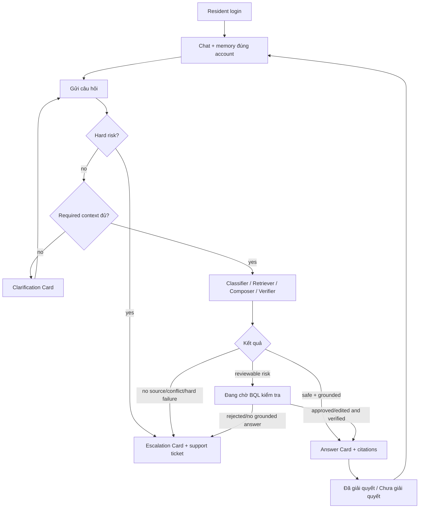

# ResidentGPT v0.4 — UI Flow cư dân và BQL

> **Trạng thái:** thiết kế mục tiêu, chưa phải UI đã chạy. Kế thừa [UI Flow MVP v0.3](../UI_Flow_ResidentGPT_MVP.md); yêu cầu mới theo [PRD v0.4](PRD_ResidentGPT_v0.4.md).

## 1. Nguyên tắc hiển thị

- Resident chỉ thấy final answer đã đủ điều kiện gửi, clarification, trạng thái BQL đang kiểm tra, hoặc support handoff. Draft, điểm confidence nội bộ, chain-of-thought và OCR text chưa duyệt không được hiển thị như policy đã xác nhận.
- Citation cho final grounded answer có `document_id`, `section_id`, `source_version_id` và locator (trang/heading/ảnh); nguồn runtime có thể mở preview đúng version đã dùng. Với golden v0.3, `document_id` + `section_id` vẫn là tối thiểu bắt buộc.
- BQL thấy rõ vì sao task vào queue: `risk_trigger`, canonical reason code nếu đã support handoff, source/claim verdict, thời điểm và người chịu trách nhiệm.
- Mọi màn hình có loading, empty, permission denied, parser/model/network failure và retry có kiểm soát. Không có màn hình trắng hoặc nút dẫn tới hành động ngoài scope.

## 2. Resident journey

### Chat và answer

- Loading không lộ draft. Nếu cần clarification, hỏi đúng field còn thiếu theo PRD v0.3 §5.1; sau follow-up, xử lý lại từ hard-risk gate.
- Auto answer và BQL-approved answer dùng cùng Answer Card nhưng metadata nội bộ phân biệt `answer_delivery_mode`; UI có thể nêu “BQL đã kiểm tra” khi phù hợp, không suy diễn thêm thẩm quyền của nguồn.
- Citation mở đúng phiên bản nguồn và vị trí đã dùng. Citation invalid hoặc source bị withdrawn trước lúc gửi → giữ câu trả lời và xử lý lại/đưa review, không render answer factual như thành công.
- Sau câu trả lời đã gửi, card feedback gắn `case_id`: `Đã giải quyết` hoặc `Chưa giải quyết`, một lần cập nhật có thể sửa với audit; feedback không tự đóng support case. Nếu resident hỏi tiếp cùng vấn đề trong 72 giờ, gắn `case_reopened` vào case cũ; chủ đề mới tạo case mới.

### Chờ BQL và chuyển hỗ trợ

- `pending_review`: hiển thị “BQL đang kiểm tra thêm trước khi trả lời”, case reference và cách xem lại trạng thái; không nói đã chuyển cho nhân viên hỗ trợ nếu mới là review task. Nếu review quá hạn, hiển thị trạng thái và tạo handoff theo SLA được chốt.
- `escalated`: Escalation Card nêu lý do ở mức người dùng, số ticket, hotline/Văn phòng BQL từ eligible directory/config và trạng thái gửi thành công. Nếu ticket chưa lưu được, hiện retry/fallback; không khẳng định “đã chuyển”.
- Emergency/life safety dùng hướng dẫn khẩn phù hợp; không chờ answer review. PII/account-specific và legal/compensation không hiện substantive draft.

## 3. BQL: quản trị tài liệu

| Surface | Tác vụ và trạng thái |
|---|---|
| Document list | Tìm theo logical ID, source version, format, owner, effective date, trạng thái; thấy active version và lịch sử. |
| Upload | Chọn file `.md/.txt/.pdf/.docx/.png/.jpg/.jpeg`, điền metadata scope; validate MIME/size/page; progress và lỗi rõ. |
| Preview | File gốc cạnh extracted/OCR text, page/section locator, cảnh báo chất lượng, đoạn loại khỏi RAG, diff với active version. |
| Review | Sửa extracted text/section metadata, approve hoặc reject kèm reason; actor/time được log. `parse_failed` và `needs_review` không có nút publish hợp lệ. |
| Publish | Hiện index progress và smoke result; chỉ báo thành công sau active snapshot swap. Lỗi giữ version cũ active, cho retry. |
| Version detail | Xem supersedes, effective scope, audit, withdraw/rollback; xác nhận version được retrieval hiện tại. |

Quyền được backend kiểm tra: resident không xem các surface/API này; management cần permission tương ứng. Không hiển thị nút publish cho version chưa approved, nhưng backend vẫn phải chặn lời gọi trực tiếp.

## 4. BQL: answer review và support Inbox

Hai tab/hàng đợi có thể cùng trong BQL workspace nhưng không dùng một trạng thái chung:

- **Answer Review:** list theo pending time, risk trigger, intent; detail chứa draft (có thể null), claim verdict, evidence/source version, conversation context tối thiểu. Actions: approve, edit+approve, reject, needs more info. Edit/approve chạy lại verifier; nếu thiếu citation/evidence, nút gửi final bị chặn. Save có idempotency key và cảnh báo version stale khi hai reviewer cùng xử lý.
- **Support Inbox:** list ticket với exact canonical reason code, `requested/accepted/in_progress/resolved/closed`, owner, thời điểm, context và evidence đã thử. Có phản hồi thủ công theo quyền; phản hồi này được gắn human-assisted/support, không ghi nhãn AI-grounded nếu không có approved evidence.

Nếu BQL reject draft và không sửa được, review task kết thúc `rejected`, support handoff được tạo một lần với `reviewer_rejected_draft` khi phù hợp. Review approval không tự sinh support ticket. Ngược lại support ticket không được đánh dấu `answered` chỉ vì BQL đã mở.

## 5. BQL: eval và dashboard

- Eval run list: `NOT RUN` hoặc run ID, dataset revision, knowledge/index snapshot, prompt/model/verifier versions, timestamp, evaluator/reviewer và sample size. Drill-down hiển thị từng claim support và relevance rubric 0/1/2; bản nháp AI và final BQL edit có nhãn riêng.
- Dashboard: chọn ngày theo `Asia/Ho_Chi_Minh`; các card thể hiện numerator/denominator và `n` cho auto-answer, confirmed auto-resolution, 72h containment **proxy**, feedback coverage. Hiện case mature/immature, assisted, handoff, unknown, out-of-scope; lọc pilot property/intent. Không hiện tỉ lệ nếu denominator bằng 0; ghi `N/A`.
- Dashboard demo dùng event thật từ các kịch bản test có gắn nhãn synthetic. Không hardcode các phần trăm vào UI.

## 6. Failure states và nghiệm thu UI

| Lỗi | Cư dân thấy | BQL thấy / hành động |
|---|---|---|
| Model/retrieval timeout | Retry hoặc chờ/chuyển hỗ trợ, không draft rỗng | Trace request và reason `system_error` nếu handoff |
| Upload sai format/không đọc được | Không áp dụng | File rejected/parse_failed, reason và cách sửa |
| OCR kém, trang thiếu | Không thấy nội dung chưa publish | Warning trong preview, xác nhận/sửa hoặc reject |
| Index/publish fail | Câu trả lời tiếp tục dùng active snapshot cũ | Version còn approved, retry publish; không báo published |
| Review decision save fail | Vẫn pending, không nhận final | Giữ form và idempotency; retry không gửi trùng |
| Support ticket save fail | Không nói đã chuyển; hiện retry/liên hệ | Alert, log lỗi, ticket xuất hiện sau khi lưu thành công |
| Unauthorized | Login lại/403 | 403; không lộ list, source hay transcript |

E2E UI pass khi có thể đi qua từng luồng trên bằng hai role; kiểm tra mobile cho chat/citations/feedback và desktop cho BQL; focus/label/contrast/keyboard đủ dùng. Mốc demo và bằng chứng cụ thể theo [backlog](DELIVERY_BACKLOG.md).
